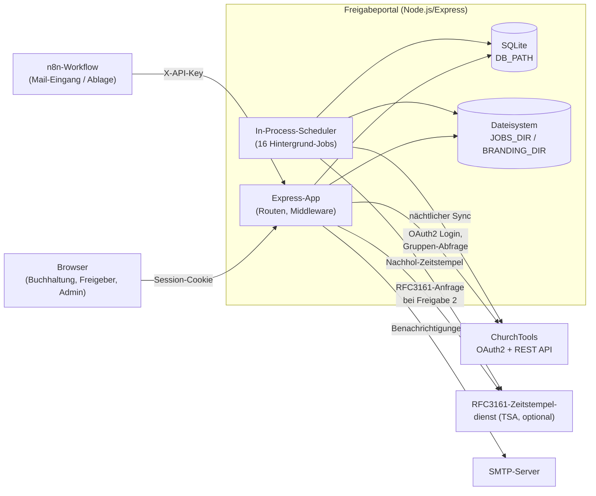
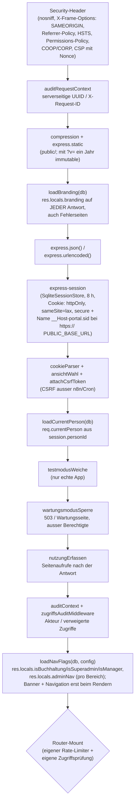

# Architektur

## Tech-Stack

- **Laufzeit**: Node.js ≥ 22.23.4 (ESM, `type: module`), kein Build-Schritt.
- **Web-Framework**: Express 4.
- **Views**: server-seitig gerenderte EJS-Templates (kein Client-Framework, kein SPA-Bundling).
- **Datenbank**: SQLite über das eingebaute `node:sqlite` — eine einzelne Datei (`DB_PATH`), kein separater DB-Server.
- **Dateiablage**: Rechnungs-PDFs/Thumbnails unter `JOBS_DIR`, Branding-Logo unter `BRANDING_DIR` — beides normales Dateisystem, keine Objectstorage-Anbindung.
- **PDF-Verarbeitung**: `mupdf` (Rendering/QR-Scan-Rasterung, im n8n-Eingang, bei Spesen und Kreditkarten-Belegen in Worker-Threads; Beleg anhängen, Stempel und Splitgruppen-Dokument mit pdf-lib ebenfalls im Worker, siehe [PDF-Worker](#pdf-worker-srcservicespdfworkerpooljs-befund-b2)), `pdf-lib` (Stempel-Seite anhängen, Beleg mergen), `pdf-rfc3161` (RFC3161-Zeitstempel, im Hauptthread).
- **QR-Code**: `jsqr` (Dekodierung), eigener Parser für das Swiss-QR-Bill-Zeilenformat.
- **Mail**: `nodemailer` gegen ein beliebiges SMTP-Konto.
- **Hosting**: Infomaniak Node.js-Webhosting; der Node-Prozess läuft dauerhaft und übernimmt Scheduling selbst (siehe unten) — kein externer Task-Scheduler nötig.

## Systemüberblick

Es gibt keine separate Backend-API und kein Frontend-Build: jede Seite ist
eine serverseitig gerenderte EJS-Ansicht, Formulare posten klassisch per
`POST`. JSON-Schnittstellen gibt es für n8n-Rechnungen und Kreditkartenbelege
(`/api/n8n/jobs/*`, `/api/n8n/kk-belege`), Rapporte (`/api/n8n/rapporte/*`), den Pool (`/api/pool`),
Cron-Aufrufe und den Healthcheck. Die Backup-API liefert eine Datei.
Siehe [n8n-schnittstelle.md](n8n-schnittstelle.md).

## Bootstrap (`src/index.js`)

1. `loadConfig()` — liest und validiert alle Umgebungsvariablen; bricht den
   Start sofort mit einer Fehlermeldung ab, wenn ein Pflichtwert fehlt oder
   ein `*_SECRET`/`*_TOKEN`/`*_KEY` kürzer als 32 Zeichen ist oder noch
   `changeme` enthält (`src/config/env.js`).
2. `acquireStorageLock(baseConfig)` sperrt den Datenspeicher exklusiv;
   `resolveStorageConfig(baseConfig)` löst einen nach Restore aktiven Datenstand
   über `<DB_PATH>.active.json` auf. `openDatabase(config.dbPath)` öffnet/erstellt
   die SQLite-Datei und wendet `schema.sql` sowie die additiven Migrationen an.
3. `seedDefaults(db)` — schreibt Default-Werte in `admin_config`, falls noch
   nicht vorhanden (Benachrichtigungen, Cron-Zeitpläne, Sync-Schwellen, …).
4. `createApp({ db, config })` — baut die Express-App (siehe unten).
5. `startScheduler({ db, config, mailer })` — startet die sechzehn
   In-Process-Hintergrund-Jobs (siehe
   [geplante-jobs-und-benachrichtigungen.md](geplante-jobs-und-benachrichtigungen.md)).
6. `app.listen(config.port)`.

Vor Schritt 2 übernimmt `konfigurierePdfArbeit(config.pdfWorker)` die
Einstellungen der PDF-Worker (Worker starten erst beim ersten Auftrag). Beim
Herunterfahren wartet `shutdown()` nach `server.close()` auf
`schliessePdfWorker()`.

## Middleware-Pipeline (`src/app.js`)

Jede Anfrage durchläuft, in dieser Reihenfolge, folgende globale
Middleware, bevor sie den passenden Router erreicht:

### Leistung

- **Vorlagen-Cache** ist fest eingeschaltet (`app.set('view cache', true)`),
  unabhängig von `NODE_ENV`. Ohne ihn übersetzt Express jede EJS-Vorlage bei
  jedem Aufruf neu.
- **Statische Dateien** werden komprimiert (`compression`). Dateien mit
  `?v=<assetVersion>` (Bootstrap, `portal.css`, `portal.js`,
  `belegUmschalter.js`, Symbole) cacht der Browser ein Jahr (`immutable`). Die
  Version ergibt sich beim Start aus den Änderungszeiten, siehe `assetVersion`
  in `src/app.js`. Neue statische Dateien, die in Vorlagen eingebunden werden,
  dort aufnehmen und mit `?v=` verlinken.
- **`loadBranding`** liest alle Einstellungen in einer Abfrage
  (`getConfigValues`). Bewusst ohne Zwischenspeicher, weil `admin_config` auch
  direkt per SQL geändert wird (Testmodus-Trigger, Wiederherstellung).
- **`loadNavFlags`** setzt `banner`, `navigation`, `zeigeKreditkarteNav` und
  `kreditkartenModulAktiv` als Getter auf `res.locals`. Sie werden erst beim
  `res.render` berechnet. Downloads, JSON und Weiterleitungen sparen sich so
  die Abfragen. Scheitert das Berechnen, gibt es einen Rückfallwert
  (kein Menü, keine Banner), damit die Fehlerseite noch rendert. `/pool` legt
  die Summe seiner Listen in `res.locals.offeneAufgabenVorab` ab, damit der
  Aufgabenzähler nicht nochmals zählt.
- **SQLite** läuft bewusst weiter im Standard-Journal (kein WAL): Wiederherstellung
  und Rückwechsel öffnen Datenstände schreibgeschützt und sichern nur die
  Hauptdatei per fsync. WAL würde zusätzliche `-wal`/`-shm`-Dateien ins Spiel
  bringen und funktioniert nicht auf Netzlaufwerken.

Danach entscheidet jeder Router-Mount selbst über Rate-Limiting
(`src/middleware/rateLimit.js`, drei Tarife: `public`, `session`, `machine`)
und Zugriffskontrolle — siehe
[auth-und-rechte.md](auth-und-rechte.md).

### Testmodus: Weiche und Test-Instanz

Direkt nach `loadCurrentPerson` (und vor Nutzungserfassung und Audit) hängt die
**Weiche** (`src/middleware/testmodusWeiche.js`). Hat die Sitzung das Flag
`session.testmodus` und ist die Person ein aktiver Superadmin oder Manager,
geht die Anfrage an eine zweite Express-App, die **Test-Instanz**. Diese wird
von `createApp({ testmodus: true })` auf der Spiel-DB gebaut, lazy beim ersten
Bedarf und beim Zurücksetzen neu (`src/services/testmodus/steuerung.js`).
Die Test-Instanz hat keine Sitzung, kein `/auth`, kein `/healthz`, einen
Test-Mailer, eine Beispielperson statt `loadCurrentPerson` und eigene
Geheimnisse. Die Pfade `/auth`, `/healthz`, `/admin/testmodus`,
`/admin/betrieb/status`, `/audit-pruefen`, `/api/n8n` und `/internal` bleiben
immer in der echten App; deren Seiten zeigen bei eingeschaltetem Testmodus einen
Hinweis statt des Bands. Die Test-Instanz wird mit einem eigenen Abschluss statt
des `next` der echten App aufgerufen: was aus ihr entweicht, beantwortet die
Weiche selbst (500/404). Siehe [testmodus.md](testmodus.md).

## PDF-Worker (`src/services/pdfWorkerPool.js`, Befund B2)

mupdf (WASM) rechnet synchron. Im Hauptthread blockiert jede PDF-Arbeit die
Event-Loop für ihre ganze Laufzeit: die QR-Erkennung braucht bei zwei
Vektorseiten ~1,5 s, im schlimmsten Fall 10–19 s; Eingangsprüfung und
Vorschaubild bei grossen Scans bis ~760 ms. Während dieser Zeit beantwortet das
Portal keine andere Anfrage.

Deshalb laufen diese Aufgaben in Worker-Threads:

- **Aufgabenliste** `src/workers/pdfAufgaben.js`: Name → bestehende reine
  Funktion (`eingangPruefen` = `pruefeEingangsPdf`, `vorschaubild`,
  `qrErkennen`, `textExtrahieren`) plus `eingangAnalysieren` (Vorschaubild, QR
  und optional Text in einem Auftrag), `belegDateiErstellen` (Beleg als PDF
  via `buildBelegPdf` plus Vorschaubild; Etappe 2) und `belegAnhaengen`
  (`belegInPdfAnhaengen`: Beleg an ein Vorgangs-PDF hängen und seine Seiten
  zählen, `{ pdf, belegSeiten }`; Etappe 4), `freigabeStempeln`
  (`stampAndFinalize`) und `kenntnisnahmeStempeln` (`stampKenntnisnahme`;
  Etappe 3) sowie `gruppenDokumentErstellen` (`services/splitGruppenPdf.js`:
  Basis-PDF + Belegseiten der Teile + Gruppenstempel; Etappe 5). Einzige Quelle
  für Worker- und Inline-Betrieb.
- **Worker** `src/workers/pdfWorker.js`: lädt die Aufgaben (inkl. mupdf,
  ~120 ms, ~+55 MB RSS je Worker), bearbeitet einen Auftrag nach dem anderen und
  meldet nach jedem Auftrag `process.memoryUsage().external` mit.
- **Pool** `src/services/pdfWorkerPool.js`: feste Grösse (`PDF_WORKER_ANZAHL`,
  Standard 2), Worker starten erst bei Bedarf.
  - Zwei Spuren: `interaktiv` vor `hintergrund`; Hintergrundaufträge (n8n-Eingang,
    Kreditkartenbelege per Mail) belegen höchstens einen Worker gleichzeitig.
  - Warteschlange höchstens 100 → `PdfWorkerUeberlastet`.
  - Zeitlimit je Auftrag (Eingangsprüfung, Vorschaubild, Text je 10 s, QR 15 s,
    kombiniert 20 s, Belegdatei, Beleg anhängen und Stempel je 30 s, Splitgruppen-Dokument 60 s; mal `PDF_WORKER_ZEITLIMIT_FAKTOR`): der Worker wird mit
    `terminate()` beendet (bricht auch laufende WASM-Arbeit nach wenigen ms ab),
    der Auftrag scheitert mit `PdfWorkerZeitueberschreitung`.
  - Der WASM-Speicher von mupdf wächst und schrumpft nie, und `resourceLimits`
    begrenzt nur den JS-Heap (`maxOldGenerationSizeMb` 512). Darum wird ein
    Worker nach dem Auftrag ersetzt, wenn sein `external` über
    `PDF_WORKER_SPEICHER_MB` (Standard 250) liegt, und spätestens nach 200 Aufträgen.
  - Absturz (`error`/`exit`) → laufender Auftrag scheitert mit
    `PdfWorkerAbsturz`, Ersatz bei Bedarf. Scheitert der Start 3× hintereinander,
    steht `ALARM: PDF-Worker …` im Log, der Dienst `pdf_verarbeitung` der
    Statusseite und von `/healthz` steht auf Fehler, wartende Aufträge scheitern
    mit `PdfWorkerNichtVerfuegbar`. Jeder neue Auftrag versucht einen neuen Start.
    Es gibt **keinen automatischen Rückfall** auf den Hauptthread.
  - Leerlauf-Worker sind `unref()` (halten den Prozess nicht am Leben) und enden
    nach 5 min; `shutdown()` in `src/index.js` wartet auf `schliessePdfWorker()`.
  - Bytes gehen als eigene Kopie per `transferList` in den Worker und zurück.
    Der Buffer des Aufrufers wird nie übertragen: kleine Buffer liegen im
    gemeinsamen Speicherpool von Node, und Aufrufer brauchen ihn danach noch.
- **Fassade** `src/services/pdfArbeit.js`: `await pdfArbeit().ausfuehren(aufgabe,
  [buffer], { spur })`. Fehler kommen wie beim direkten Aufruf an
  (`PdfEingangFehler` mit `code` und `BelegBildFehler` werden aus
  `services/pdfFehler.js` wieder aufgebaut, alle anderen als `Error` mit Name,
  `code` und Meldung), dazu die Pool-Fehler (Basisklasse `PdfWorkerFehler`).
  Für Formulare: `antworteSpaeterErneut(res, err, wo)` setzt 503 und
  `Retry-After: 60`, die Seite zeigt `PDF_VORUEBERGEHEND_MELDUNG` («… in einer
  Minute erneut …»). Mit `PDF_WORKER=aus` laufen dieselben
  Aufgaben im Hauptthread (dynamischer `import()` beim ersten Auftrag) – ein
  bewusster Betriebs-/Testschalter.

**Etappe 1** (umgestellt): `POST /api/n8n/jobs` (Eingangsprüfung → 422 bei
Prüffehler, 503 mit `Retry-After` bei Überlastung/Zeitlimit/Absturz;
`eingangAnalysieren` danach) und der Kreditkarten-Mailbeleg
(`services/kkBelegEingang.js`, QR und Text). Weil zwischen der
Dublettenprüfung und `createJob` jetzt ein `await` liegt und
`idx_jobs_datei_hash` nicht eindeutig ist, prüft die Route die Dublette
unmittelbar vor Dateischreiben und Jobanlage im selben synchronen Abschnitt
erneut.

**Etappe 2** (umgestellt, Spur `interaktiv`, eine Person wartet):

| Aufrufer | Aufgabe(n) im Worker | Bei `PdfWorkerFehler` |
|---|---|---|
| `POST /spesen` (`routes/spesen.js`) | `eingangPruefen` (PDF-Belege), `belegDateiErstellen` je Position | Formular mit 503 und Hinweis; bereits geschriebene Dateien früherer Positionen werden entfernt, kein Job, keine Abrechnung |
| `POST /kreditkarte/belege`, `POST /kreditkarte/belege/:id` (`routes/kreditkarte.js` über `speichereKkBelegDatei`) | `belegDateiErstellen` | Formular mit 503; beim Bearbeiten entsteht die neue Datei **vor** der Datenänderung, damit keine halbe Änderung bleibt |
| `POST /kontierung/:id/kk-abgleich` (nachgereichte Belege über `speichereKkBelegDatei`) | `belegDateiErstellen` | Formular mit 503, nichts aufgesplittet, angelegte Dateien entfernt |
| Abgleichsseite (`ladeAnalyse` in `routes/kkAbgleich.js`) | `textExtrahieren` | Seite ohne Vorschläge (200); die leere Analyse wird **nicht** gespeichert, der nächste Aufruf versucht es erneut |
| `POST /api/n8n/kk-belege` (`kkBelegEingang.js`, Spur `hintergrund`) | `belegDateiErstellen` (zusätzlich zu QR/Text aus Etappe 1) | 503 `{fehler: 'pdf_verarbeitung_ausgelastet'}` mit `Retry-After`, kein Entwurf |

Echte Prüffehler bleiben unverändert: `PdfEingangFehler` → Formularfehler 400
mit derselben Meldung; Bild über 40 Megapixel → 400 aus `pruefeBelegBild`.
Bewusst im Hauptthread geblieben: `pruefeBelegBild` (liest nur den Bildkopf),
`detectBelegMimetype` und die Lesbarkeitsprüfung `countBelegSeiten` im KK-Abgleich
(pdf-lib, nur PDF-Belege – ein Bild zählt ohne Dekodieren als eine Seite; das
eigentliche Zusammenführen läuft seit Etappe 4 im Worker).
`buildBelegPdf` dagegen läuft im Worker: ein PNG bis 40 Megapixel zu dekodieren
und einzubetten (pdf-lib `embedPng`) blockierte den Hauptthread ~6 s.

**Hauptprozess und mupdf**: Im Worker-Betrieb lädt der Hauptprozess mupdf
nicht mehr, auch nicht transitiv (Test
`test/integration/pdfWorkerMupdfImport.test.js`). Auch die
Testmodus-Beispieldaten (`services/testmodus/beispieldaten.js`, über
`middleware/roles.js` bei jedem Start geladen) rechnen ihre Vorschaubilder über
den PDF-Worker. Das spart im Leerlauf rund 25 MB RSS (gemessen ~155 → ~131 MB).

**Etappe 4** (umgestellt, Spur `interaktiv`): «Beleg anhängen» – Aufgabe
`belegAnhaengen`, die in einem Auftrag zusammenführt und danach die Belegseiten
zählt (scheitert das Zusammenführen, gibt es keine Seitenzahl).

| Aufrufer | Aufgabe(n) im Worker | Bei `PdfWorkerFehler` |
|---|---|---|
| `POST /kontierung/:id` (Kontieren und `aktion=ablehnen`, `routes/kontierung.js`) | `belegAnhaengen` | Formular mit 503 und Hinweis; Vorgang, Verlauf, `beleg_seitenzahl` und PDF unverändert, keine Mail |
| `POST /kontierung/:id/aufsplitten` (`bereiteTeilDateienVor` in `services/aufsplitten.js`) | `belegAnhaengen` je Zeile mit Beleg | Formular mit 503; angelegte Teildateien entfernt, nichts aufgesplittet |
| `POST /kontierung/:id/kk-abgleich` (Kartenbelege und nachgereichte Belege über `bereiteTeilDateienVor`) | `belegAnhaengen` | wie Etappe 2: Formular mit 503, nichts aufgesplittet, Dateien entfernt |

Kontierung und Ablehnung haben früher **erst** die Transaktion festgeschrieben und
**danach** den Beleg zusammengeführt. Mit einem `await` auf den Worker an dieser
Stelle könnte eine Störung eine gespeicherte Kontierung ohne Beleg hinterlassen.
Deshalb jetzt (`services/aufsplitten.js`):

1. `bereiteBelegAnhangVor` **vor** der Transaktion: Vorgangs-PDF lesen, im Worker
   zusammenführen, Ergebnis in eine temporäre Datei `<pdf>.beleg-….tmp` daneben.
   Scheitert das, ist nichts gespeichert.
2. `belegAnhangNochAktuell` **in** der Transaktion: Das `await` hebt den bisher
   durchgehend synchronen Ablauf von der Zuständigkeitsprüfung bis zum COMMIT auf,
   auf den sich `setKontierung`/`abschliessenFreigabe1` (ohne Status-Bedingung im
   `WHERE`) verlassen. Haben sich Status, Zuständigkeit, Konto, Eskalation,
   `beleg_seitenzahl` oder die PDF-Bytes seit dem Lesen geändert (z. B. eine
   gleichzeitige zweite Kontierung oder Ablehnung mit Beleg), folgt ROLLBACK und
   409. `addBelegSeiten` läuft in derselben Transaktion.
3. `uebernimmBelegAnhang` unmittelbar nach dem COMMIT, ohne `await` dazwischen:
   `renameSync` der temporären Datei auf das PDF (atomar im selben Verzeichnis).
   In allen anderen Fällen entfernt `verwirfBelegAnhang` die temporäre Datei
   (verwaiste `.tmp` nach einem Absturz fallen unter die Mindestalter-Regel der
   Verwaiste-Dateien-Prüfung).

Ein Beleg, der sich erst beim Zusammenführen als unlesbar erweist (kennungsgültiges,
aber kaputtes PDF; abgeschnittenes Bild), führte früher **nach** dem COMMIT zu
Fehler 500 – die Kontierung war gespeichert, der Beleg fehlte, Mails gingen keine
raus. Jetzt: Formular mit 422 (`BelegAnhangFehler`) bzw. 400 (`BelegBildFehler`),
nichts gespeichert. Gemessen (Test `pdfWorkerBelegEventLoop.test.js`, PNG 3000 × 3000):
inline ~1,4 s Blockade, im Worker < 5 ms.

**Etappe 3** (umgestellt): Stempelseiten (`pdfStamp.js`, pdf-lib: das ganze
Dokument laden, Schriften einbetten, speichern). Die Stempeldaten sind reine Daten
(Texte, ISO-Zeitpunkte, Zahlen, Booleans) und gehen unverändert über die
Worker-Grenze; die Meldung eines Stempelfehlers bleibt erhalten.

| Aufrufer | Aufgabe | Spur | Bei `PdfWorkerFehler` |
|---|---|---|---|
| `POST /freigabe2/:id` (`routes/freigabe2.js`) | `freigabeStempeln` | `interaktiv` | Formular mit 503, `Retry-After` und Hinweis; Status, Freigaben, PDF und Snapshot unverändert, keine Datei geschrieben (gestempelt wird vor TSA, Datei und Transaktion). Ein echter Stempelfehler bleibt 400 mit der Meldung des Stempels |
| Abschluss eines Rapports (`finalisiereRapport` in `services/rapporte.js`) nach der letzten Kenntnisnahme (`POST /rapporte/:id/bestaetigen`) oder dem Entfernen des letzten offenen Empfängers (Admin) | `kenntnisnahmeStempeln` | `interaktiv` | wie bei jedem Stempelfehler: die Bestätigung bzw. Entfernung ist schon für sich gespeichert, der Abschluss scheitert ohne Datei und ohne Datenänderung (Rapport bleibt `kenntnisnahme` mit 0 offen), Antwort normal (Redirect, keine 500), Log `Abschluss fehlgeschlagen, wird nachgeholt` |
| Nachhol-Cron `rapport-erinnerungen` (`schliesseRapporteNach`) | `kenntnisnahmeStempeln` | `hintergrund` | Rapport als fehlgeschlagen gezählt und protokolliert, der nächste Lauf (stündlich) versucht es erneut |

Gemessen (PDF 17 MB, 1500 Textseiten, `stampAndFinalize`): inline ~0,84 s
Laufzeit mit bis zu ~290 ms am Stück blockierter Event-Loop (pdf-lib gibt beim
Parsen zwischendurch ab), im Worker höchstens ~2 ms.

**Etappe 5** (umgestellt): Splitgruppen-Export (`pruefeUndFinalisiereSplitGruppe` in
`services/splitGruppenExport.js`). Die reine PDF-Arbeit – Basis-PDF laden,
Belegseiten der Teile übernehmen (`haengeBelegSeitenAn`), Gruppenstempel
(`stampGruppenDokument`), speichern – ist nach `services/splitGruppenPdf.js`
gezogen und läuft als `gruppenDokumentErstellen` im Worker. Lesen der Dateien,
Hash-Prüfung der Teile, Gruppen-Snapshot, TSA und Festschreiben bleiben im
Hauptthread.

| Aufrufer | Spur | Bei `PdfWorkerFehler` |
|---|---|---|
| `POST /freigabe2/:id` nach dem COMMIT des letzten Teils | `interaktiv` (die Person wartet auf die Weiterleitung) | `status: 'fehler'`, geloggt; Freigabe 2 des Teils bleibt erfolgreich (302), die Gruppe bleibt ausstehend |
| `POST /admin/altfaelle/:id` (Entscheidung), `POST /admin/abgelehnt/:id/loeschen` (blockierende Zeile gelöscht) | `interaktiv` | wie oben: Admin-Aktion gespeichert, Gruppe bleibt ausstehend |
| Cron `split-gruppen-nachholen` (alle 15 min) | `hintergrund` | als fehlgeschlagen gezählt, nächster Lauf versucht es erneut |

Wie bei jedem anderen Fehler entsteht keine Datei (der Worker liefert nur Bytes,
geschrieben wird erst danach) und `gruppe_pdf_pfad` bleibt leer.

**Gleichzeitigkeit**: Zwischen dem Lesen (frühe Prüfung `gruppe_pdf_pfad`,
Vollständigkeit, Snapshot) und dem Festschreiben liegt ein `await` auf den Worker
(und ggf. die TSA). Schon vorher lagen dort `await`s (pdf-lib gibt beim Laden und
Speichern ab, TSA), durch den Worker laufen zwei Aufrufe jetzt aber wirklich
gleichzeitig – etwa Freigabe 2 zweier Teile fast zur selben Zeit oder Freigabe 2
und Nachhol-Cron. Abgesichert ist das in der Transaktion (`BEGIN IMMEDIATE`):
`gruppe_pdf_pfad` wird erneut gelesen (gesetzt → ROLLBACK, eigene Datei löschen,
`'uebersprungen'`), Gruppenstand, TSA-Einstellung, Kommentare und die Bytes
aller Quelldateien müssen unverändert sein, und `markGruppeExportiert` schreibt
nur bei `gruppe_pdf_pfad IS NULL`. Zwei Teile können auch nicht beide «noch
unvollständig» sehen: jede Freigabe 2 prüft die Gruppe synchron direkt nach
ihrem COMMIT. Tests: `test/integration/splitGruppeWorker.test.js`
(`Promise.all` über zwei Freigaben bzw. zwei Aufrufe plus Cron → genau ein
Export, eine Datei).

**Was jetzt noch an PDF-Arbeit im Hauptthread läuft** (bewusst):

- RFC3161-Zeitstempel (`services/zeitstempel.js`, `pdf-rfc3161`): Signaturplatz
  im PDF vorbereiten, Hash, TSA-Abfrage, Einbetten – bei Freigabe 2, Rapport,
  Splitgruppe und `zeitstempel-nachholen`; Prüfung auf `/zeitstempel-pruefen`.
  Netzwerkgebunden, laut Auftrag unverändert.
- `countBelegSeiten` im KK-Abgleich (pdf-lib, Lesbarkeitsprüfung nachgereichter
  PDF-Belege), `pruefeBelegBild` und `detectBelegMimetype` (nur Dateikopf).
- Testmodus-Beispieldaten erzeugen kleine Beispiel-PDFs mit pdf-lib
  (`PDFDocument.create`); ihre Vorschaubilder rechnet der Worker.
- `pdfStamp.js` und `splitGruppenPdf.js` werden vom Hauptprozess nicht mehr
  geladen (Importtest).

## Router-Übersicht

| Mount | Rate-Limiter | Zugriff | Zweck |
|---|---|---|---|
| `/branding` | keiner (wie statische Dateien) | offen | Logo ausliefern (`/branding/logo`, optional `/branding/logo-dunkel`); ETag/304, Seiten verlinken `?v=<Änderungszeit>` → einen Tag cachebar |
| `/admin` + Unterrouten | session | `requireAdminAreaAccess` + pro Bereich unterschiedlich (siehe [admin-bereich.md](admin-bereich.md)) | gesamter Admin-Bereich |
| `/api/n8n/jobs` | machine | `X-API-Key` | Rechnungseingang/-abholung durch n8n |
| `/api/n8n/backup` | machine | `X-API-Key` mit separatem `BACKUP_API_KEY` | Abholung des neuesten Backup-Archivs durch n8n (Offsite-Ablage) |
| `/api/n8n/kk-belege` | machine | `X-API-Key` mit `N8N_API_KEY`, Modul aktiv | Kreditkartenbelege per Mail als Entwurf erfassen |
| `/api/n8n/rapporte` | machine | `X-API-Key` mit `N8N_API_KEY` | Abholung und Archivquittung abgeschlossener Rapporte, getrennt von `/api/n8n/jobs`, siehe [n8n-schnittstelle.md](n8n-schnittstelle.md) |
| `/kreditkarte` | session | eingeloggt + Beleg-/Kartenrechte | Kreditkartenbelege erfassen und bearbeiten |
| `/ferienmodus` | session | eingeloggt | eigene Abwesenheit und Stellvertretung verwalten |
| `/api/pool` | session | Rolle `buchhaltung` | JSON-Pool-API (Beanspruchen) |
| `/pool` | session | eingeloggt | Dashboard für jede aktive Person (nur offene Aufgaben) |
| `/meine-abgeschlossenen` | session | eingeloggt | eigene abgeschlossene Rechnungen, paginiert |
| `/auswertung` | session | `auswertung_einsehen` oder Freigeber 1/Stellvertreter 1 eines aktiven Kontos (sonst 403) | Auswertung Rechnungen mit Budget, Durchlaufzeit, Engpässen, Lieferanten; CSV-Export `GET /export/:abschnitt.csv`, siehe [auswertung.md](auswertung.md) |
| `/meine-spesen` | session | eingeloggt | eigene Spesen-Einreichungen über alle Stati, siehe [spesen-einreichung.md](spesen-einreichung.md) |
| `/downloads` | eigene (session bzw. public je Route) | siehe [n8n-schnittstelle.md](n8n-schnittstelle.md) | signierte PDF-/Thumbnail-Auslieferung: `GET /:jobId?expires&signature` (public, signiert), `GET /:jobId/thumbnail` (eingeloggt, Vorschaubild), `GET /:jobId/refresh-url` (eingeloggt, frisch signierte Vorschau-URL als JSON), `GET /:jobId/oeffnen` (eingeloggt, 302 auf frisch signierte URL — Knopf "PDF öffnen") |
| `/kontierung` | session | eingeloggt + Job-Autorisierung | Kontierung, Aufsplitten, Kreditkarten-Abgleich |
| `/spesen` | session | eingeloggt | Spesen-Einreichung (Formular + Speichern) |
| `/spesen-freigabe1` | session | eingeloggt + Job-Autorisierung | Freigabe 1 für Spesen-Positionen (review-only) |
| `/freigabe2` | session | eingeloggt + Job-Autorisierung | zweite Freigabe (Rechnungen und Spesen) |
| `/rapporte` | session | eingeloggt + Beteiligung am Rapport | Rapport ansehen und zur Kenntnis nehmen (`GET /:id`, `POST /:id/bestaetigen`), siehe [rechnungs-workflow.md](rechnungs-workflow.md#9-rapporte-status-kenntnisnahme) |
| `/abgelehnt` | session | eingeloggt + Job-Autorisierung | Überarbeitung abgelehnter Rechnungen |
| `/kommentare` | session | eingeloggt + Sichtrecht auf den Vorgang | `POST /kommentare/:jobId`: Kommentar speichern, siehe [kommentare.md](kommentare.md) |
| `/zeitstempel-pruefen` | session | eingeloggt | Zeitstempel-Verifikation + Zertifikat |
| `/fehler-melden` | session | eingeloggt | Problem melden (Fehler-ID, Beschreibung), siehe [betrieb-und-nutzung.md](betrieb-und-nutzung.md) |
| `/banner` | session | eingeloggt | Info-Banner ausblenden (`POST /banner/:id/ausblenden`) |
| `/datenschutz` | session | eingeloggt | Datenschutzhinweis zu den Nutzungsdaten |
| `/audit-pruefen` | public (`publicLimiter`) | offen, nur lesend | Prüfseite des Audit-Nachweises für die Revision, siehe [audit-externe-nachweise.md](audit-externe-nachweise.md) |
| `/admin/testmodus` | session | `testmodus_nutzen` (Standard: Superadmin und Manager) | Testmodus ein/aus, Zurücksetzen, Personenwechsel |
| `/testmodus` (nur Test-Instanz) | session | eingeloggt (Beispielperson) | Test-Postfach (`/postfach`) und Jobs (`POST /jobs`) |
| `/auth` | public | offen | ChurchTools-OAuth2-Login/-Logout |
| `/internal/cron` | machine | `X-Cron-Secret` | manuelles/externes Auslösen von zehn Hintergrund-Jobs (nicht: `datenbank-sicherung`, `mail-digest`, `sicherheitsalarme`, `audit-export`, `audit-pruefnummer`, `nutzungsdaten-bereinigung`) |
| `/healthz` | eigener (120/min/IP) | offen; Details nur mit `X-Monitoring-Key` | `{status:"ok"}`, mit Schlüssel Dienststatus (30 s zwischengespeichert, gemeinsam mit Statusseite und Dashboard), siehe [statusseite-und-monitoring.md](statusseite-und-monitoring.md) |
| `/` | public | — | leitet auf `/pool` (eingeloggt) oder `/auth/login` (anonym) weiter |

## Sicherheitsmechanismen (Auszug)

- **Security-Header** auf jeder Antwort: `X-Content-Type-Options: nosniff`,
  `X-Frame-Options: SAMEORIGIN` (nicht `DENY`, weil PDF-Vorschauen als
  same-origin `<iframe>` eingebettet werden), `Referrer-Policy: no-referrer`
  (signierte Download-URLs tragen ihre Signatur in der Query-String),
  `Strict-Transport-Security` (nur auf HTTPS-Anfragen, ein Jahr, inklusive
  Subdomains), `Permissions-Policy` (Kamera, Mikrofon, Standort, Zahlung, USB
  gesperrt), `Cross-Origin-Opener-Policy` und `Cross-Origin-Resource-Policy`
  (`same-origin`), restriktive `Content-Security-Policy`: Skripte und `<style>`-Blöcke nur aus
  eigenen Dateien oder mit der Nonce der Anfrage (`res.locals.cspNonce`, pro
  Anfrage neu; jede View setzt sie, `test/integration/cspSweep.test.js` und
  `test/verhalten/csp.test.js` prüfen das), keine Inline-Ereignis-Attribute
  (`onclick=…`; Druck-Knöpfe nutzen `data-drucken` aus `public/js/portal.js`).
  `style="…"`-Attribute bleiben erlaubt (`style-src-attr 'unsafe-inline'`).
  `img-src 'self' data:` — `data:` nur für Bilder, weil Bootstraps Symbole wie
  Schliessen-✕, Auswahlpfeil und Häkchen als data-URI-SVG im CSS stecken.
- **Signierte, zeitlich begrenzte Download-URLs** (`src/services/downloadUrl.js`):
  HMAC-SHA256 über `jobId.expires`, zeitkonstanter Vergleich
  (`crypto.timingSafeEqual`). Nutzt niemand die Session, sondern eine
  Signatur — so kann auch n8n (ohne Login) eine PDF für ein kurzes
  Zeitfenster abrufen.
- **API-Key/Cron-Secret**: gleiche zeitkonstante Vergleichslogik für
  `X-API-Key` (`/api/n8n/jobs`, `/api/n8n/backup/latest`) und `X-Cron-Secret`
  (`/internal/cron`).
- **Rate-Limiting**, dreistufig: `public` (100/15 Min, IP-basiert),
  `session` (300/15 Min, personen- oder IP-basiert) und `machine`
  (60/1 Min, IP-basiert, für API-Key-/Cron-Aufrufer). Bei 429 zeigt ein Browser
  (`Accept: text/html`) die normale Fehlerseite mit Wartezeit («in etwa N
  Minuten»), fetch-/Maschinenaufrufe bekommen JSON; `Retry-After` bleibt. Der
  Handler ist als `createRateLimitHandler()` wiederverwendbar.
  Zusätzlich gelten **Eigenlimits je Person und Stunde** auf den schreibenden
  POST-Routen: `POST /spesen` 10 Abrechnungen, `POST /fehler-melden` 5 Meldungen
  (Schlüssel = angemeldete Person, IP nur ohne Sitzung). Sie sitzen in `app.js`
  hinter `requireLogin` (Fremde verbrauchen kein Kontingent) und vor multer/CSRF;
  abgelehnte Eingaben (Status 400 und höher) zählen nicht mit. GET bleibt frei.
- **Magic-Byte-Prüfung** statt Vertrauen auf den deklarierten
  Content-Type bei jedem Datei-Upload (Rechnungs-PDF, Beleg-Anhang,
  Branding-Logo).
- **Upload-Grenzen** (`src/middleware/uploadLimit.js`): multipart-Uploads
  werden im Arbeitsspeicher gepuffert und deshalb je Anfrage auf 60 MB
  gesamt begrenzt (je Datei weiterhin 20 MB, Bilder höchstens 40
  Megapixel). Ein zu grosser Upload wird schon nach dem Header
  (Content-Length) oder beim Überschreiten der gelesenen Bytes mit 413 und
  einer Fehlerseite abgebrochen. Auf `/kontierung/:id`,
  `/kontierung/:id/aufsplitten` und `/kontierung/:id/kk-abgleich` wird die
  Zuständigkeit vor dem Upload geprüft (Unzuständige bekommen 403, ohne dass
  die Datei angenommen wird); die CSRF-Prüfung bleibt nach multer, weil das
  Token im multipart-Body steht.

## Oberfläche: Layout und Responsive

Alle Seiten nutzen das gemeinsame Gerüst `views/_seite_anfang.ejs` /
`_seitenleiste.ejs` / `_seite_ende.ejs` mit Bootstrap 5 und
`public/css/portal.css` (kein Build-Schritt, kein Sass). Breakpoints wie
Bootstrap:

| Breite | Verhalten |
|---|---|
| unter 576 px (Handy) | Kopfzeile zweizeilig (Menü, Titel, Knöpfe; darunter Reiter Portal/Admin — ohne Admin-Reiter entfällt die zweite Zeile), Testmodus-Band scrollt mit statt oben zu kleben, Filterzeilen einspaltig |
| 576 / 768 px | Feldgruppen zweispaltig ab 576 (`col-12 col-sm-6`); 768–991 px Tablet-Stufe: Formulare auf mittlere Breite begrenzt |
| unter 992 px | Seitenleiste als Offcanvas hinter dem Menüknopf ☰; Listen standardmässig als Kacheln; PDF-Seiten mit Umschalter "Beleg / Formular" (Vorschaubild spaltenbreit, höchstens 420 px) |
| unter 1200 px | `.stapel-tabelle` (Admin → Personen, Betrieb → Status) zeigt jede Zeile als Karte (`data-label` als Beschriftung; Einzelrechte zwei-, ab 768 px dreispaltig); Aufsplitten-Zeilen als Karten |
| ab 992 px | Seitenleiste fest links, PDF eingebettet neben dem Formular |
| ab 1200 px | Desktop-Darstellung wie vor dem Responsive-Durchgang (z. B. Aufsplitten-Zeilen als Tabelle statt Karten) |

- **Touch-Ziele** (`@media (pointer: coarse)` in `portal.css`): auf
  Touch-Geräten sind Knöpfe, Felder, Auswahllisten, Menüpunkte, Reiter und
  Checkbox-/Radio-Zeilen mindestens 44 × 44 px. Mit Maus (`pointer: fine`)
  bleibt alles unverändert — auch auf breiten Bildschirmen entscheidet das
  Eingabegerät, nicht die Breite.
- **Beleg / Formular** (`views/_beleg_umschalter.ejs`,
  `public/js/belegUmschalter.js`) auf Kontierung, Aufsplitten, KK-Abgleich,
  Freigabe 2 und Spesen-Freigabe 1: unter 992 px zeigen zwei Knöpfe
  entweder das Formular (vorgewählt) oder den Beleg. Statt eingebettetem PDF
  (iOS scrollt es nicht zuverlässig) gibt es das Vorschaubild
  (`/downloads/:jobId/thumbnail`) und den Knopf "PDF öffnen" →
  `GET /downloads/:jobId/oeffnen` (neuer Tab, leitet auf eine frisch
  signierte URL um). Das iframe lädt unter 992 px gar nicht; ab 992 px wie
  bisher mit "Vorschau neu laden" (`/downloads/:jobId/refresh-url`). Im
  Kontierungs-Modal eingebettet zeigt Aufsplitten keinen Umschalter. Ohne
  JavaScript stehen Beleg und Formular untereinander. Im Pool öffnet das
  Vorschaubild unter 992 px das PDF im neuen Tab, ab 992 px den Dialog.
- **Prüfung**: `npm run test:responsive` (Playwright, nicht Teil von
  `npm test`) besucht jede Seite in 360/768/1024/1280 px (360 und 1280
  zusätzlich im Dunkelmodus), siehe README
  "Responsive testen".
