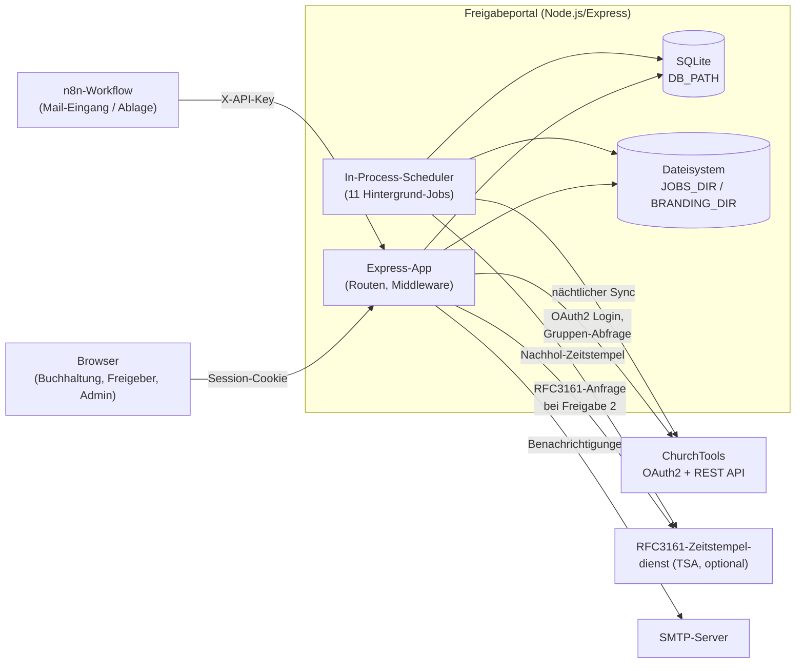
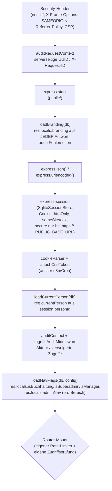

# Architektur

## Tech-Stack

- **Laufzeit**: Node.js ≥ 22.13.0 (ESM, `type: module`), kein Build-Schritt.
- **Web-Framework**: Express 4.
- **Views**: server-seitig gerenderte EJS-Templates (kein Client-Framework, kein SPA-Bundling).
- **Datenbank**: SQLite über das eingebaute `node:sqlite` — eine einzelne Datei (`DB_PATH`), kein separater DB-Server.
- **Dateiablage**: Rechnungs-PDFs/Thumbnails unter `JOBS_DIR`, Branding-Logo unter `BRANDING_DIR` — beides normales Dateisystem, keine Objectstorage-Anbindung.
- **PDF-Verarbeitung**: `mupdf` (Rendering/QR-Scan-Rasterung), `pdf-lib` (Stempel-Seite anhängen, Beleg mergen), `pdf-rfc3161` (RFC3161-Zeitstempel).
- **QR-Code**: `jsqr` (Dekodierung), eigener Parser für das Swiss-QR-Bill-Zeilenformat.
- **Mail**: `nodemailer` gegen ein beliebiges SMTP-Konto.
- **Hosting**: Infomaniak Node.js-Webhosting; der Node-Prozess läuft dauerhaft und übernimmt Scheduling selbst (siehe unten) — kein externer Task-Scheduler nötig.

## Systemüberblick

Es gibt keine separate Backend-API und kein Frontend-Build: jede Seite ist
eine serverseitig gerenderte EJS-Ansicht, Formulare posten klassisch per
`POST`. JSON-Schnittstellen gibt es für n8n-Rechnungen und Kreditkartenbelege
(`/api/n8n/jobs/*`, `/api/n8n/kk-belege`), den Pool (`/api/pool`),
Cron-Aufrufe und den Healthcheck. Die Backup-API liefert eine Datei.
Siehe [n8n-schnittstelle.md](n8n-schnittstelle.md).

## Bootstrap (`src/index.js`)

1. `loadConfig()` — liest und validiert alle Umgebungsvariablen; bricht den
   Start sofort mit einer Fehlermeldung ab, wenn ein Pflichtwert fehlt oder
   ein `*_SECRET`/`*_TOKEN`/`*_KEY` kürzer als 32 Zeichen ist oder noch
   `changeme` enthält (`src/config/env.js`).
2. `acquireStorageLock(baseConfig)` sperrt den Datenspeicher exklusiv;
   `resolveStorageConfig(baseConfig)` löst einen nach Restore aktiven Datenstand
   über `<DB_PATH>.active.json` auf. `openDatabase(config.dbPath)` öffnet/erstellt
   die SQLite-Datei und wendet `schema.sql` sowie die additiven Migrationen an.
3. `seedDefaults(db)` — schreibt Default-Werte in `admin_config`, falls noch
   nicht vorhanden (Eskalationszeiten, Cron-Zeitpläne, Sync-Schwellen, …).
4. `createApp({ db, config })` — baut die Express-App (siehe unten).
5. `startScheduler({ db, config, mailer })` — startet die fünfzehn
   In-Process-Hintergrund-Jobs (siehe
   [geplante-jobs-und-benachrichtigungen.md](geplante-jobs-und-benachrichtigungen.md)).
6. `app.listen(config.port)`.

## Middleware-Pipeline (`src/app.js`)

Jede Anfrage durchläuft, in dieser Reihenfolge, folgende globale
Middleware, bevor sie den passenden Router erreicht:

Danach entscheidet jeder Router-Mount selbst über Rate-Limiting
(`src/middleware/rateLimit.js`, drei Tarife: `public`, `session`, `machine`)
und Zugriffskontrolle — siehe
[auth-und-rechte.md](auth-und-rechte.md).

### Testmodus: Weiche und Test-Instanz

Direkt nach `loadCurrentPerson` (und vor Nutzungserfassung und Audit) hängt die
**Weiche** (`src/middleware/testmodusWeiche.js`). Hat die Sitzung das Flag
`session.testmodus` und ist die Person ein aktiver Superadmin oder Manager,
geht die Anfrage an eine zweite Express-App, die **Test-Instanz**. Diese wird
von `createApp({ testmodus: true })` auf der Spiel-DB gebaut, lazy beim ersten
Bedarf und beim Zurücksetzen neu (`src/services/testmodus/steuerung.js`).
Die Test-Instanz hat keine Sitzung, kein `/auth`, kein `/healthz`, einen
Test-Mailer, eine Beispielperson statt `loadCurrentPerson` und eigene
Geheimnisse. Die Pfade `/auth`, `/healthz`, `/admin/testmodus`,
`/admin/betrieb/status`, `/audit-pruefen`, `/api/n8n` und `/internal` bleiben
immer in der echten App; deren Seiten zeigen bei eingeschaltetem Testmodus einen
Hinweis statt des Bands. Die Test-Instanz wird mit einem eigenen Abschluss statt
des `next` der echten App aufgerufen: was aus ihr entweicht, beantwortet die
Weiche selbst (500/404). Siehe [testmodus.md](testmodus.md).

## Router-Übersicht

| Mount | Rate-Limiter | Zugriff | Zweck |
|---|---|---|---|
| `/branding` | keiner (wie statische Dateien) | offen | Logo ausliefern (`/branding/logo`, optional `/branding/logo-dunkel`); ETag/304, Seiten verlinken `?v=<Änderungszeit>` → einen Tag cachebar |
| `/admin` + Unterrouten | session | `requireAdminAreaAccess` + pro Bereich unterschiedlich (siehe [admin-bereich.md](admin-bereich.md)) | gesamter Admin-Bereich |
| `/api/n8n/jobs` | machine | `X-API-Key` | Rechnungseingang/-abholung durch n8n |
| `/api/n8n/backup` | machine | `X-API-Key` mit separatem `BACKUP_API_KEY` | Abholung des neuesten Backup-Archivs durch n8n (Offsite-Ablage) |
| `/api/n8n/kk-belege` | machine | `X-API-Key` mit `N8N_API_KEY`, Modul aktiv | Kreditkartenbelege per Mail als Entwurf erfassen |
| `/kreditkarte` | session | eingeloggt + Beleg-/Kartenrechte | Kreditkartenbelege erfassen und bearbeiten |
| `/ferienmodus` | session | eingeloggt | eigene Abwesenheit und Stellvertretung verwalten |
| `/api/pool` | session | Rolle `buchhaltung` | JSON-Pool-API (Beanspruchen) |
| `/pool` | session | eingeloggt | Dashboard für jede aktive Person (nur offene Aufgaben) |
| `/meine-abgeschlossenen` | session | eingeloggt | eigene abgeschlossene Rechnungen, paginiert |
| `/meine-spesen` | session | eingeloggt | eigene Spesen-Einreichungen über alle Stati, siehe [spesen-einreichung.md](spesen-einreichung.md) |
| `/downloads` | eigene (session bzw. public je Route) | siehe [n8n-schnittstelle.md](n8n-schnittstelle.md) | signierte PDF-/Thumbnail-Auslieferung: `GET /:jobId?expires&signature` (public, signiert), `GET /:jobId/thumbnail` (eingeloggt, Vorschaubild), `GET /:jobId/refresh-url` (eingeloggt, frisch signierte Vorschau-URL als JSON), `GET /:jobId/oeffnen` (eingeloggt, 302 auf frisch signierte URL — Knopf "PDF öffnen") |
| `/kontierung` | session | eingeloggt + Job-Autorisierung | Kontierung, Aufsplitten, Kreditkarten-Abgleich |
| `/spesen` | session | eingeloggt | Spesen-Einreichung (Formular + Speichern) |
| `/spesen-freigabe1` | session | eingeloggt + Job-Autorisierung | Freigabe 1 für Spesen-Positionen (review-only) |
| `/freigabe2` | session | eingeloggt + Job-Autorisierung | zweite Freigabe (Rechnungen und Spesen) |
| `/abgelehnt` | session | eingeloggt + Job-Autorisierung | Überarbeitung abgelehnter Rechnungen |
| `/kommentare` | session | eingeloggt + Sichtrecht auf den Vorgang | `POST /kommentare/:jobId`: Kommentar speichern, siehe [kommentare.md](kommentare.md) |
| `/zeitstempel-pruefen` | session | eingeloggt | Zeitstempel-Verifikation + Zertifikat |
| `/fehler-melden` | session | eingeloggt | Problem melden (Fehler-ID, Beschreibung), siehe [betrieb-und-nutzung.md](betrieb-und-nutzung.md) |
| `/banner` | session | eingeloggt | Info-Banner ausblenden (`POST /banner/:id/ausblenden`) |
| `/datenschutz` | session | eingeloggt | Datenschutzhinweis zu den Nutzungsdaten |
| `/audit-pruefen` | public (`publicLimiter`) | offen, nur lesend | Prüfseite des Audit-Nachweises für die Revision, siehe [audit-externe-nachweise.md](audit-externe-nachweise.md) |
| `/admin/testmodus` | session | `superadmin` oder `manager` | Testmodus ein/aus, Zurücksetzen, Personenwechsel |
| `/testmodus` (nur Test-Instanz) | session | eingeloggt (Beispielperson) | Test-Postfach (`/postfach`) und Jobs (`POST /jobs`) |
| `/auth` | public | offen | ChurchTools-OAuth2-Login/-Logout |
| `/internal/cron` | machine | `X-Cron-Secret` | manuelles/externes Auslösen von acht Hintergrund-Jobs (nicht: `datenbank-sicherung`, `mail-digest`, `sicherheitsalarme`) |
| `/healthz` | eigener (120/min/IP) | offen; Details nur mit `X-Monitoring-Key` | `{status:"ok"}`, mit Schlüssel Dienststatus (30 s zwischengespeichert, gemeinsam mit Statusseite und Dashboard), siehe [statusseite-und-monitoring.md](statusseite-und-monitoring.md) |
| `/` | public | — | leitet auf `/pool` (eingeloggt) oder `/auth/login` (anonym) weiter |

## Sicherheitsmechanismen (Auszug)

- **Security-Header** auf jeder Antwort: `X-Content-Type-Options: nosniff`,
  `X-Frame-Options: SAMEORIGIN` (nicht `DENY`, weil PDF-Vorschauen als
  same-origin `<iframe>` eingebettet werden), `Referrer-Policy: no-referrer`
  (signierte Download-URLs tragen ihre Signatur in der Query-String),
  restriktive `Content-Security-Policy` (`img-src 'self' data:` — `data:`
  nur für Bilder, weil Bootstraps Symbole wie Schliessen-✕, Auswahlpfeil und
  Häkchen als data-URI-SVG im CSS stecken).
- **Signierte, zeitlich begrenzte Download-URLs** (`src/services/downloadUrl.js`):
  HMAC-SHA256 über `jobId.expires`, zeitkonstanter Vergleich
  (`crypto.timingSafeEqual`). Nutzt niemand die Session, sondern eine
  Signatur — so kann auch n8n (ohne Login) eine PDF für ein kurzes
  Zeitfenster abrufen.
- **API-Key/Cron-Secret**: gleiche zeitkonstante Vergleichslogik für
  `X-API-Key` (`/api/n8n/jobs`, `/api/n8n/backup/latest`) und `X-Cron-Secret`
  (`/internal/cron`).
- **Rate-Limiting**, dreistufig: `public` (100/15 Min, IP-basiert),
  `session` (300/15 Min, personen- oder IP-basiert) und `machine`
  (60/1 Min, IP-basiert, für API-Key-/Cron-Aufrufer).
- **Magic-Byte-Prüfung** statt Vertrauen auf den deklarierten
  Content-Type bei jedem Datei-Upload (Rechnungs-PDF, Beleg-Anhang,
  Branding-Logo).

## Oberfläche: Layout und Responsive

Alle Seiten nutzen das gemeinsame Gerüst `views/_seite_anfang.ejs` /
`_seitenleiste.ejs` / `_seite_ende.ejs` mit Bootstrap 5 und
`public/css/portal.css` (kein Build-Schritt, kein Sass). Breakpoints wie
Bootstrap:

| Breite | Verhalten |
|---|---|
| unter 576 px (Handy) | Kopfzeile zweizeilig (Menü, Titel, Knöpfe; darunter Reiter Portal/Admin — ohne Admin-Reiter entfällt die zweite Zeile), Testmodus-Band scrollt mit statt oben zu kleben, Filterzeilen einspaltig |
| 576 / 768 px | Feldgruppen zweispaltig ab 576 (`col-12 col-sm-6`); 768–991 px Tablet-Stufe: Formulare auf mittlere Breite begrenzt |
| unter 992 px | Seitenleiste als Offcanvas hinter dem Menüknopf ☰; Listen standardmässig als Kacheln; PDF-Seiten mit Umschalter "Beleg / Formular" (Vorschaubild spaltenbreit, höchstens 420 px) |
| unter 1200 px | `.stapel-tabelle` (Admin → Personen, Betrieb → Status) zeigt jede Zeile als Karte (`data-label` als Beschriftung; Einzelrechte zwei-, ab 768 px dreispaltig); Aufsplitten-Zeilen als Karten |
| ab 992 px | Seitenleiste fest links, PDF eingebettet neben dem Formular |
| ab 1200 px | Desktop-Darstellung wie vor dem Responsive-Durchgang (z. B. Aufsplitten-Zeilen als Tabelle statt Karten) |

- **Touch-Ziele** (`@media (pointer: coarse)` in `portal.css`): auf
  Touch-Geräten sind Knöpfe, Felder, Auswahllisten, Menüpunkte, Reiter und
  Checkbox-/Radio-Zeilen mindestens 44 × 44 px. Mit Maus (`pointer: fine`)
  bleibt alles unverändert — auch auf breiten Bildschirmen entscheidet das
  Eingabegerät, nicht die Breite.
- **Beleg / Formular** (`views/_beleg_umschalter.ejs`,
  `public/js/belegUmschalter.js`) auf Kontierung, Aufsplitten, KK-Abgleich,
  Freigabe 2 und Spesen-Freigabe 1: unter 992 px zeigen zwei Knöpfe
  entweder das Formular (vorgewählt) oder den Beleg. Statt eingebettetem PDF
  (iOS scrollt es nicht zuverlässig) gibt es das Vorschaubild
  (`/downloads/:jobId/thumbnail`) und den Knopf "PDF öffnen" →
  `GET /downloads/:jobId/oeffnen` (neuer Tab, leitet auf eine frisch
  signierte URL um). Das iframe lädt unter 992 px gar nicht; ab 992 px wie
  bisher mit "Vorschau neu laden" (`/downloads/:jobId/refresh-url`). Im
  Kontierungs-Modal eingebettet zeigt Aufsplitten keinen Umschalter. Ohne
  JavaScript stehen Beleg und Formular untereinander. Im Pool öffnet das
  Vorschaubild unter 992 px das PDF im neuen Tab, ab 992 px den Dialog.
- **Prüfung**: `npm run test:responsive` (Playwright, nicht Teil von
  `npm test`) besucht jede Seite in 360/768/1024/1280 px (360 und 1280
  zusätzlich im Dunkelmodus), siehe README
  "Responsive testen".
