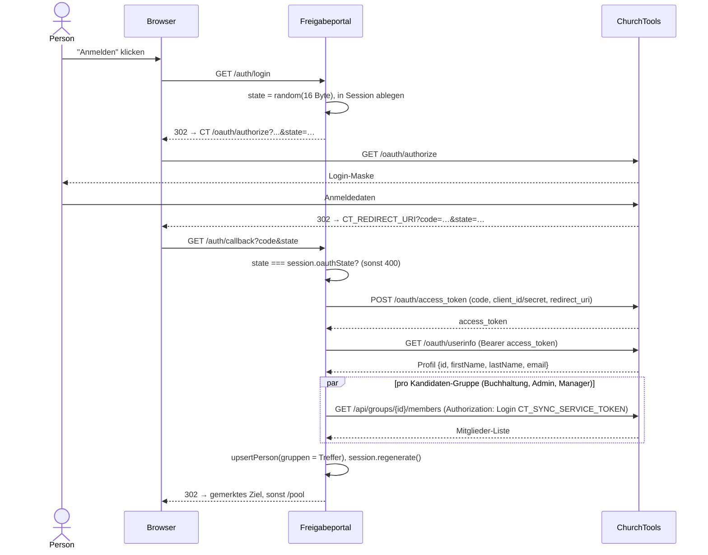
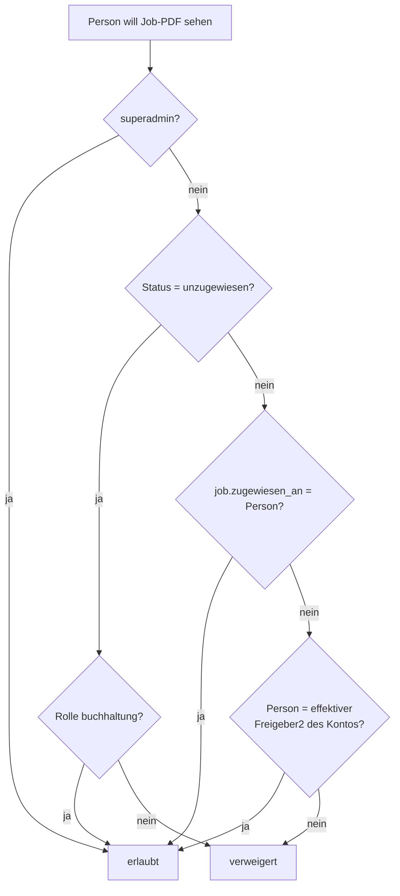

# Authentifizierung und Rechte

Das Portal hat kein eigenes Passwort/Benutzerverwaltung — jeder Login läuft
über ChurchTools-OAuth2. Rechte ergeben sich aus zwei unabhängigen
Quellen: ChurchTools-Gruppenmitgliedschaft (grobe Rollen) und additive,
im Portal selbst vergebene Einzelrechte (feingranular für den
Admin-Bereich).

## ChurchTools-OAuth2-Login

Wichtige Details:

- **Zwei verschiedene Token-Typen**: der frisch geholte OAuth-
  `access_token` funktioniert nur gegen `/oauth/*`. Für die
  Gruppenmitgliedschaft (`/api/groups/{id}/members`) wird stattdessen der
  technische `CT_SYNC_SERVICE_TOKEN` mit dem Schema `Authorization: Login
  <token>` verwendet — dieselbe Anfrage wie im nächtlichen Sync (siehe
  [personen-sync.md](personen-sync.md)).
- **Gruppen werden über die ID abgeglichen, nie über den Namen** — ein
  explizites Lastenheft-Requirement, damit eine Umbenennung der Gruppe in
  ChurchTools den Zugriff nicht stillschweigend bricht. `/oauth/userinfo`
  liefert zwar auch ein `groups`-Feld, das wird bewusst ignoriert, weil es
  nur Namen enthält.
- **Session-Fixation-Schutz**: `session.regenerate()` beim Login — eine vor
  dem Login ausgestellte Session-ID darf nie zu einer authentifizierten
  werden.
- **Sitzung und Cookie** (`src/app.js`): Eine Sitzung gilt 8 Stunden und liegt
  in der Tabelle `sessions` (`src/db/sessionStore.js`). Hinter HTTPS heisst das
  Cookie `__Host-portal.sid` (nur `Secure`, `Path=/`, ohne Domain: eine andere
  Subdomain kann es nicht setzen), lokal über http `connect.sid`; es ist
  `httpOnly` und `sameSite=lax`. Wer in ChurchTools aus einer Rollen-Gruppe
  entfernt wird, verliert die Rolle spätestens nach dem nächsten Sync oder
  Login, die Sitzung selbst endet nach 8 Stunden.
- **Rollenentzug wirkt nicht sofort**: Das Portal fragt ChurchTools nicht bei
  jeder Anfrage. Wird jemand in ChurchTools aus einer Rollen-Gruppe entfernt,
  merkt das Portal es erst beim nächtlichen Sync oder bei der nächsten
  Anmeldung der Person. Soll die Sperre **sofort** gelten (z. B. bei
  Austritt im Streit), muss ein Admin mit dem Recht
  `geplante_jobs_verwalten` den Sync von Hand starten: Admin → Geplante Jobs
  (`/admin/geplante-jobs`), Abschnitt „ChurchTools-Personen-Sync — Verlauf“,
  Knopf „Jetzt ausführen“ (`POST /admin/geplante-jobs/sync-personen/jetzt-ausfuehren`).
  Das Ergebnis steht danach im Verlauf (dieselbe Anzeige wie unter
  `/admin/sync`). Bricht die Massenänderungs-Sperre den Lauf ab
  (siehe [personen-sync.md](personen-sync.md)), wird nichts entzogen; dann ist
  die Meldung im Verlauf zu prüfen.

- **Rücksprung nach der Anmeldung**: Ruft jemand ohne Sitzung eine geschützte
  Seite auf (GET mit `Accept: text/html`, z. B. einen Link aus einer Mail),
  merkt sich das Portal den Pfad samt Query in der Sitzung
  (`session.rueckkehr`) und leitet zu `/auth/login`; `/auth/callback` führt
  danach dorthin zurück. Gemerkt werden nur eigene Seitenpfade
  (`src/utils/rueckkehrZiel.js`: ein führender `/`, höchstens 300 Zeichen, keine
  `//`, Backslashes, Steuer- oder Leerzeichen, kein `#`); nicht gemerkt werden
  `/auth`, `/api`, `/internal`, `/healthz`, `/downloads`, `/branding`,
  `/audit-pruefen` sowie Dateiausgaben (Backup-Download, CSV-Export,
  Kreditkarten-Belegdatei). Das Ziel wird vor `regenerate` in eine lokale
  Variable gelesen, nach dem Login nochmals geprüft und nur für die
  Weiterleitung benutzt (nicht in die neue Sitzung übernommen). POST wird nie
  umgeleitet: dort und bei Download-Zielen erscheint die 401-Seite
  «Bitte melde dich an» mit dem Knopf «Anmelden». fetch- und Maschinenrouten
  (`/api/*`, `/downloads/*`, oder `Accept: application/json` ohne HTML)
  bekommen weiter 401 als JSON. Eine Sitzung mit deaktivierter Person wird nie
  umgeleitet (sonst Schleife). Die Abmelde-Bestätigungsseite `/auth/abgemeldet`
  bleibt öffentlich und leitet nicht weiter, die Abmeldung hinterlässt kein Ziel;
  die SSO-Schleife nach «Abmelden» bleibt damit unterbrochen.
- **Ablauf-Hinweis**: Der Ablaufzeitpunkt (8 Stunden nach dem Login, durch
  Aktivität nicht verlängert, kein Keep-alive) steht als `data-ablauf` in
  `#sitzung-hinweis` (`views/_seite_anfang.ejs`). `public/js/sitzungHinweis.js`
  zeigt auf Seiten mit Formular 10 Minuten vor Ablauf «Deine Anmeldung läuft um
  HH:MM ab …» (`role="status"`, `aria-live="polite"`) und danach einen
  Abgelaufen-Hinweis. Nach Ablauf sagen 401- und CSRF-Fehlerseite klar, dass die
  Anmeldung abgelaufen ist.
- **Kein Gruppenzwang beim Login**: der Login gelingt unabhängig davon, ob
  die Person in einer der drei Gruppen ist — Freigeber/Stellvertreter
  können rein kontobasierte Rollen ohne jede Gruppenmitgliedschaft sein.
  Die eigentliche Autorisierung passiert weiter unten in der Kette, pro
  Route bzw. pro Job. Der nächtliche Sync deaktiviert solche Personen
  deshalb auch nicht wegen fehlender Gruppenmitgliedschaft, sondern nur,
  wenn ChurchTools sie als gelöscht oder archiviert meldet (siehe
  [personen-sync.md](personen-sync.md#zugangsmodell)). Deaktivierte Personen
  gelten bei geschützten Seiten als nicht angemeldet, bis sie sich erneut
  einloggen.
- **`/pool` ist das Ziel für jeden Login** — es gibt keine separate
  Landingpage; `/` leitet eingeloggte Personen direkt dorthin weiter.

## Abmelden

`POST /auth/logout` zerstört die Portal-Session und leitet auf eine
Bestätigungsseite (`GET /auth/abgemeldet`) statt direkt auf `/` weiter.
**Grund**: ein direkter Redirect auf `/` liess eine anonyme Anfrage sofort
wieder auf `/auth/login` springen (siehe Login-Sequenz oben) — solange die
ChurchTools-Session im selben Browser noch aktiv ist, meldet SSO die
Person dort augenblicklich wieder an, ohne dass sie es merkt (der
"Abmelden"-Button wirkte, als würde er nichts tun). Die Portal-seitige
Abmeldung ist dabei bereits vollständig und real — das Problem ist rein
das sofortige, unsichtbare Re-Login. Die Bestätigungsseite verlinkt
zusätzlich `{CT_BASE_URL}/?q=logout`, um bei Bedarf auch die
ChurchTools-Session selbst zu beenden.

## Rollenmodell (Gruppen)

Drei ChurchTools-Gruppen werden auf drei Rollen abgebildet
(`src/middleware/roles.js`). Es gibt keine weitere Gruppe.

| Rolle | Umgebungsvariable | Pflicht? | Bedeutung |
|---|---|---|---|
| `buchhaltung` | `CT_GROUP_ID_BUCHHALTUNG` | ja | sieht den unternehmensweiten Pool unzugewiesener Rechnungen, kann Rechnungen beanspruchen |
| `superadmin` | `CT_GROUP_ID_ADMIN` | ja | ist Fallback-Empfänger für jede Admin-Eskalation; seine Admin-Rechte stehen wie bei jeder Gruppe in der Rechte-Matrix (siehe unten), nur `gruppenrechte_verwalten` ist fest |
| `manager` | `CT_GROUP_ID_MANAGER` | optional | nur Admin-Rechte laut Rechte-Matrix |

`personHasRole(person, config, rolle)` prüft, ob die zugehörige
ChurchTools-Gruppen-ID in `person.gruppen` enthalten ist — dieses Array
wird bei Login und beim nächtlichen Sync neu geschrieben, **nicht** bei
jeder Anfrage live gegen ChurchTools geprüft. Wer eine Gruppe verlässt,
verliert die Rolle also spätestens mit dem nächsten Sync-Lauf, behält aber
den Portalzugang für seine konto-, karten- oder rechtebasierten Aufgaben.
`gruppenVon(person, config)` liefert alle Gruppen einer Person (eine Person kann in mehreren sein).

## Rechte: Gruppenrechte und Einzelrechte

Die Rechte für den Admin-Bereich kommen aus **zwei additiven Quellen**
(`src/middleware/permissions.js`):

1. **Gruppenrechte** (`gruppen_berechtigungen`): pro Gruppe (`superadmin`, `manager`, `buchhaltung`)
   stellt ein Superadmin unter **Admin → Einstellungen → Gruppenrechte** ein, welche Rechte die Gruppe hat.
2. **Einzelrechte** (`person_berechtigungen`): pro Person unter **Admin → Stammdaten → Personen**
   (`POST /admin/personen/:id/berechtigungen`, Recht `gruppenrechte_verwalten`).

Das effektive Recht einer Person ist die **Vereinigung** aus den Rechten aller ihrer Gruppen und ihren
Einzelrechten. Es gibt kein Verbotsrecht: Ein Recht entfällt erst, wenn keine Quelle es mehr liefert. Wer
z. B. in `superadmin` und `buchhaltung` ist, bekommt die Summe beider Gruppen. Unter **Personen** zeigt
die Checkbox jedes Rechts die Herkunft (`ermittleRechteMitHerkunft` liefert sie): Liefert eine Gruppe das
Recht, ist die Checkbox angehakt und grau (nicht bedienbar), daneben steht «über Gruppe X» (mehrere Gruppen
mit Komma). Hat die Person das Recht zusätzlich direkt, steht «(auch direkt)», und das Formular sendet das
Recht als verstecktes Feld mit – so bleibt der Einzelrechte-Eintrag beim Speichern erhalten und wirkt
weiter, wenn die Person die Gruppe später verliert. Reine Einzelrechte bleiben bedienbar. Feste Rechte
ohne Checkbox (`gruppenrechte_verwalten`) erscheinen als Textzeile, z. B. «Gruppenrechte verwalten – über
Gruppe Superadmin».

### Rechtekatalog

Der Katalog liegt in `src/services/berechtigungKatalog.js` (`GRANTABLE_BERECHTIGUNGEN`, Labels,
Bereiche, Startwerte). Vergebbar sind:

- `konten_verwalten`, `kreditoren_verwalten`, `geplante_jobs_verwalten`, `abgelehnt_verwalten`,
  `mails_einsehen`, `sync_einsehen`, `audit_log_einsehen`
- `pool_zuweisen`: Pool-Belege an Personen zuweisen — erlaubt `POST /pool/:id/zuweisen`
- `kreditkarten_verwalten`: Kreditkarten anlegen/bearbeiten/(de)aktivieren und Erfasser pflegen — siehe [kreditkarten-belege.md](kreditkarten-belege.md#rechte)
- `sync_verwalten`: Sync konfigurieren (zusätzlich zu `sync_einsehen`)
- `vorgaenge_einsehen`: Übersicht laufender Vorgänge — `GET /admin/vorgaenge` und `GET /admin/vorgaenge/:id`
- `workflow_eingreifen`: in laufende Vorgänge eingreifen — Force-Aktionen, Altfälle, Umhängen (`POST /admin/vorgaenge/:id/umhaengen`); gilt auch für Rapporte: Empfänger ersetzen/entfernen und Markierung aufheben sowie `POST /kontierung/:id/rapport-aufheben` für Dritte. Das Bestätigen eines Rapports ist **kein** Recht, sondern an die namentlich zugeteilte Person gebunden
- `betrieb_einsehen` («Betrieb & Nutzung»): siehe [betrieb-und-nutzung.md](betrieb-und-nutzung.md)
- `auswertung_einsehen`, `budgets_verwalten`: siehe [auswertung.md](auswertung.md)
- Neu (früher fest an Rollen gebunden): `personen_einsehen`, `testmodus_nutzen`,
  `benachrichtigungen_verwalten`, `erscheinungsbild_verwalten`, `ersteinrichtung_verwalten`,
  `zeitstempel_verwalten`, `backup_verwalten`, `module_verwalten`, `dateiquarantaene_verwalten`
- `wartungsmodus_schalten`: Wartungsmodus ein-/ausschalten

Für «Zurück in den Pool» bei abgelehnten Rechnungen (`/admin/abgelehnt/:id/pool`) genügt `abgelehnt_verwalten`;
`workflow_eingreifen` ist dafür nicht nötig.

Dazu ein **festes** Recht: `gruppenrechte_verwalten` (Gruppenrechte-Seite, Einzelrechte vergeben). Es hängt
allein an der Mitgliedschaft in `superadmin`, ist nicht abschaltbar und weder anderen Gruppen noch als
Einzelrecht vergebbar — Schutz vor dem Aussperren.

### Startwerte

Beim ersten Start nach der Einführung (leere Tabelle `gruppen_berechtigungen`) werden die Gruppen mit dem
bisherigen Verhalten befüllt: `superadmin` alle Rechte; `manager` alle ausser `sync_verwalten`,
`workflow_eingreifen`, `betrieb_einsehen` und den neuen, nur für Superadmin gedachten Rechten
(`benachrichtigungen_verwalten`, `erscheinungsbild_verwalten`, `ersteinrichtung_verwalten`,
`zeitstempel_verwalten`, `backup_verwalten`, `module_verwalten`, `dateiquarantaene_verwalten`,
`wartungsmodus_schalten`); `buchhaltung` keine. Das Seeding läuft einmalig und überschreibt später nie
Änderungen.

### Admin-Zugang und Audit

`requireAdminAreaAccess` lässt jede Person in `/admin`, die mindestens ein Recht hat (aus Gruppe oder
Einzelrecht). Änderungen an Gruppenrechten stehen im globalen Audit-Log (`objekt` = `gruppenrechte`,
`objekt_id` = Gruppe, `aktion` = `recht_erteilt`/`recht_entzogen`, ein Eintrag pro geändertem Recht);
Einzelrechte protokolliert der bestehende Trigger auf `person_berechtigungen`.

Details zur Rechte-Matrix pro Admin-Seite: [admin-bereich.md](admin-bereich.md).

## Job-Autorisierung (pro Rechnung)

Unabhängig vom Admin-Bereich hat jede Rechnung ihre eigene, kontextuelle
Autorisierung — wer eine bestimmte Rechnung sehen/bearbeiten darf, hängt
vom aktuellen `status` und den auf dem zugehörigen **Konto** hinterlegten
Personen ab (Details zum Status-Modell: [rechnungs-workflow.md](rechnungs-workflow.md)).

`canViewJobPdf(db, config, person, job)` (`src/services/jobAuthorization.js`)
ist die zentrale, überall geteilte Sichtbarkeitsprüfung für PDF-Vorschau,
Thumbnail und Zeitstempel-Verifikation:

Die einzelnen Seiten-Routen (`/kontierung/:id`, `/freigabe2/:id`,
`/abgelehnt/:id`) implementieren eine engere Variante derselben Logik
zusätzlich zum konkreten Status, den die jeweilige Aktion voraussetzt
(z. B. `/kontierung/:id` nur bei Status `zugewiesen`).

**Vier-Augen-Prinzip, hart erzwungen**: Freigabe 2 prüft bei jeder Anfrage
zusätzlich, ob dieselbe Person bereits Freigabe 1 für genau diesen Job
erteilt hat — unabhängig davon, was zum Zeitpunkt der Konto-Zuweisung
galt (Konto-Rollen können sich zwischendurch geändert haben, oder eine
Person hat sowohl Buchhaltungs- als auch Superadmin-Rolle).

Damit ein Vorgang an dieser Sperre nicht liegen bleibt (z. B. wenn Freigeber 2
als Ferienvertretung Freigabe 1 erteilt hat), leitet das Portal Freigabe 2 beim
Abschluss von Freigabe 1 an die Stellvertretung 2 bzw. die Admin-Gruppe um,
siehe [rechnungs-workflow.md](rechnungs-workflow.md#3-freigabe-2-status-freigabe2).

**Interessenskonflikt-Sperre, hart erzwungen**: Ebenso prüfen Freigabe 2
(`loadAuthorized` in `src/routes/freigabe2.js`), Kontierung
(`ladeKontierbarenJob` in `src/services/kontierungZugriff.js`) und
Spesen-Freigabe 1 bei jeder Anfrage, ob die Person für genau diesen Job auf
dieser Stufe einen Interessenskonflikt erklärt hat
(`listKonfliktmelder` in `src/db/freigabenRepo.js`, gelesen aus dem
`freigaben`-Verlauf). Falls ja: 403 — auch für Ferienvertretungen und
Superadmins, und auch nachdem ein Admin den Vorgang umgehängt hat. Der
Routing-Zustand (`*_eskaliert_von`, Admin-Flags) allein reicht dafür nicht,
weil Umhängen und Ablehnung ihn zurücksetzen können.

## Kreditkarten-Belege — eigene Rechte

Eine dritte, von der Job-Autorisierung oben unabhängige Rechte-Ebene:
Vorab-Belege sind vor dem Abgleich keine `jobs`-Zeilen, brauchen also eine
eigene Prüfung (`src/services/kkRechte.js`).

| Aktion | Berechtigt |
|---|---|
| Karten verwalten, Erfasser pflegen | `superadmin`, Einzelrecht `kreditkarten_verwalten` |
| Beleg hochladen | Modus A: alle angemeldeten Personen · Modus B: `kreditkarte_erfasser` + verantwortliche Person der Karte |
| Beleg bearbeiten/verwerfen | `hochgeladen_von`, `gekauft_von`, verantwortliche Person der Karte — nur solange `offen`/`entwurf` |
| Abrechnung markieren | wer den Job heute beanspruchen bzw. kontieren dürfte |
| Markierung aufheben, Abgleich | `zugewiesen_an` des Abrechnungs-Jobs (inkl. Ferienmodus-Vertretung, Admin-Eskalations-Sonderfall) |
| Freigabe der Teil-Jobs | unverändert Freigeber 1/2 des jeweiligen Kontos (Vier-Augen-Prinzip) |

Details: [kreditkarten-belege.md](kreditkarten-belege.md#rechte).

## Ferienmodus — additive Abwesenheits-Stellvertretung

Zusätzlich zur Job-Autorisierung oben kann jede Person für sich selbst unter `/ferienmodus`
einen Zeitraum mit gewähltem Stellvertreter hinterlegen (`src/routes/ferienmodus.js`). Dies ist
**nicht** dasselbe wie der pro-Konto feste `stellvertreter1_id`/`stellvertreter2_id`
(Interessenskonflikt-Eskalation) — es ist ein zweiter, unabhängiger, personenbezogener
Mechanismus. Details: [rechnungs-workflow.md](rechnungs-workflow.md#ferienmodus--abwesenheits-stellvertretung).

Solange der Zeitraum aktiv ist (`istAktiveVertretungFuer`, `src/services/vertretung.js`), gilt
additiv — die abwesende Person behält ihren eigenen Zugriff unverändert:

- der Stellvertreter darf `/kontierung/:id` für Jobs öffnen/bearbeiten, die der abwesenden Person
  zugewiesen sind
- der Stellvertreter darf `/freigabe2/:id` für Jobs öffnen/bearbeiten, deren effektiver Freigeber2
  die abwesende Person ist
- der Stellvertreter darf `/abgelehnt/:id` für abgelehnte Jobs öffnen (und über
  `/abgelehnt/:id/ueberarbeiten` wieder zur Kontierung zurückgeben), die der abwesenden Person
  zugewiesen sind
- alle drei Aufgaben erscheinen zusätzlich im eigenen `/pool`-Dashboard des Stellvertreters
- betroffene Zuweisungs-/Freigabe-2-fällig-/Ablehnungs-Mails gehen zusätzlich an den
  Stellvertreter (`sendNotificationMitVertretung`, `src/services/notify.js`)
- im Audit-Log wird vermerkt, wenn eine Aktion als Stellvertreter ausgeführt wurde
  (`freigaben.vertretung_fuer`)

Auswählbar als Stellvertreter sind nur aktive Personen, die mit der eigenen Person mindestens ein
Konto teilen (`listVertretungsKandidaten`, `src/db/kontenRepo.js`). Admin → Stammdaten → Personen zeigt einen
gesetzten Ferienmodus rein informativ an — Verwaltung bleibt Selbstbedienung.
