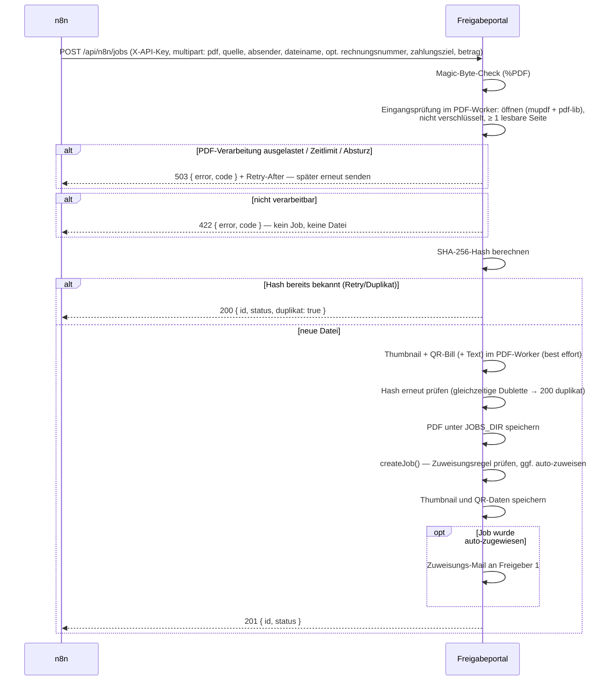
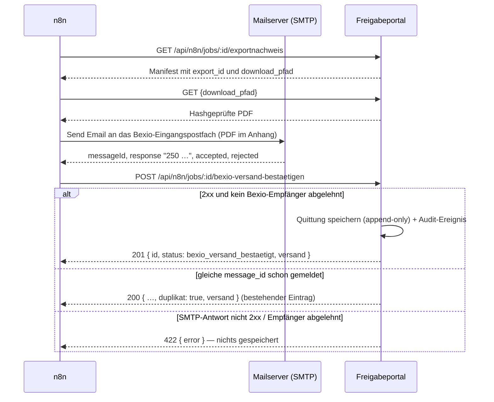

# n8n-Schnittstelle

Das Portal selbst empfängt keine E-Mails und spricht kein IMAP — ein
externer n8n-Workflow übernimmt Mail-Eingang und Ablage und kommuniziert
mit dem Portal ausschliesslich über eine kleine REST-API unter
`/api/n8n/jobs` (`src/routes/n8n/jobs.js`), abgesichert per
`X-API-Key`-Header (`requireApiKey`, zeitkonstanter Vergleich gegen
`N8N_API_KEY`).

> Nativer Mail-Empfang/-Versand direkt im Portal (ohne n8n) ist als
> Design-Spec vorbereitet, aber noch nicht implementiert — n8n bleibt bis
> dahin der einzige Weg, wie Rechnungen ins Portal gelangen.

## Rechnungseingang



**Vertrag** (`POST /api/n8n/jobs`, `multipart/form-data`):

| Feld | Pflicht | Beschreibung |
|---|---|---|
| `pdf` | ja | die Rechnung, max. 20 MB, ein unverschlüsseltes, verarbeitbares PDF mit mindestens einer lesbaren Seite (ein QR-Code ist nicht nötig). Der Dateiname dieses Teils wird als `pdf_dateiname` gespeichert und in der Oberfläche bevorzugt angezeigt |
| `quelle` | ja | `"scanner"` oder `"lieferant"` |
| `dateiname` | ja | Anzeigename; geht unverändert an n8n zurück. In der Oberfläche nur, wenn der PDF-Teil keinen `.pdf`-Namen hat und `dateiname` kein Bildname ist (z. B. `image002.png` aus einer Mail-Signatur) — sonst `Eingang <Datum>`. Jede Anzeige trägt die Belegnummer `#<id>` (`src/services/belegName.js`) |
| `absender` | nein | `From:`-Header der eingehenden Mail (roh, mit oder ohne Display-Name) — Basis für die automatische Zuweisungsregel |
| `eingang_am` | nein | ISO-Datum; Default: jetzt |
| `rechnungsnummer` | nein | Vorschlag für die Kontierung (z. B. von einem KI-Modell aus dem PDF gelesen), höchstens 100 Zeichen, eine Zeile |
| `zahlungsziel` | nein | Vorschlag für die Kontierung im Format `JJJJ-MM-TT` (z. B. `2026-12-31`), muss ein existierendes Datum sein |
| `betrag` | nein | Vorschlag für die Kontierung, positiv, höchstens zwei Nachkommastellen, Punkt oder Komma (`1234.50`, `1234,5`); ohne Tausendertrennzeichen und Währung. Wird als `betrag_vorschlag` gespeichert, nicht als kontierter Betrag. Hat die Rechnung einen QR-Code, gilt dessen Betrag |

`rechnungsnummer`, `zahlungsziel` und `betrag` füllen nur das Kontierungsformular vor
und erscheinen in Pool und Aufgabenlisten rot markiert als «automatisch erkannt»;
die kontierende Person sieht und korrigiert sie dort. Ein ungültiger Wert
(falsches Format, unmögliches Datum, zu lang, Zeilenumbruch, mehrfach
gesendet) wird **still verworfen** und führt nie zu `400` – der Upload
scheitert also nicht an einem schlecht gelesenen Wert. Ein gültiger und ein
ungültiger Wert: nur der gültige wird übernommen. Prüfung in
`src/services/eingangVorbefuellung.js`. Bestehende n8n-Workflows ohne diese
Felder funktionieren unverändert.

Antworten: `201` mit `{id, status}` bei neuer Rechnung, `200` mit
`{id, status, duplikat: true}` bei bytegleichem Wiederholungs-Upload
(SHA-256-Hash-Vergleich — macht die Schnittstelle idempotent gegenüber
n8n-Retries oder mehrfach ausgelösten IMAP-Triggern), `400` bei
Validierungsfehlern (fehlende Felder, zu gross, keine PDF-Signatur) und
`422` `{error, code}`, wenn das Dokument zwar mit `%PDF` beginnt, aber nicht
verarbeitet werden kann:

| `code` | Bedeutung |
|---|---|
| `pdf_beschaedigt` | lässt sich nicht öffnen bzw. nicht als PDF verarbeiten |
| `pdf_verschluesselt` | passwortgeschützt oder verschlüsselt (auch nur mit Besitzerpasswort) — wird nicht unterstützt, da sich das Dokument nicht unverfälscht stempeln lässt |
| `pdf_keine_seiten` | keine lesbare Seite |

Die Prüfung (`src/services/pdfEingang.js`) läuft vor Duplikatprüfung und
Jobanlage: bei `422` entsteht weder ein Job noch eine Datei, und ein erneuter
Versuch mit denselben Bytes ergibt wieder `422`. Der n8n-Workflow soll `422`
nicht automatisch wiederholen, sondern die Mail zur manuellen Bearbeitung
weiterleiten (z. B. an die Buchhaltung, mit der Meldung aus `error`).
Dieselbe Prüfung gilt für PDF-Belege bei der Spesen-Einreichung.

**`503` bei ausgelasteter PDF-Verarbeitung (B2):** Eingangsprüfung, Vorschaubild
und QR-Erkennung laufen in Worker-Threads mit Warteschlange und Zeitlimit
([architektur.md](architektur.md#pdf-worker-srcservicespdfworkerpooljs-befund-b2)).
Ist die Eingangsprüfung wegen Überlastung, Zeitlimit oder Absturz eines Workers
nicht möglich, antwortet die Route mit **HTTP 503**, `Retry-After: 60` und
`{"error": "…", "code": "pdf_verarbeitung_ausgelastet"}`. Es entsteht weder ein
Job noch eine Datei. Das ist kein Prüfergebnis: **n8n soll die Einreichung
nach der Wartezeit wiederholen** (wie beim Wartungsmodus, «Retry On Fail» mit
Pause); erst nach mehreren erfolglosen Versuchen zur manuellen Bearbeitung
weiterleiten. Vorschaubild und QR-Erkennung sind dagegen weiterhin best effort:
scheitern sie, entsteht der Job trotzdem (ohne Vorschaubild bzw. QR-Daten).

## Wartungsmodus (503)

Ist das Portal im [Wartungsmodus](betrieb-und-nutzung.md#wartungsmodus-für-updates), antworten alle
`/api/n8n/jobs`, `/api/n8n/kk-belege` und `/api/n8n/rapporte`-Routen mit **HTTP 503**, dem Header
`Retry-After: 300` und `{"error":"wartungsmodus"}`. Es wird nichts gespeichert. **Der n8n-Workflow muss bei 503
(und Netzwerkfehlern) erneut versuchen**, z. B. über «Retry On Fail» mit mehreren Minuten Pause; die Mail bleibt
solange im Postfach bzw. der Beleg im Workflow. Auch der PDF-Abruf über die signierten Links (`/downloads/:jobId?expires=…&signature=…`) antwortet mit 503 und JSON; auch dort erneut versuchen. `/api/n8n/backup/*` bleibt im Wartungsmodus erreichbar. Ebenso bleiben die **Bestätigungen** (`POST /api/n8n/jobs/:id/abholung-bestaetigen`, `…/archivierung-bestaetigen` und die Rapporte-Variante sowie `…/bexio-versand-bestaetigen`) offen: sie schreiben nur das Ergebnis eines schon gelaufenen Exports, ein 503 würde zur Doppelbuchung führen. Empfehlung: den n8n-Export-Workflow vor dem Einschalten pausieren.

## Abholung fertiger Rechnungen

```mermaid
sequenceDiagram
    participant n8n
    participant P as Freigabeportal

    loop Polling
        n8n->>P: GET /api/n8n/jobs/abholbereit
        P-->>n8n: [{id, Kontierungs- & Konto-Metadaten, QR-Bill-Felder, download_url (15 Min gültig, signiert)}]
        n8n->>P: GET /api/n8n/jobs/:id/exportnachweis
        P-->>n8n: Festgeschriebenes Manifest mit Export-ID, SHA-256 und download_pfad
        n8n->>P: GET {download_pfad} (X-API-Key)
        P-->>n8n: Hashgepruefte PDF
        n8n->>n8n: In Paperless archivieren, Original erneut laden und Hash vergleichen
        n8n->>P: POST /api/n8n/jobs/:id/archivierung-bestaetigen
        P->>P: Quittung speichern, Status abgeholt; lokale Dateien behalten
        P-->>n8n: 200 { id, status: archiv_bestaetigt, quittung }
    end
```

- `GET /api/n8n/jobs/abholbereit` liefert alle Jobs mit Status
  `abgeschlossen`, deren letzter Abholversuch (`fetched_by_n8n_at`) länger
  als 15 Minuten her ist oder noch nie stattfand — jeder Abruf markiert
  sie sofort neu als "gerade abgeholt", sodass ein paralleler zweiter
  Poll-Zyklus dieselben Jobs nicht doppelt liefert.
- **Ist ein RFC3161-Zeitstempeldienst konfiguriert** (`zeitstempel_tsa_url`
  gesetzt), bleibt ein Job so lange **unsichtbar** für diese Route, bis
  sein Zeitstempel tatsächlich gesetzt ist (`zeitstempel_gesetzt_am IS NOT
  NULL`) — siehe
  [zeitstempel-und-pruefbescheinigung.md](zeitstempel-und-pruefbescheinigung.md).
  Dieselbe Bedingung gilt für `abholung-bestaetigen`.
- Alle Felder stammen aus dem Freigabe-Snapshot bzw. einer Altfall-Entscheidung, nie aus der
  aktuellen Jobzeile oder Stammdaten (siehe [export-und-zahlungsintegritaet.md](export-und-zahlungsintegritaet.md)).
- Antwort-Felder je Job:

  | Feld | Beschreibung |
  |---|---|
  | `id`, `eingang_am`, `quelle`, `absender`, `dateiname` | wie beim Rechnungseingang übergeben — `quelle` ist bei einer Spesen-Position `"spesen"` statt `"scanner"`/`"lieferant"` (siehe unten) |
  | `lieferant`, `rechnungsnummer`, `betrag`, `zahlungsziel` | bei der Kontierung erfasste Rechnungsdaten — `betrag` ist immer **positiv**, auch bei einer Gutschrift |
  | `typ` | `"rechnung"` oder `"gutschrift"` (ein Job ohne gesetzten Typ wird als `"rechnung"` geliefert) |
  | `betrag_signiert` | `betrag` mit Vorzeichen als String mit 2 Nachkommastellen: negativ bei `typ: "gutschrift"`, sonst gleich `betrag`; `null`, wenn kein `betrag` erfasst ist |
  | `konto_id` | ID des zugeordneten Kontos, `null` falls noch keines gesetzt |
  | `konto_kontonummer`, `konto_bezeichnung` | Kontonummer und Bezeichnung des Kontos, `null` falls `konto_id` leer ist |
  | `eingereicht_von` | ChurchTools-Personen-ID der einreichenden Person, nur bei `quelle: "spesen"` gesetzt, sonst `null` |
  | `auslage_datum` | Datum der Auslage (von der einreichenden Person erfasst), nur bei `quelle: "spesen"` gesetzt, sonst `null` |
  | `beschreibung` | Verwendungszweck der Spesen-Position, nur bei `quelle: "spesen"` gesetzt, sonst `null` |
  | `rechnungsdatum` | Gespeichertes Rechnungsdatum, sonst `null`; das Zahlungsziel wird nicht als Rechnungsdatum ausgegeben |
  | `iban`, `kontoinhaber` | Bei Freigabe 2 bestätigte Zahlungsdaten, nur bei `quelle: "spesen"` mit `zahlung.freigegeben`; sonst `null`, kein Live-Abruf beim Export |
  | `nachweis_status` | `snapshot`, `altfall_nachbestaetigt` oder `altfall_nur_archiv`; Belege ohne ausreichenden Nachweis erscheinen gar nicht (Admin → Vorgänge → Altfälle) |
  | `zahlung` | Bestätigte Zahlung: `{art, freigegeben, herkunft, iban, kontoinhaber, referenz, betrag, waehrung, iban_abgleich, hinweise, bestaetigt_von, bestaetigt_am}` — **nur bei `freigegeben: true` darf n8n zahlen**, siehe [export-und-zahlungsintegritaet.md](export-und-zahlungsintegritaet.md#exportvertrag) |
  | `altfall` | nur bei Altfall-Entscheidung: Person, Begründung, Zeitpunkt und Herkunft der Werte |
  | `qr_iban`, `qr_referenz`, `qr_betrag`, `qr_waehrung`, `qr_creditor_name` | beim Eingang gescannte QR-Bill-Werte, wie bei Freigabe 2 eingefroren, sonst `null` — kein Zahlungsauftrag |
  | `qr_erkannt_am` | Zeitpunkt der QR-Erkennung, `null` falls keine QR-Bill erkannt wurde |
  | `download_url` | signierte, 15 Minuten gültige Download-URL |
  | `export_nachweis_url` | relativer API-Pfad fuer das unveraenderliche Exportmanifest; neuer Archivablauf verwendet dessen `download_pfad` |

  Für eine Spesen-Position (`quelle: "spesen"`) ist `betrag` die einzelne
  Auslage und `konto_id`/`konto_kontonummer`/`konto_bezeichnung` das von der
  einreichenden Person gewählte Konto — es gibt kein separates
  Kontierungs-/Freigabe-1-Ergebnis wie bei einer Rechnung, da die
  Spesen-Position bereits bei der Einreichung ihr Konto erhält. Siehe
  [spesen-einreichung.md](spesen-einreichung.md) für den vollständigen
  Workflow.

### Splitgruppen: kombinierte Einträge statt N Einzeljobs

Eine vollständig abgeschlossene **Splitgruppe** (siehe
[rechnungs-workflow.md](rechnungs-workflow.md#6-splitgruppen--kombinierter-export-statt-n-einzel-buchungen))
erscheint in `/abholbereit` **nicht** als N separate Job-Einträge ihrer
Teil-Jobs, sondern als **ein zusätzlicher Eintrag pro Elternjob**, sobald
das kombinierte, gestempelte PDF fertig gemergt ist (`gruppe_pdf_pfad`
gesetzt, ggf. auch zeitgestempelt). Ein Gruppen-Eintrag hat eine andere
Feldform als ein Einzeljob-Eintrag — Unterscheidungsmerkmal ist das
zusätzliche Feld `positionen`, das ein Einzeljob-Eintrag nie hat:

| Feld | Beschreibung |
|---|---|
| `id` | ID des **Elternjobs** (Status `aufgesplittet`) |
| `eingang_am`, `quelle`, `absender`, `lieferant`, `rechnungsnummer`, `betrag`, `zahlungsziel`, `rechnungsdatum`, `dateiname` | Kopf des Elternjobs, wie im Gruppen-Freigabe-Snapshot eingefroren |
| `qr_iban`, `qr_referenz`, `qr_betrag`, `qr_waehrung`, `qr_creditor_name`, `qr_erkannt_am` | QR-Daten des Elternjobs aus dem Gruppen-Snapshot (Aufsplitten fasst die QR-Daten nicht an) |
| `nachweis_status`, `zahlung`, `altfall` | wie beim Einzeljob; `zahlung` ist die **eine** Zahlung der Gesamtrechnung, von jedem Teilbeleg bestätigt |
| `positionen` | Array, ein Eintrag je nicht-gelöschtem Teil-Job aus dessen Freigabe-Snapshot: `{job_id, konto_id, konto_kontonummer, konto_bezeichnung, betrag, typ, betrag_signiert, position}` (`position` = die bei Aufsplitten erfasste Freitext-"Position auf der Rechnung"; `typ`/`betrag_signiert` wie beim Einzeljob) |
| `download_url` | signierte URL auf das **kombinierte** Gruppen-PDF (nicht auf einen einzelnen Teil) |

**Gutschriften/Rückerstattungen**: `betrag` ist im Portal immer positiv,
die Bedeutung trägt `typ`. Eine Kreditkarten-Abrechnung mit einer
Rückerstattung (siehe [kreditkarten-belege.md](kreditkarten-belege.md))
liefert z. B. Positionen `30.00` (`rechnung`) und `11.50` (`gutschrift`)
bei einem Gruppen-`betrag` von `18.50`. Der n8n-Workflow **muss** deshalb
`betrag_signiert` (oder `typ`) auswerten, um Rückerstattungen korrekt zu
buchen — wer nur `betrag` liest, bucht eine Gutschrift als Aufwand. Die
Summe der `betrag_signiert` aller Positionen ergibt den Gruppen-`betrag`.
Die Felder sind additiv; alle bisherigen Felder bleiben unverändert.

Ein Gruppen-Eintrag hat kein eigenes `konto_id`/`iban`/`kontoinhaber`-Feld
auf oberster Ebene (unterschiedliche Konten je Position) und keine
Spesen-Felder; die Zahlungsdaten stehen in `zahlung`. `abholung-bestaetigen` erkennt an der ID automatisch, ob es
sich um einen Gruppen- oder Einzeljob-Elternjob handelt
(`istGruppenElternjob`). Die alte Bestaetigung markiert nur den Transport;
Gruppen-PDF und Teil-PDFs bleiben erhalten. Eine Archivquittung wird auf
dem Elternjob und dem Hash des kombinierten Dokuments gespeichert.

Eine Splitgruppe, deren letzter Teil noch offen oder deren Merge noch
nicht gelaufen ist, liefert **weder** Gruppen- **noch** Einzeljob-Einträge
für ihre Teile — Teil-Jobs werden nie einzeln über `/abholbereit`
ausgeliefert, unabhängig von ihrem eigenen Status.

- Der `download_url` ist eine HMAC-signierte, 15 Minuten gültige URL auf
  `GET /downloads/:jobId` — **keine** Session nötig, siehe
  [architektur.md](architektur.md#sicherheitsmechanismen-auszug).
- `abholung-bestaetigen` bleibt als Legacy-Transport-ACK verfuegbar und
  liefert zusaetzlich `archiv_bestaetigt: false`. Es loescht KEINE Dateien.
- Die Bereinigung verlangt eine passende Archivquittung und sieben volle
  Tage seit deren Speicherung. Ohne Quittung bleiben auch Altfaelle erhalten.
- [Archivvertrag und n8n-Umstellung](n8n-paperless-archivierung.md) beschreibt
  die neuen Endpunkte, Wiederholungen und den Nachweis aus Paperless.

## Versand an Bexio bestätigen

n8n schickt den fertigen Beleg per Mail an das Bexio-Eingangspostfach. Damit
das Portal davon weiss, meldet n8n nach dem erfolgreichen Mailversand die
Antwort des Mailservers zurück (Versandquittung). Das Portal speichert sie
unveränderlich in `bexio_versand` (siehe [datenmodell.md](datenmodell.md)),
protokolliert sie im Audit-Log (Objekt `bexio_versand`, Akteur `service:n8n`)
und zeigt sie auf der Belegseite (`/zeitstempel-pruefen?jobId=`, Knopf
«Jetzt prüfen» unter den abgeschlossenen Rechnungen): «An Bexio gesendet:
‹Zeitpunkt›, an ‹Empfänger›, Message-ID ‹…›» bzw. «Versand an Bexio: noch
nicht gemeldet». Ein Teilbeleg zeigt den Versand seiner Splitgruppe. Eine
Bexio-API gibt es dabei nicht; die Rückmeldung kommt ausschliesslich von n8n.

> **Grenze:** Die SMTP-Antwort belegt nur, dass der **eigene Mailserver** die
> Mail angenommen hat (z. B. `250 2.0.0 Ok: queued as …`), **nicht** die
> Zustellung bei Bexio oder die Verbuchung dort.



**Vertrag** (`POST /api/n8n/jobs/:id/bexio-versand-bestaetigen`, Header
`X-API-Key`, `Content-Type: application/json`, höchstens 8 KB). `:id` ist die
ID aus `/abholbereit` bzw. dem Manifest, bei einer Splitgruppe also der
**Elternjob**.

| Feld | Pflicht | Beschreibung |
|---|---|---|
| `export_id` | ja | `export_id` aus `GET /api/n8n/jobs/:id/exportnachweis` — welche Datei verschickt wurde. Muss zum Exportnachweis **dieses** Vorgangs gehören |
| `empfaenger` | ja | Mailadresse des Bexio-Eingangspostfachs (Text) oder Liste von höchstens 10 Adressen; nur die nackte Adresse ohne Anzeigename, je höchstens 254 Zeichen |
| `message_id` | ja | Message-ID der verschickten Mail (z. B. `<…@mail.example.org>`), einzeilig, höchstens 255 Zeichen |
| `smtp_antwort` | ja | Antwortzeile des Mailservers, z. B. `250 2.0.0 Ok: queued as 4ABC12`, höchstens 500 Zeichen. Zeilenumbrüche und Steuerzeichen werden zu Leerzeichen |
| `gesendet_am` | ja | ISO-Zeitpunkt mit Zeitzone, z. B. `2026-11-16T10:15:00+01:00`; gespeichert als UTC |
| `akzeptiert` | nein | Liste der vom Mailserver angenommenen Adressen. Wenn mitgeschickt, muss jede Adresse aus `empfaenger` darin stehen |
| `abgelehnt` | nein | Liste der abgelehnten Adressen. Steht eine Adresse aus `empfaenger` darin → 422 |

Alle Felder müssen Text bzw. Listen von Text sein; ein Objekt oder eine
Liste an Stelle eines Textes ergibt 400. Gross-/Kleinschreibung der Adressen
spielt beim Abgleich keine Rolle.

| Antwort | Bedeutung |
|---|---|
| `201` | Quittung gespeichert: `{id, status: "bexio_versand_bestaetigt", versand: {id, job_id, export_id, empfaenger, message_id, smtp_antwort, gesendet_am, gemeldet_am}}` |
| `200` | dieselbe `message_id` war für diesen Vorgang schon gemeldet: bestehender Eintrag mit `duplikat: true` (Wiederholung ist gefahrlos) |
| `400` | Pflichtfeld fehlt, falscher Typ, zu lang, keine gültige Adresse, Zeilenumbruch in `message_id`, `gesendet_am` ohne Uhrzeit/Zeitzone, ungültige ID |
| `401` | `X-API-Key` fehlt oder falsch |
| `404` | Vorgang unbekannt — oder ein **Rapport**: Rapporte gehen nie an Bexio und existieren für `/api/n8n/jobs/*` nicht (siehe unten) |
| `409` | Vorgang nicht exportiert (noch kein Exportnachweis, z. B. Teilbeleg einer Splitgruppe), `export_id` gehört zu einem anderen Vorgang, oder die `message_id` ist schon einem anderen Vorgang zugeordnet |
| `413` | Body grösser als 8 KB |
| `422` | Versand nicht erfolgreich: `smtp_antwort` beginnt nicht mit `2xx`, ein Bexio-Empfänger steht in `abgelehnt` oder fehlt in `akzeptiert`. Es wird **nichts** gespeichert; der Beleg bleibt in `bexio-versand-ausstehend` |

Ein späterer **zweiter Versand** desselben Belegs (z. B. erneut geschickt,
neue `message_id`) wird als weiterer Eintrag gespeichert; die Belegseite
zeigt dann beide Zeilen. Ein Fehlversand wird bewusst nicht als eigener
Eintrag gespeichert: die Tabelle hält nur bestätigte Versände, damit
«gesendet» auf der Belegseite und in `bexio-versand-ausstehend` eindeutig
bleibt. Fehlversände stehen im n8n-Ausführungsprotokoll. Wie die übrigen
Bestätigungen bleibt die Route auch im [Wartungsmodus](#wartungsmodus-503)
erreichbar.

**Nachzügler:** `GET /api/n8n/jobs/bexio-versand-ausstehend?nach_id=` liefert
exportierte Rechnungen (Exportnachweis vorhanden) ohne Versandquittung, nach
ID aufsteigend, höchstens 100 je Abruf: `[{id, status, export_id,
export_nachweis_url}]`. Für die nächste Seite die letzte `id` als `nach_id`
übergeben. Rapporte und Teilbelege einer Splitgruppe erscheinen nicht. Ein
Beleg, den n8n gerade verarbeitet, kann hier kurz auftauchen; vor einem
erneuten Versand deshalb im n8n-Ausführungsprotokoll prüfen, ob die Mail
nicht schon unterwegs ist.

### Anleitung für den n8n-Workflow

1. Im bestehenden Bexio-Zweig direkt **nach dem «Send Email»-Knoten** einen
   **HTTP-Request-Knoten** einfügen: Methode `POST`, URL
   `https://portal.example.org/api/n8n/jobs/{{ $('Exportnachweis').item.json.job_id }}/bexio-versand-bestaetigen`
   (Job-ID aus dem Knoten referenzieren, der das Manifest geholt hat — hier
   «Exportnachweis» genannt; nach dem Mail-Knoten enthält `$json` nur noch
   dessen Ausgabe), Header `X-API-Key`
   (Credential wie bei den übrigen Portal-Aufrufen), Body als JSON.
2. Die Ausgabe des Send-Email-Knotens enthält u. a. `messageId`, `response`
   (die SMTP-Antwortzeile), `accepted` und `rejected` (Listen von Adressen).
   **Die genauen Feldnamen im n8n-Ausführungsprotokoll prüfen** — sie hängen
   von n8n-Version und Knoteneinstellungen ab. Zuordnung:

   ```json
   {
     "export_id": "{{ $('Exportnachweis').item.json.export_id }}",
     "empfaenger": "eingang@bexio.example.org",
     "message_id": "{{ $json.messageId }}",
     "smtp_antwort": "{{ $json.response }}",
     "gesendet_am": "{{ $now.toISO() }}",
     "akzeptiert": {{ JSON.stringify($json.accepted) }},
     "abgelehnt": {{ JSON.stringify($json.rejected) }}
   }
   ```

   `empfaenger` ist die im Send-Email-Knoten eingetragene Bexio-Adresse (hier
   ein Platzhalter), nicht ein Wert aus `accepted` — sonst würde eine
   Ablehnung nicht auffallen.
3. Am HTTP-Request-Knoten «Retry On Fail» einschalten (Netzwerkfehler, 503):
   die Wiederholung mit gleicher `message_id` ist idempotent. **Nicht** die
   Mail erneut senden, nur weil die Quittung fehlschlug.
4. Bei `422` die Mail als nicht zugestellt behandeln (Fehlerzweig, z. B.
   Nachricht an die Buchhaltung); bei `409` die `export_id` bzw. Job-ID im
   Workflow prüfen.
5. Optional einen zeitgesteuerten Zweig, der `bexio-versand-ausstehend`
   abfragt und Nachzügler meldet oder (nach Prüfung) erneut schickt.

## Rapporte (nur zur Kenntnis)

Rapporte (`jobs.typ = 'rapport'`, siehe [rechnungs-workflow.md](rechnungs-workflow.md#9-rapporte-status-kenntnisnahme))
laufen **nicht** über `/api/n8n/jobs/*`: dort liefern alle Endpunkte für einen
Rapport 404, und `abholbereit`/`archivierung-ausstehend`/`bexio-versand-ausstehend`
enthalten keine Rapporte (auch keine Versandquittung für Bexio). Sie haben einen eigenen Pfad mit demselben Header `X-API-Key`
(`N8N_API_KEY`):

| Endpunkt | Zweck |
|---|---|
| `GET /api/n8n/rapporte/abholbereit` | abgeschlossene Rapporte (Einträge mit `art: "rapport"`, `export_nachweis_url`); gleiche Zeitstempel-Bedingung wie bei Rechnungen |
| `GET /api/n8n/rapporte/archivierung-ausstehend?nach_id=` | abgeholte/archivierte Rapporte ohne Archivquittung |
| `GET /api/n8n/rapporte/:id/exportnachweis` | Exportmanifest (Version 2) |
| `GET /api/n8n/rapporte/:id/exportdatei/:exportId` | die zum Nachweis gehörenden PDF-Bytes |
| `POST /api/n8n/rapporte/:id/archivierung-bestaetigen` | Archivquittung wie bei Rechnungen |

Das Manifest trägt `metadaten.art = "rapport"` (mit Markierer:in, Bemerkung und
den Kenntnisnahmen samt Zeitpunkten), `nachweis_status: "kenntnisnahme"`,
`zahlung: null` und `positionen: []`. **Der Rapport darf nicht in Bexio
gebucht werden**; er wird nur in Paperless archiviert.

**Betreiberhinweis:** n8n braucht dafür einen **eigenen, zusätzlichen Zweig**
(Abholung `rapporte/abholbereit` → Paperless → Quittung). Der bestehende
Rechnungs-Workflow bleibt unverändert; ohne den neuen Zweig bleiben
abgeschlossene Rapporte im Status `abgeschlossen`.

## Backup-Abholung

`GET /api/n8n/backup/latest` (`X-API-Key`, ausschliesslich der separate
`BACKUP_API_KEY`, nicht `N8N_API_KEY`) liefert das jeweils neueste, unter `BACKUP_DIR`
liegende `.fpbak`-Backup aus (`application/octet-stream`, `404` falls noch keines
existiert). Alte Klartext-ZIPs werden nicht als Fallback ausgeliefert. Kein
eigener Trigger-Mechanismus — die Datei wird vom internen Scheduler
ohnehin produziert (siehe
[geplante-jobs-und-benachrichtigungen.md](geplante-jobs-und-benachrichtigungen.md)),
n8n holt sich nur ab, was bereits da ist. Ein n8n-Workflow ausserhalb
dieses Repos ist dafür verantwortlich, die Datei extern abzulegen
(WebDAV, Cloud-Speicher etc.) — eine native WebDAV-Anbindung im Portal
selbst wurde bewusst nicht gebaut, siehe
[2026-08-24-datenbank-backup-design.md](superpowers/specs/2026-08-24-datenbank-backup-design.md#nicht-teil-von-diesem-design).

**Achtung:** Neue Archive sind AES-256-GCM-verschluesselt. n8n speichert die Bytes
unveraendert und bekommt keinen Entschluesselungsschluessel. Der separate
`BACKUP_KEYRING_FILE` bleibt beim Betrieb und in einer getrennten Schluesselsicherung.
Ohne ihn werden keine neuen Sicherungen erstellt. Das entschluesselte Archiv
enthaelt Geheimnisse (unter anderem das TSA-Passwort); alte ZIPs sind weiterhin Klartext.

Neue Sicherungen verwenden innen Format 2 mit verbindlichem Dateimanifest und
enthalten keine aktiven Sessions. Alte ZIPs werden nicht automatisch
konvertiert. [Schluesselverwaltung und Formatwechsel](backup-verschluesselung.md).
Grenzen und verbleibende Risiken: [Backup-Sicherheitsstand](backup-sicherheit.md).

Ohne `BACKUP_API_KEY` ist der API-Zugriff gesperrt. Der HTTP-Live-Restore
ist ebenfalls gesperrt; Wiederherstellungen erfolgen ueber den
[Offline-Wartungsprozess](offline-restore.md).
Die neue Archivquittung bindet Paperless-Dokument-ID und Dateihash an einen
Export. Der alte ACK-Endpunkt gilt weiterhin nicht als Archivnachweis.
Siehe [aktuellen Umsetzungsstand](audit-umsetzungsstand-2026-09-27.md).

## Kreditkarten-Beleg-Eingang

`POST /api/n8n/kk-belege` (`X-API-Key`, `multipart/form-data`) nimmt
einen per Mail eingereichten Kreditkartenbeleg entgegen und legt ihn als
Entwurf (`status = 'entwurf'`) ab, den die einreichende Person im Portal
noch ergänzen muss (Karte, Betrag, Kaufdatum, Beschreibung — siehe
"Zu ergänzen" auf `/kreditkarte`). Die fachliche Logik steckt in
`src/services/kkBelegEingang.js` (`nimmKkBelegEntgegen`), damit sie
später auch von einem nativen Mail-Modul wiederverwendet werden kann.

**Vertrag** (`POST /api/n8n/kk-belege`, `multipart/form-data`):

| Feld | Pflicht | Beschreibung |
|---|---|---|
| `pdf` | ja | der Beleg — trotz des Feldnamens PDF, PNG **oder** JPEG (Magic-Byte-Erkennung), max. 20 MB, Bilder höchstens 40 Megapixel (sonst 400 `datei_ungueltig`) |
| `absender` | ja | `From:`-Header der eingehenden Mail (roh, mit oder ohne Display-Name) — bestimmt, welcher aktiven Person der Beleg zugeordnet wird |

Ablauf: Absender wird über `normalizeAbsender` (siehe
[architektur.md](architektur.md)) auf eine einzelne E-Mail-Adresse
reduziert und gegen die aktiven Personen abgeglichen
(`findActivePersonByEmail`). Ein Bild-Beleg wird wie bei einem regulären
Web-Upload in eine A4-PDF-Seite umgewandelt. Aus dem PDF-Text und einem
eventuellen Swiss-QR-Code werden Betrag und Kaufdatum als Vorschlag
extrahiert (bestmöglich, kein Fehler bei leerem Ergebnis); ist genau eine
Karte für die Person erfassbar, wird sie vorbelegt. Die Person erhält
sofort (nicht erst mit dem nächsten Digest) eine Mail mit dem
Ergänzen-Link (`kk-beleg-eingegangen`, siehe
[geplante-jobs-und-benachrichtigungen.md](geplante-jobs-und-benachrichtigungen.md)).

Antworten: `201` mit `{id, status: 'entwurf'}` bei Erfolg, `400` bei
fehlender/ungültiger Datei, `409` `{fehler: 'modul_deaktiviert'}` wenn
das Kreditkarten-Modul deaktiviert ist, `422`
`{fehler: 'absender_unbekannt'}` wenn keine aktive Person zum Absender
passt, `422` `{fehler: 'absender_mehrdeutig'}` wenn sich **mehrere**
aktive Personen diese Adresse teilen (z. B. eine Familienadresse) — es
wird dann kein Beleg angelegt, da unklar ist, wem er gehört. `503`
`{fehler: 'pdf_verarbeitung_ausgelastet'}` mit `Retry-After: 60`, wenn die
Belegdatei (PDF und Vorschaubild, im PDF-Worker) wegen Überlastung,
Zeitlimit oder Absturz vorübergehend nicht erstellt werden konnte (B2) —
es wurde nichts angelegt und keine Mail verschickt; **erneut versuchen**
wie bei `POST /api/n8n/jobs`.

Workflow-Skizze: IMAP-Trigger auf einem dedizierten "belege@"-Postfach →
Anhänge aufsplitten → je Anhang ein `POST /api/n8n/kk-belege` →
bei `422` eine Antwort-Mail an den ursprünglichen Absender schicken
("Absender unbekannt" bzw. bei `absender_mehrdeutig` "Adresse mehreren
Personen zugeordnet — bitte über das Portal hochladen").
