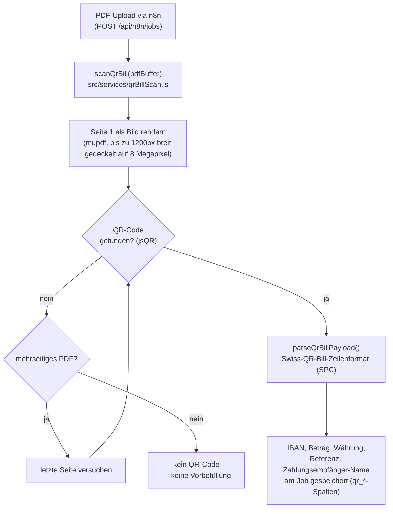
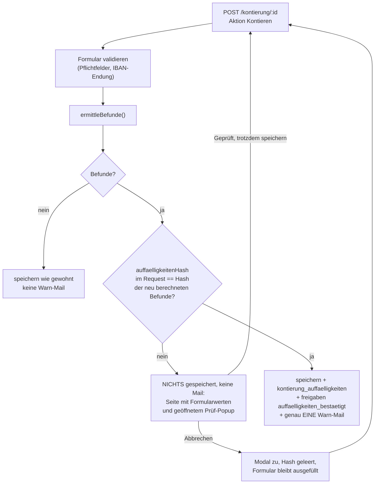

# Swiss-QR-Bill-Erkennung und Betrugserkennung

Zwei zusammenhängende Mechanismen: automatisches Auslesen der Zahlungsdaten
aus einem Swiss-QR-Bill-Code (Komfort) und die **Betrugserkennung bei der
Kontierung**: Das Portal vergleicht die Rechnung mit den Stammdaten des
Lieferanten (hinterlegte IBANs, Name, übliche Beträge) und zeigt der
kontierenden Person Auffälligkeiten in einem Prüf-Popup. Wer sie bewusst
bestätigt, löst eine Warn-Mail an Freigeber 1 und 2 aus; die Auffälligkeiten
bleiben im Verlauf und in den Freigabe-Ansichten sichtbar.

Inhalt: [Zahlungsart und Pflicht-IBAN](#zahlungsart-und-pflicht-iban) ·
[Erkennung beim Rechnungseingang](#erkennung-beim-rechnungseingang) ·
[Die Prüfungen](#die-prüfungen) · [Das Prüf-Popup](#das-prüf-popup) ·
[Manuelle IBAN-Kontrolle](#manuelle-iban-kontrolle-ohne-qr-code) ·
[Aufsplitten](#aufsplitten) · [Schwellen](#schwellen) ·
[Verwaltung der IBANs](#verwaltung-der-hinterlegten-ibans)

## Zahlungsart und Pflicht-IBAN

Jeder Lieferant hat eine **Zahlungsart** (`kreditoren.zahlungsart`, Default
`ueberweisung`). Sie entscheidet, ob eine IBAN hinterlegt sein muss und welche
Prüfungen gelten:

| Zahlungsart | IBAN Pflicht | Verhalten |
|---|---|---|
| `ueberweisung` | ja, mindestens eine | volle IBAN-Prüfung; ohne QR-Code manuelle Kontrolle |
| `dauerauftrag` | ja, mindestens eine | wie Überweisung, aber ohne Prüfung „gleicher Betrag“ |
| `lastschrift` (vom Konto belastet) | nein | keine IBAN-Prüfung; ohne Prüfung „gleicher Betrag“ |
| `kreditkarte` | nein | keine IBAN-Prüfung |

Hat eine Rechnung von einem Lieferanten ohne IBAN-Pflicht trotzdem einen
QR-Code, erscheint die gelbe Auffälligkeit „Lieferant wird sonst per
Lastschrift/Kreditkarte bezahlt“. Ein Lieferant mit Überweisung oder
Dauerauftrag ohne IBAN ist **unvollständig** (`istKreditorVollstaendig`) und
ist weder bei der Kontierung noch beim Aufsplitten, im Kreditkarten-Abgleich
oder in Zuweisungsregeln wählbar (eine Regel auf einen unvollständigen
Lieferanten lässt den Beleg im Pool). Die Migration setzt bestehende Lieferanten
auf `ueberweisung`; wer keine IBAN hat, ist bis zur Nachpflege im Admin
unvollständig.

## Erkennung beim Rechnungseingang

Der Parser erwartet exakt das SIX/SPC-Zeilenformat (Header `"SPC"`,
mindestens 31 Zeilen); IBAN wird normalisiert (Leerzeichen entfernt,
Grossbuchstaben) — reale QR-Bill-Generatoren fügen teils
Gruppierungs-Leerzeichen ein, die sonst zu falschen
IBAN-Mismatch-Meldungen führen würden.

## Die Prüfungen

Auf der Kontierungsseite werden die gescannten QR-Daten als Formular-Vorschlag
angezeigt (Betrag, ggf. vorgeschlagener Lieferant anhand der IBAN). Die
Prüfungen laufen erst beim **Speichern** (Aktion „Kontieren“), serverseitig in
`ermittleBefunde` (`src/services/betrugspruefung.js`), nicht bei Ablehnen,
Rapport oder „Zurück in den Pool“. Rote Befunde stehen vor gelben.

**Mit QR-Code** (`job.qr_iban` vorhanden):

| Code | Auffälligkeit | Bedingung | Schwere |
|---|---|---|---|
| `iban_fremd` | IBAN nicht hinterlegt | QR-IBAN gehört nicht zu den IBANs des gewählten Lieferanten (nur bei Überweisung/Dauerauftrag) | rot |
| `iban_anderer_kreditor` | IBAN gehört einem anderen Lieferanten | QR-IBAN ist bei einem anderen Lieferanten hinterlegt (nennt dessen Namen); ersetzt „IBAN nicht hinterlegt“ | rot |
| `zahlungsart_ohne_iban` | Lieferant wird sonst per Lastschrift/Kreditkarte bezahlt | Lieferant ohne IBAN-Pflicht, Rechnung hat trotzdem einen QR-Code | gelb |
| `name` | Name weicht ab | Zahlungsempfänger im QR-Code passt nicht zum Lieferantennamen | gelb |
| `betrag_qr` | Betrag weicht ab | `qr_betrag` vorhanden und ungleich kontiertem Betrag (exakt, auf Rappen); entfällt bei Splitkindern (`aufgesplittet_von`), deren QR-Betrag der ganzen Rechnung gilt — der Gesamtbetrag wurde schon beim Aufsplitten verglichen | gelb |

Eine frühere Prüfung „ausländische IBAN“ gibt es **nicht**: Swiss-QR-Rechnungen
enthalten nur CH/LI-IBANs; eine fremde IBAN ist bereits durch „IBAN nicht
hinterlegt“ abgedeckt.

**Namensvergleich:** Kleinbuchstaben, Akzente entfernt, Umlaut-Umschreibung
vereinheitlicht (`ae/oe/ue` wie `ä/ö/ü`), Rechtsform-Suffixe (AG, GmbH, SA,
Sàrl, KLG, e.V. …) sowie Satzzeichen und Leerzeichen entfernt. Treffer, wenn ein
Name den anderen enthält. Bewusst **ohne** Tippfehler-Toleranz (kein
Levenshtein): „Muster Druk AG“ gegen „Muster Druck AG“ wird angezeigt;
„MUSTER-DRUCK“ gegen „Muster Druck AG“ nicht.

**Betragsprüfungen** (unabhängig vom QR-Code, nur Typ Rechnung; Gutschriften
bekommen nur die QR-Prüfungen):

| Code | Auffälligkeit | Bedingung (Defaults) |
|---|---|---|
| `betrag_hoch` | Ungewöhnlich hoher Betrag | mindestens 5 frühere Rechnungen **und** Betrag mindestens 3 × deren Durchschnitt **und** mindestens CHF 500. Entfällt, wenn beim Lieferanten „Beträge schwanken stark“ (`betrag_schwankt`) gesetzt ist |
| `neuer_kreditor` | Neuer Lieferant, hoher Betrag | noch keine frühere Rechnung **und** Betrag über CHF 2'000 |
| `gleicher_betrag` | Gleicher Betrag kurz hintereinander | andere Rechnung desselben Lieferanten mit gleichem Betrag innerhalb von 30 Tagen und anderer Rechnungsnummer; nicht bei Dauerauftrag und Lastschrift |

„Frühere Rechnungen“ sind Jobs desselben Lieferanten, Typ Rechnung, mindestens
kontiert (nicht abgelehnt, gelöscht, unzugewiesen, zugewiesen oder
aufgesplittet), ohne den aktuellen Job. Der Durchschnitt läuft über die letzten
12 Monate, sofern dort genug Rechnungen liegen, sonst über alle. Beträge werden
nominal verglichen, es gibt keine Währungsumrechnung.

Der Rechnungsnummer-Duplikat-Check und der Doppelscan-Check bleiben
eigenständig und nicht blockierend (siehe unten); sie erscheinen **nicht** im
Popup.

## Das Prüf-Popup

- Das Popup (Titel „Bitte Rechnung nochmals prüfen“) listet die Befunde, bei
  IBAN-Befunden mit dem Hinweis, die Bankverbindung telefonisch mit einer
  Nummer aus den eigenen Unterlagen zu prüfen, und bietet das optionale Feld
  „Wie hast du geprüft?“ (höchstens 500 Zeichen).
- „Geprüft, trotzdem speichern“ sendet das Formular mit dem Hash über Codes und
  Texte der Befunde erneut. Der Server rechnet die Befunde **neu**; stimmt der
  Hash nicht (anderer Betrag, neue Rechnung im Zeitfenster …), erscheint das
  Popup erneut. Der Hash **schlägt geschlossen fehl**: fehlt er oder ist er
  falsch, gilt das nie als Bestätigung. „Abbrechen“ leert den Hash.
- Ein angehängter **Beleg** lässt sich nicht im Formular vorbefüllen; im Modal
  muss die Datei nochmals gewählt werden.
- Jeder **nicht bestätigte** Popup-Durchgang schreibt ein Ereignis in
  `audit_ereignisse` (`objekt = 'kontierung'`, `aktion =
  'auffaelligkeiten_angezeigt'`, Job-ID, Person, in `nachher` nur die
  Befund-Codes — nie die eingegebene IBAN-Endung oder eine IBAN). So bleibt
  sichtbar, wenn jemand das Popup als Orakel für die letzten 4 IBAN-Zeichen
  missbraucht. Gilt auch beim Aufsplitten.
- Nach der Bestätigung entstehen: eine Zeile in `kontierung_auffaelligkeiten`
  (Befunde, Bemerkung, Person, Zeit; unveränderlich), ein `freigaben`-Eintrag
  `auffaelligkeiten_bestaetigt` und **eine** Mail `auffaelligkeiten-warnung`
  (ersetzt die frühere `iban-warnung`). Empfänger: Freigeber 1 und 2 des Kontos,
  die kontierende Person und die zusätzlich konfigurierten Empfänger
  (`iban_abweichung_empfaenger`, **Admin → Einstellungen → Benachrichtigungen**),
  jede Adresse einmal. Die Mail geht immer sofort, nie gebündelt.
- Die **bestätigten Auffälligkeiten** erscheinen als rot umrandeter Kasten
  „N Auffälligkeiten, bewusst bestätigt“ (mit „Bestätigt von X am …“ und „Wie
  geprüft“) auf der Freigabe-2-Seite, der Kontierungsseite und in der
  Admin-Vorgangsansicht; angezeigt wird immer die jüngste Bestätigung. Der
  Kasten bleibt auch nach einem Validierungsfehler beim Speichern sichtbar.
- Die Warnung blockiert die Kontierung nicht: Wer bestätigt, kann speichern;
  Freigeber 1, 2 und die Empfänger werden informiert und können nachfragen.
- Der Hinweis „QR-Code deutet auf Lieferant X hin, aktuell zugewiesen Y“ auf der
  Kontierungsseite bleibt unabhängig davon bestehen.

## Manuelle IBAN-Kontrolle ohne QR-Code

Hat die Rechnung **keinen** QR-Code, der gewählte Lieferant Überweisung oder
Dauerauftrag und der Typ ist Rechnung, erscheint auf der Kontierungsseite der
gelbe Kasten „Kein QR-Code: IBAN bitte von Hand prüfen“ mit dem Pflichtfeld
**Letzte 4 Zeichen der IBAN** (alphanumerisch, Gross/Klein egal). Der Kasten
erscheint und verschwindet beim Wechsel des Lieferanten; massgeblich ist der
Server (`brauchtManuelleIbanPruefung`).

- Die hinterlegte IBAN wird auf der Kontierungsseite **nie** angezeigt, auch
  nicht teilweise.
- Passen die 4 Zeichen zu keiner hinterlegten IBAN des Lieferanten, gibt es den
  roten Befund `iban_manuell_fremd` („IBAN nicht hinterlegt (manuelle Prüfung)“)
  im Popup.
- In jedem Fall (Treffer oder nicht) wird ein `freigaben`-Eintrag
  `iban_manuell_geprueft` geschrieben: „IBAN manuell geprüft: Übereinstimmung /
  keine Übereinstimmung (Eingabe XXXX)“, mit Person und Zeit.

## Aufsplitten

Die Aufsplitten-Route (`POST /kontierung/:id/aufsplitten`, siehe
[rechnungs-workflow.md](rechnungs-workflow.md#5-aufsplitten-status-zugewiesen--aufgesplittet))
zeigt dasselbe Prüf-Popup wie die Kontierung, aber **einmal für die ganze
Rechnung**: Der Lieferant ist ein **Pflichtfeld** im Aufsplitten-Formular (es
gibt keinen Lieferanten pro Zeile). Vorgewählt ist der im Kontierungsformular
gewählte (`?kreditorId=`), sonst der am Beleg (`job.kreditor_id`); angeboten und
angenommen werden nur aktive, vollständige Lieferanten (`listKreditorenWaehlbar`).
Pool-Belege haben meist noch keinen Lieferanten am Beleg — ohne dieses Feld liefe
die Prüfung ins Leere. Der gewählte Lieferant wird vor dem Anlegen der Kinder am
Elternjob gespeichert (`kreditor_id`, `lieferant`), die Kinder übernehmen ihn.
Die Befunde aus `ermittleBefunde` werden mit dem
**Gesamtbetrag** berechnet (auch der Vergleich mit dem QR-Betrag), es gibt
einen Hash und — ohne QR-Code bei Typ Rechnung und IBAN-pflichtigem
Lieferanten — ein Feld für die letzten 4 Zeichen der IBAN. Ohne passende
Bestätigung wird nichts angelegt. Nach der Bestätigung bekommt jedes Kind
eine `kontierung_auffaelligkeiten`-Zeile und einen freigaben-Eintrag
`auffaelligkeiten_bestaetigt` (bei manueller Prüfung zusätzlich
`iban_manuell_geprueft`); die Warn-Mail `auffaelligkeiten-warnung` geht
einmal an Freigeber 1 + 2 aller Teil-Konten, die splittende Person und die
konfigurierten Empfänger, protokolliert am Elternjob, mit Link aufs erste
Kind, das die splittende Person selbst freigegeben hat (gibt es keins, auf den
Pool — Kinder auf fremden Konten könnten die meisten Empfänger nicht öffnen, den
Elternjob niemand mehr). Wurden Zeilen-Belege angehängt, bietet das Popup für jede dieser
Zeilen ein Datei-Feld zum nochmaligen Auswählen an.

Der Kreditkarten-Abgleich hat kein Popup: `pruefeIbanNachKkAbgleich` schreibt
bei einem IBAN-Befund (`ibanBefund` aus betrugspruefung.js, unabhängig von der
Zahlungsart, sobald mindestens eine IBAN hinterlegt ist) nachträglich
`iban_abweichung` am Elternjob und schickt die Warn-Mail. Geprüft wird gegen
den Kartenherausgeber, wie er nach dem Speichern der Kopfdaten am Elternjob
steht — also auch, wenn er erst im Abgleich-Formular gewählt wurde. Diese IBAN-Warnung ist
nicht blockierend und bleibt bewusst vom Popup und von der Zahlungsart
unabhängig.

## Schwellen

Die Schwellen der Betragsprüfungen liegen in `admin_config` (Defaults in
`src/db/adminConfigRepo.js`); ein fehlender oder ungültiger Wert fällt auf den
Default zurück:

| Schlüssel | Default | Bedeutung |
|---|---|---|
| `pruefung_betrag_min_rechnungen` | 5 | frühere Rechnungen, ab denen „ungewöhnlich hoher Betrag“ geprüft wird |
| `pruefung_betrag_faktor` | 3 | Vielfaches des Durchschnitts |
| `pruefung_betrag_minimum` | 500 | Mindestbetrag in CHF für „ungewöhnlich hoher Betrag“ |
| `pruefung_neuer_kreditor_betrag` | 2000 | Betrag in CHF, ab dem eine erste Rechnung auffällt |
| `pruefung_gleicher_betrag_tage` | 30 | Zeitfenster für „gleicher Betrag kurz hintereinander“ |

## Verwandter, unabhängiger Mechanismus: Rechnungsnummer-Duplikat-Check

Beim Kontieren (normal wie via Aufsplitten) läuft zusätzlich ein zweiter,
ebenfalls nicht-blockierender Check auf **Kreditor + Rechnungsnummer** —
unabhängig vom QR-Bill/IBAN-Mechanismus dieser Seite, aber nach demselben
Muster (Warn-Mail + Audit-Log-Eintrag, blockiert nicht). Details:
[rechnungs-workflow.md](rechnungs-workflow.md#2-kontierung-status-zugewiesen).

## Verwaltung der hinterlegten IBANs

**Admin → Stammdaten → Kreditoren** (Recht `kreditoren_verwalten`) verwaltet pro
Lieferant Zahlungsart, die Checkbox „Beträge schwanken stark“ und beliebig viele
IBANs (`kreditor_ibans`, eindeutig über die gesamte Tabelle: eine IBAN gehört
höchstens einem Lieferanten). Die Liste zeigt Zahlungsart, gekürzte IBANs und
„vollständig“ bzw. „IBAN fehlt“ sowie einen roten Hinweis mit der Anzahl
unvollständiger Lieferanten. Speichern mit Überweisung/Dauerauftrag ohne IBAN
wird abgelehnt; die letzte IBAN eines solchen Lieferanten lässt sich nicht
löschen. Neue IBANs nur aus unabhängiger Quelle (Vertrag, Telefonat) erfassen,
nicht von einer Rechnung.

- **Neue IBANs entstehen nur im Admin** (`quelle = 'manuell'`). Die frühere
  Checkbox „IBAN merken“ auf der Kontierungsseite gibt es nicht mehr; bestehende
  Zeilen mit `quelle = 'bestaetigt'` bleiben gültig.
- **Schnellanlage** eines Lieferanten auf der Kontierungsseite
  (`POST /kontierung/lieferanten`, `src/services/kreditorAnlegen.js`) darf nur,
  wer Superadmin ist oder das Recht `kreditoren_verwalten` hat; Zahlungsart und
  bei Überweisung/Dauerauftrag die IBAN sind Pflicht. Kreditor und erste IBAN
  entstehen atomar.
- **Zwei IBAN-Prüfungen:** Für Kreditor-Stammdaten gilt die internationale
  Prüfung (`isValidIbanInternational`: Ländercode, Länge, Mod-97), sodass auch
  ausländische IBANs erfasst werden können. Für QR-Parser, Spesen-Auszahlung und
  Zahlungsexport bleibt die strenge CH/LI-Prüfung (`isValidIban`, `^CH\d{2}[0-9A-Z]{17}$`) unverändert (`src/services/ibanUtils.js`).
