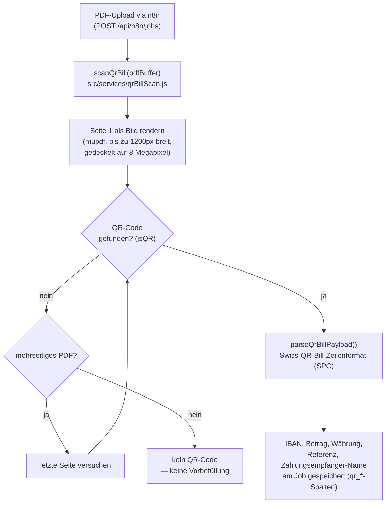
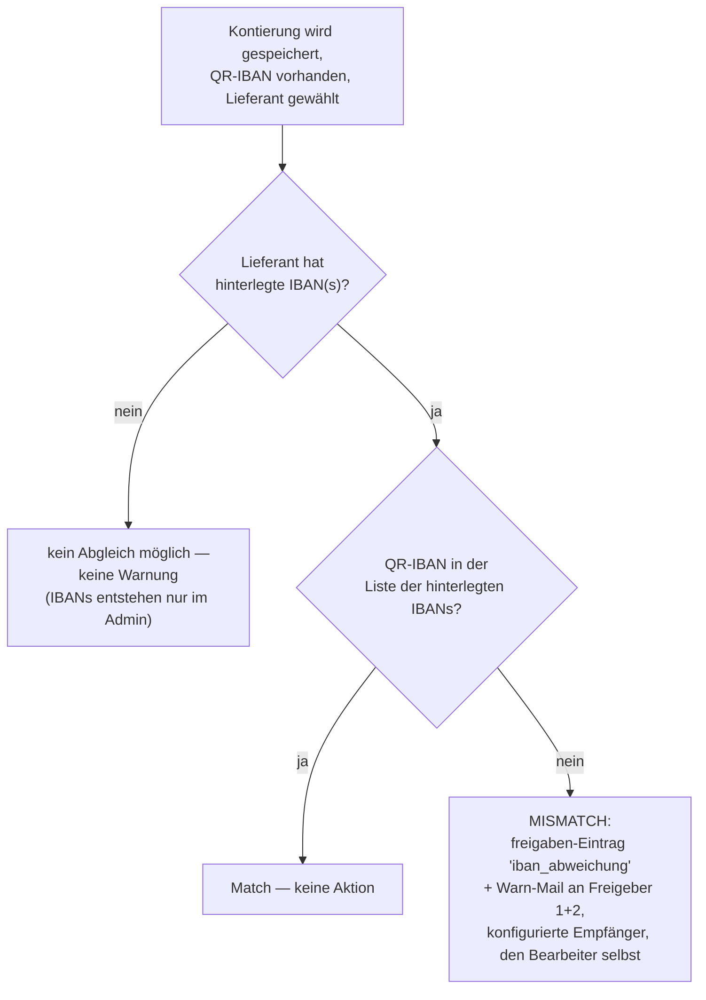

# Swiss-QR-Bill-Erkennung und IBAN-Abgleich

Zwei zusammenhängende, aber unabhängige Mechanismen: automatisches
Auslesen der Zahlungsdaten aus einem Swiss-QR-Bill-Code (Komfort) und ein
Abgleich der darin enthaltenen Zahlungsempfänger-IBAN gegen die für den
gewählten Lieferanten hinterlegten IBANs (Betrugserkennung — z. B. gegen
gefälschte Rechnungen mit manipulierter Kontoverbindung).

## Erkennung beim Rechnungseingang

Der Parser erwartet exakt das SIX/SPC-Zeilenformat (Header `"SPC"`,
mindestens 31 Zeilen); IBAN wird normalisiert (Leerzeichen entfernt,
Grossbuchstaben) — reale QR-Bill-Generatoren fügen teils
Gruppierungs-Leerzeichen ein, die sonst zu falschen
IBAN-Mismatch-Meldungen führen würden.

## Vorbefüllung und Abgleich bei der Kontierung

Auf der Kontierungs-Seite werden die gescannten QR-Daten als
Formular-Vorschlag angezeigt (Betrag, ggf. vorgeschlagener Lieferant
anhand der IBAN). Erst beim tatsächlichen **Speichern** der Kontierung
(mit einem gewählten Lieferanten) läuft der eigentliche
Sicherheits-Abgleich:

Die Warn-Mail blockiert die Kontierung **nicht** — sie ist ein Hinweis,
kein Stopp: die Person kann die Rechnung trotzdem freigeben, aber
Freigeber 1, Freigeber 2 und ggf. weitere konfigurierte Empfänger
(**Admin → Einstellungen → Eskalationszeiten**, Feld "IBAN-Abweichungs-Empfänger") werden
zusätzlich informiert und können gezielt nachfragen.

## Aufsplitten

Die Aufsplitten-Route (`POST /kontierung/:id/aufsplitten`, siehe
[rechnungs-workflow.md](rechnungs-workflow.md#5-aufsplitten-status-zugewiesen--aufgesplittet))
zeigt dasselbe Prüf-Popup wie die Kontierung, aber **einmal für die ganze
Rechnung**: Der Lieferant kommt vom Beleg (`job.kreditor_id`, es gibt keinen
Lieferanten pro Zeile), die Befunde aus `ermittleBefunde` werden mit dem
**Gesamtbetrag** berechnet (auch der Vergleich mit dem QR-Betrag), es gibt
einen Hash und — ohne QR-Code bei Typ Rechnung und IBAN-pflichtigem
Lieferanten — ein Feld für die letzten 4 Zeichen der IBAN. Ohne passende
Bestätigung wird nichts angelegt. Nach der Bestätigung bekommt jedes Kind
eine `kontierung_auffaelligkeiten`-Zeile und einen freigaben-Eintrag
`auffaelligkeiten_bestaetigt` (bei manueller Prüfung zusätzlich
`iban_manuell_geprueft`); die Warn-Mail `auffaelligkeiten-warnung` geht
einmal an Freigeber 1 + 2 aller Teil-Konten, die splittende Person und die
konfigurierten Empfänger, protokolliert am Elternjob, mit Link aufs erste
Kind. Wurden Zeilen-Belege angehängt, bietet das Popup für jede dieser
Zeilen ein Datei-Feld zum nochmaligen Auswählen an.

Der Kreditkarten-Abgleich hat kein Popup: `pruefeIbanNachKkAbgleich` schreibt
bei einem IBAN-Befund (`ibanBefund` aus betrugspruefung.js, unabhängig von der
Zahlungsart, sobald mindestens eine IBAN hinterlegt ist) nachträglich
`iban_abweichung` am Elternjob und schickt die Warn-Mail.

## Verwandter, unabhängiger Mechanismus: Rechnungsnummer-Duplikat-Check

Beim Kontieren (normal wie via Aufsplitten) läuft zusätzlich ein zweiter,
ebenfalls nicht-blockierender Check auf **Kreditor + Rechnungsnummer** —
unabhängig vom QR-Bill/IBAN-Mechanismus dieser Seite, aber nach demselben
Muster (Warn-Mail + Audit-Log-Eintrag, blockiert nicht). Details:
[rechnungs-workflow.md](rechnungs-workflow.md#2-kontierung-status-zugewiesen).

## Verwaltung der hinterlegten IBANs

**Admin → Stammdaten → Kreditoren** (Recht `kreditoren_verwalten`) verwaltet pro
Lieferant beliebig viele IBANs (`kreditor_ibans`, eindeutig über die
gesamte Tabelle — eine IBAN kann nur einem Lieferanten zugeordnet sein).
Validierung einer Schweizer IBAN: `^CH\d{2}[0-9A-Z]{17}$`
(`src/services/ibanUtils.js`) — dieselbe Prüfung wird an allen drei
Stellen verwendet (QR-Parser, Admin-Formular, Kontierungs-Schnellanlage), damit keine
der drei aus der Reihe fällt und dadurch falsche Warnungen erzeugt.

## Nur vollständige Lieferanten wählbar

Lieferanten mit Zahlungsart Überweisung oder Dauerauftrag sind erst wählbar
(Kontierung, KK-Abgleich, automatische Zuweisung per Regel), wenn mindestens eine
IBAN hinterlegt ist. Die Checkbox "IBAN merken" entfällt. Neue Lieferanten (inkl.
Schnellanlage auf der Kontierungsseite) legt nur an, wer Superadmin ist oder das
Recht `kreditoren_verwalten` hat; Zahlungsart und bei Überweisung/Dauerauftrag die
IBAN sind dabei Pflicht.
