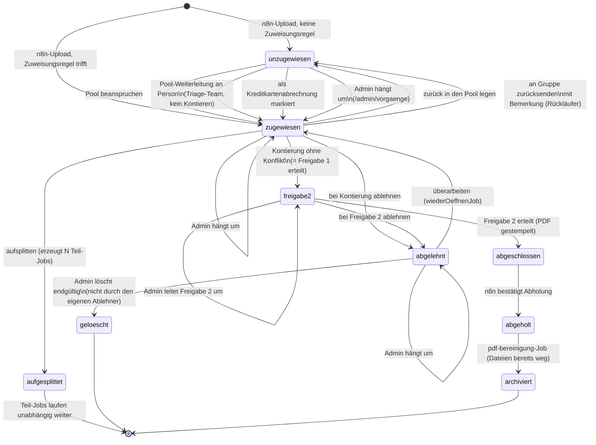
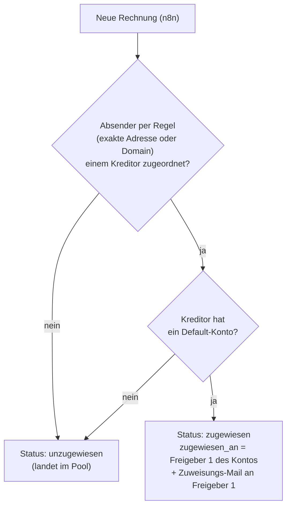
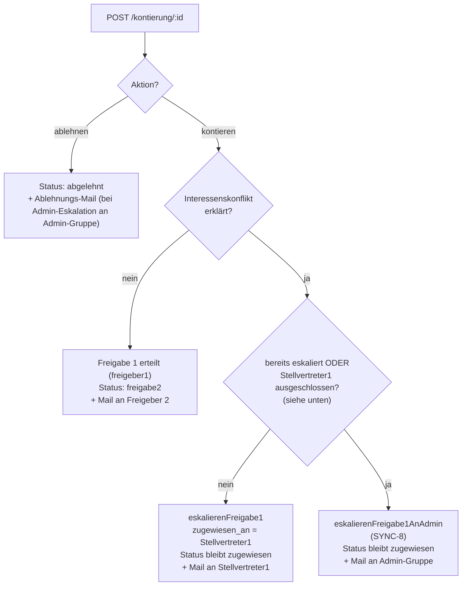
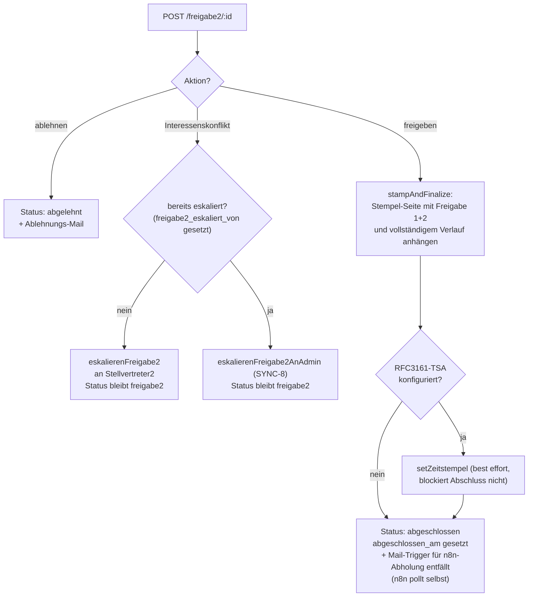

# Rechnungs-Workflow

Der zentrale fachliche Prozess des Portals: eine Rechnung durchläuft
Zuweisung, Kontierung, eine zweistufige, unabhängige Freigabe
(Vier-Augen-Prinzip) und wird danach von n8n abgeholt und archiviert.
Jede Rechnung ist eine Zeile in der `jobs`-Tabelle
(siehe [datenmodell.md](datenmodell.md)); ihr Zustand steckt fast
vollständig in der Spalte `status`.

> Spesen-Einreichungen (Auslagen von Personen selbst erfasst) durchlaufen
> dieselbe `jobs`/Freigabe-Maschinerie, aber mit eigenem Einstieg statt
> Kontierung durch Dritte — eigener Prozess, siehe
> [spesen-einreichung.md](spesen-einreichung.md).

## Status-Modell

| Status | Bedeutung |
|---|---|
| `unzugewiesen` | im Pool, noch niemandem zugewiesen |
| `zugewiesen` | einer Person zur Kontierung zugewiesen |
| `freigabe2` | Kontierung + Freigabe 1 erledigt, wartet auf die zweite, unabhängige Freigabe |
| `abgeschlossen` | beide Freigaben erteilt, PDF final gestempelt (und ggf. zeitgestempelt) |
| `abgeholt` | von n8n abgerufen, lokale PDF-Datei bereits gelöscht |
| `archiviert` | vom nächtlichen Bereinigungs-Job als endgültig archiviert markiert |
| `abgelehnt` | bei Kontierung oder Freigabe 2 zurückgewiesen, wartet auf Überarbeitung |
| `aufgesplittet` | in mehrere unabhängige Teil-Jobs aufgeteilt; bleibt als historische Referenz stehen |
| `geloescht` | endgültig durch einen Admin gelöscht (Soft-Delete, siehe unten) |

> Das Datenbankschema erlaubt per `CHECK`-Constraint zusätzlich die Werte
> `kontiert` und `freigabe1` — diese werden im aktuellen Code nirgends mehr
> gesetzt: Kontierung und Freigabe 1 werden in einem einzigen
> Formular-Submit erledigt und springen direkt von `zugewiesen` zu
> `freigabe2`. Die beiden Werte sind ein Überbleibsel eines früheren
> Entwurfs und aus Kompatibilitätsgründen weiterhin im Constraint erlaubt.

## Status-Diagramm

## 1. Rechnungseingang und automatische Zuweisung

n8n lädt jede eingehende Rechnung per `POST /api/n8n/jobs`
hoch (Details: [n8n-schnittstelle.md](n8n-schnittstelle.md)). Beim Anlegen
prüft `createJob` (`src/db/jobsRepo.js`), ob der Absender zu einer
hinterlegten Zuweisungsregel passt:

Zusätzlich wird beim Eingang automatisch nach einem Swiss-QR-Bill
gesucht (siehe [qr-bill-und-betrugserkennung.md](qr-bill-und-betrugserkennung.md))
und ein Thumbnail gerendert.

## 1a. Pool-Weiterleitung an Personen

Ein additives Einzelrecht `pool_zuweisen` (siehe
[auth-und-rechte.md](auth-und-rechte.md)) erlaubt es, einen
`unzugewiesen`-Pool-Beleg direkt einer Person zuzuweisen
(`POST /pool/:id/zuweisen`), ohne selbst zu kontieren — identisch zum
Ergebnis von "Beanspruchen", nur mit fremder Zielperson. Wählbar sind
aktive Personen mit einer der vier Konto-Rollen (Freigeber1/2,
Stellvertreter1/2) auf mindestens einem aktiven Konto. Die Zielperson
kann den Beleg mit einer Pflicht-Bemerkung an die Gruppe zurücksenden
(`POST /kontierung/:id/an-gruppe-zurueck`) — er landet als "Rückläufer"
(drei `pool_rueckgesendet_*`-Spalten gesetzt) nicht in der normalen
Pool-Liste, sondern in einer eigenen Rückläufer-Sektion, nur für
`pool_zuweisen`-Inhaber sichtbar.

## 2. Kontierung (Status `zugewiesen`)

Nur die zugewiesene Person (bzw. bei SYNC-8-Eskalation an die
Admin-Gruppe: jede Person mit Rolle `superadmin`) darf
`GET/POST /kontierung/:id` aufrufen. Beim Absenden entscheidet das
Formular über drei mögliche Ausgänge:

**Rechnung oder Gutschrift**: ein `typ`-Radio (Default `rechnung`) im
Kontierungsformular setzt `jobs.typ`. Der Betrag bleibt in der Datenbank in
beiden Fällen positiv — allein `typ` trägt die Bedeutung, es gibt keine
Vorzeichen-/Gegenbuchungslogik. Bei `gutschrift` ist das Zahlungsziel
optional (eine Gutschrift hat kein Fälligkeitsdatum), und das
Rechnungsnummer-Feld wird in der UI zu "Gutschriftnummer" umbeschriftet
(gleiche Spalte). Freigabe 1/2 laufen identisch zur normalen Rechnung, kein
Shortcut. Auch beim Aufsplitten (Abschnitt 5) wird der Typ gewählt; er gilt
für alle Teile gemeinsam.

**Strikte Freigeber1-Prüfung (optional, `/admin/module`)**: ist der
Schalter `kontierung_strikte_freigeber1_pruefung` aktiv, gilt Freigabe 1
nur noch als erteilt, wenn die kontierende Person tatsächlich Freigeber1
(oder bei laufender Eskalation: Stellvertreter1) des gewählten Kontos
ist. Andernfalls bleiben die erfassten Daten gespeichert, der Job bleibt
`zugewiesen`, wechselt aber an eine zuständige Person (`freigaben`-Eintrag
`freigabe1_weiterleitung`, Mail an sie) — SYNC-8-Admin-Eskalationen
bleiben davon ausgenommen. Per Default deaktiviert (`'0'`).

Das Weiterleitungsziel (`ermittleStriktesWeiterleitungsZiel` in
`src/services/kontierungZugriff.js`) ist nicht mehr zwingend
`konto.freigeber1_id`: Gewählt wird die erste der Personen
[Stellvertreter 1, falls eine Freigabe-1-Konflikteskalation läuft
(`freigabe1_eskaliert_von` gesetzt), sonst Freigeber 1; danach die jeweils
andere], die auf diesem Job keinen Freigabe-1-Interessenskonflikt erklärt hat
(`freigaben`-Eintrag `freigabe1_eskalation` oder Job-Feld `freigabe1_eskaliert_von`),
nicht die aktuelle Person und aktiv ist. Qualifiziert sich niemand, wird der
Job per `eskalierenFreigabe1AnAdmin` an die Admin-Gruppe eskaliert und diese
erhält die Mail.

Zusätzlich, unabhängig vom Ausgang: ein optional mit hochgeladener
**Beleg** (PDF/PNG/JPEG, z. B. bei Kreditkartenabrechnungen) wird per
`mergeBelegInPdf` (`src/services/belegAnhaengen.js`) als zusätzliche
Seite(n) in die bestehende Rechnungs-PDF eingefügt — als PDF durch
Seiten-Kopie, als Bild durch eine neue, bildgrosse Seite. Beim Kontieren
mit hinterlegtem Kreditor laufen ausserdem zwei unabhängige,
nicht-blockierende Prüfungen: der IBAN-Abgleich gegen den gescannten
QR-Code (siehe
[qr-bill-und-betrugserkennung.md](qr-bill-und-betrugserkennung.md)) sowie
ein Duplikat-Check auf **Kreditor + Rechnungsnummer** — stimmt die
eingegebene Rechnungsnummer mit einem bereits vorhandenen Job desselben
Kreditors überein (auch ein `abgelehnter`, aber kein `geloescht`-Job zählt
mit), wird ein `freigaben`-Eintrag `rechnungsnummer_duplikat` geschrieben
und Freigeber 1+2 des gewählten Kontos sowie die kontierende Person per
Mail informiert (`typ: 'rechnungsnummer-warnung'`, siehe
[geplante-jobs-und-benachrichtigungen.md](geplante-jobs-und-benachrichtigungen.md)) —
die Kontierung wird dadurch nicht blockiert, gleiches Muster wie bei der
IBAN-Abweichung.

**Zurück in den Pool** (`POST /kontierung/:id/zurueck-in-pool`): setzt den
Job auf `unzugewiesen` zurück und löscht alle Konto-/Eskalations-Felder —
ein vollständiger Neustart. Optional kann ein "Hinweis-Konto" mitgegeben
werden, das den vermuteten richtigen Freigeber 1 per Mail informiert, ohne
den Job selbst zuzuweisen.

## 3. Freigabe 2 (Status `freigabe2`)

Autorisiert ist der **effektive Freigeber 2** des Kontos —
`stellvertreter2_id`, wenn der Job bereits einmal eskaliert wurde, sonst
`freigeber2_id` — bzw. die per Admin-Eingriff umgeleitete Person
(`freigabe2_umgeleitet_an`, siehe Abschnitt 8) — bzw. bei
SYNC-8-Eskalation jede `superadmin`-Person. Ein
harter Zusatz-Check verhindert, dass dieselbe Person, die Freigabe 1
erteilt hat, auch Freigabe 2 erteilen kann (Vier-Augen-Prinzip, siehe
[auth-und-rechte.md](auth-und-rechte.md)).

**Interessenskonflikt-Sperre, hart erzwungen**: Ein erklärter Konflikt gehört
zur Rechnung. Wer für diesen Job einen `freigaben`-Eintrag
`freigabe2_eskalation` hat, bekommt bei `/freigabe2/:id` immer 403 —
direkt zuständig, als Ferienvertretung oder als Superadmin — und sieht den
Job nicht unter „Meine Freigaben“. Erreicht ein Job Freigabe 2 erneut
(z. B. Admin-Umhängen → Ablehnung → Überarbeitung) und wäre die effektive
Freigabe-2-Person ein solcher Konfliktmelder, setzt `abschliessenFreigabe1`
`freigabe2_eskaliert_an_admin` und die „Freigabe 2 wartet“-Mail geht an die
Admin-Gruppe. Dasselbe gilt bei Freigabe 1: Konfliktmelder (Einträge
`freigabe1_eskalation` plus `freigabe1_eskaliert_von`) bekommen bei
`/kontierung/:id` und `/spesen-freigabe1/:id` 403; zurück in den Pool bzw.
an die Gruppe geben können sie einen Job weiterhin.

**Ausgeschlossene Stellvertretung → Admin-Gruppe**: Bevor eine
Konfliktmeldung an Stellvertreter 1 bzw. 2 geht, prüft
`ausschlussGrundFuerEskalationsziel` (`src/services/eskalationsZiel.js`), ob
diese Person den Vorgang überhaupt bearbeiten dürfte. Ausgeschlossen ist sie,
wenn sie fehlt, selbst die meldende Person ist, auf dieser Stufe schon einen
Konflikt erklärt hat (aus `freigaben`, also auch nach Umhängen oder
Pool-Rückgabe), bei Freigabe 2 schon Freigabe 1 erteilt hat oder die Spesen
selbst eingereicht hat. Dann geht der Vorgang direkt an die Admin-Gruppe; der
Ausschlussgrund steht im Eskalationsgrund und in der Admin-Mail. Gilt für
Kontierung, Aufsplitten (geprüft gegen den Verlauf der Originalrechnung),
Spesen-Freigabe 1, Freigabe 2 und die Umleitung bei Spesen-Selbsteinreichung
durch Freigeber 2.

Details zur PDF-Stempelung und zum Zeitstempel:
[zeitstempel-und-pruefbescheinigung.md](zeitstempel-und-pruefbescheinigung.md).

**Zahlungsdaten:** Bei einer Rechnung mit Swiss-QR-Bill zeigt Freigabe 2
Empfänger, IBAN, Referenz, QR-Betrag und den Abgleich mit den hinterlegten
Lieferanten-IBANs. Die Freigabe verlangt eine ausdrückliche Bestätigung,
bei Abweichungen eine zweite. Bei Spesen gilt dasselbe für IBAN und
Kontoinhaber aus ChurchTools. Gutschriften und Rechnungen ohne QR-Bill
lösen keine Zahlung aus. Der bestätigte Stand wird im Freigabe-Snapshot
eingefroren und auf die Stempelseite gedruckt; siehe
[export-und-zahlungsintegritaet.md](export-und-zahlungsintegritaet.md).

Ein Job bleibt hier nicht mehr unbegrenzt liegen: der
`freigabe2-erinnerungen`-Job schickt nach einer konfigurierbaren Frist
einen Reminder an den effektiven Freigeber 2 und übergibt den Job nach
einer weiteren Frist automatisch an die Admin-Gruppe (dieselbe
`freigabe2_eskaliert_an_admin`-Übergabe wie beim Interessenskonflikt
oben). Details:
[geplante-jobs-und-benachrichtigungen.md](geplante-jobs-und-benachrichtigungen.md#freigabe2-erinnerungen).

## 4. Ablehnung, Überarbeitung, Löschung

- **Ablehnen** ist sowohl bei der Kontierung (`zugewiesen`) als auch bei
  Freigabe 2 (`freigabe2`) möglich — eine Rechnung muss nicht erst beide
  Stufen durchlaufen, um als ungültig/doppelt erkannt zu werden.
- **Überarbeiten** (`POST /abgelehnt/:id/ueberarbeiten`): nur die Person,
  der die Rechnung zum Zeitpunkt der Ablehnung zugewiesen war (bzw. bei
  Admin-Eskalation: `superadmin`), kann sie zurück auf `zugewiesen`
  setzen und erneut kontieren.
- **Endgültige Löschung** (`POST /admin/abgelehnt/:id/loeschen`,
  Recht `abgelehnt_verwalten`): nur für Rechnungen im Status `abgelehnt`,
  mit Pflicht-Begründung und Bestätigungs-Checkbox. **Selbstschutz**: wer
  die Rechnung selbst abgelehnt hat, darf sie nicht auch selbst löschen —
  das verhindert, dass eine einzelne Person eine Rechnung komplett aus dem
  System entfernen kann. Technisch ein **Soft-Delete**: die Zeile bleibt
  mit Status `geloescht` erhalten (PDF/Thumbnail ebenfalls), zusätzlich
  wird ein unveränderlicher Protokoll-Eintrag in `job_loeschungen`
  geschrieben (siehe [datenmodell.md](datenmodell.md)).

## 5. Aufsplitten (Status `zugewiesen` → `aufgesplittet`)

> Die Splitting-Logik selbst (Schritte 2–3 unten) lebt seit der
> Kreditkarten-Belege-Erweiterung in einem gemeinsamen Service
> `src/services/aufsplitten.js` (`erzeugeTeilJobs`), den sowohl
> `POST /kontierung/:id/aufsplitten` als auch der Kreditkarten-Abgleich
> nutzen — ein als Kreditkartenabrechnung markierter Job durchläuft nicht
> dieses Aufsplitten-Formular, sondern eine eigene Abgleich-Seite mit
> leicht abweichendem Verhalten bei fremden Konten. Details:
> [kreditkarten-belege.md](kreditkarten-belege.md).

Für Sammelrechnungen/Kreditkartenabrechnungen, die auf mehrere Konten
verteilt werden müssen (`GET/POST /kontierung/:id/aufsplitten`):

1. Die Person wählt den **Typ** (Rechnung/Gutschrift, vorbelegt aus dem
   Kontierungsformular bzw. dem gespeicherten `typ`) und gibt den
   Gesamtbetrag und mindestens zwei Teile
   (Konto + Betrag, optional eine Freitext-**Position auf der Rechnung**
   wie "Pos. 3", optional eigener Beleg pro Teil) ein; die Summe der Teile
   muss dem Gesamtbetrag entsprechen (Toleranz 0.005). Der Typ wird auf
   dem Ursprungs-Job und auf jedem Teil-Job gespeichert — eine Mischung
   innerhalb eines Belegs gibt es nicht. Der Typ des Ursprungs-Jobs ist
   massgeblich für die Zahlungsart der Splitgruppe.
2. Der Ursprungs-Job wird auf `aufgesplittet` gesetzt und bleibt als
   historische Referenz stehen — er selbst gilt nie als freigegeben oder
   abgelehnt.
3. Für **jeden Teil** entsteht ein komplett unabhängiger neuer Job (eigene
   PDF-Kopie, eigener Freigabe-Verlauf), inkl. desselben IBAN-Abgleichs und
   Rechnungsnummer-Duplikat-Checks wie im normalen Kontierungsformular
   (Abschnitt 2):
   - Konto gehört der aufsplittenden Person selbst → sofort Freigabe 1
     erteilt, direkt Status `freigabe2` (analog zum Normalfall ohne
     Konflikt).
   - Konto gehört ihr, aber mit erklärtem Interessenskonflikt → wie beim
     Normalfall an Stellvertreter1 bzw. Admin eskaliert.
   - Konto gehört ihr **nicht** → landet als `unzugewiesen`-Teil-Job mit
     Hinweis-Konto zurück im Pool (Freigeber 1 des Ziel-Kontos bekommt
     eine Hinweis-Mail).

> **Bekannte Lücke**: `typ` (Rechnung/Gutschrift, siehe Abschnitt 2) wird
> nicht an die Teil-Jobs weitergegeben — siehe oben.

## 6. Splitgruppen — kombinierter Export statt N Einzel-Buchungen

Ohne weiteres Zutun würde jeder Teil-Job aus Abschnitt 5 einzeln über
Abschnitt 7 an n8n/Bexio geliefert — eine aufgesplittete Rechnung mit drei
Konten entstünde als drei unzusammenhängende Bexio-Buchungen. Stattdessen
führt `pruefeUndFinalisiereSplitGruppe`
(`src/services/splitGruppenExport.js`) eine **Splitgruppe** (alle
Teil-Jobs mit demselben `aufgesplittet_von`-Elternjob) zu einem einzigen
Dokument zusammen, sobald **alle** ihre Teile `abgeschlossen` sind (weder
offen noch abgelehnt/gelöscht):

- Die Original-Belegseiten jedes Teils werden 1:1 kopiert, dahinter **eine
  gemeinsame** Stempel-/Verlaufsseite (`stampGruppenDokument`,
  `src/services/pdfStamp.js`) mit allen Konten, Positionen (Freitext aus
  Abschnitt 5) und allen Freigabe-1/2-Einträgen jedes Teils.
- Das Ergebnis wird RFC3161-zeitgestempelt wie ein normaler Job (siehe
  [zeitstempel-und-pruefbescheinigung.md](zeitstempel-und-pruefbescheinigung.md))
  und in `jobs.gruppe_pdf_pfad`/`gruppe_zeitstempel_*` **auf dem
  Elternjob** abgelegt — der Elternjob (Status bleibt `aufgesplittet`)
  wird dadurch selbst zum Abholobjekt für n8n, nicht mehr seine Kinder
  einzeln (siehe [n8n-schnittstelle.md](n8n-schnittstelle.md)).
- Positionen, Freigaben und die gemeinsame Zahlung stammen aus den
  Freigabe-Snapshots der Teile und werden als unveränderlicher
  Gruppen-Snapshot (`gruppe_freigabe_snapshot`) zusammen mit dem Dokument
  gespeichert. Fehlt ein Snapshot oder haben die Teile unterschiedliche bzw.
  unbestätigte Zahlungsdaten, entsteht kein Dokument; die Gruppe erscheint
  unter Admin → Vorgänge → Altfälle.
- Ausgelöst wird der Merge-Versuch direkt nach Abschluss des jeweils
  letzten offenen Geschwister-Teils und nach Auflösung einer blockierenden
  Ablehnung; der Hintergrund-Job `split-gruppen-nachholen` holt einen
  gescheiterten oder noch unvollständigen Merge alle 15 Minuten nach
  (siehe [geplante-jobs-und-benachrichtigungen.md](geplante-jobs-und-benachrichtigungen.md)).

## 7. Abholung und Archivierung

Nach `abgeschlossen` übernimmt n8n: `GET /api/n8n/jobs/abholbereit` liefert
die Liste. Der neue Archivablauf schreibt einen Exportnachweis fest und
verlangt nach Ablage in Paperless eine Quittung mit Dokument-ID und Dateihash.
Der alte `abholung-bestaetigen`-Endpunkt setzt nur `abgeholt`, ohne Dateien zu loeschen.
Erst mit Archivquittung, nach sieben Tagen und erneutem Hashvergleich darf
`pdf-bereinigung` die lokale Datei entfernen und `archiviert` setzen.
Siehe [Archivvertrag](n8n-paperless-archivierung.md) und
[geplante-jobs-und-benachrichtigungen.md](geplante-jobs-und-benachrichtigungen.md).

## 8. Admin-Eingriff: laufende Vorgänge umhängen

Unter **Admin → Vorgänge → Laufende Vorgänge** (`/admin/vorgaenge`, Recht
`vorgaenge_einsehen`) stehen alle Vorgänge in `unzugewiesen`, `zugewiesen`,
`freigabe2` und `abgelehnt` mit aktuell zuständiger Person und
voraussichtlicher Freigabe-2-Person. Mit `workflow_eingreifen` lässt sich ein
Vorgang auf der Detailseite mit Pflicht-Bemerkung (mind. 10 Zeichen) an eine
andere Person mit Konto-Rolle übergeben:

| Phase | Wirkung |
|---|---|
| `unzugewiesen` | wird `zugewiesen` an die Zielperson (wie Pool-Weiterleitung) |
| `zugewiesen` / `abgelehnt` | `zugewiesen_an` = Zielperson, Admin-Eskalation bei Freigabe 1 aufgehoben |
| `freigabe2` | `freigabe2_umgeleitet_an` = Zielperson, Admin-Eskalation aufgehoben, Erinnerungsuhr startet neu |

Die bisher zuständige Person verliert den Zugriff. Ausgeschlossen sind die
aktuell zuständige Person, bei Freigabe 2 die Person mit Freigabe 1 und alle
Konfliktmelder dieser Stufe, bei Kontierung alle Konfliktmelder bei Freigabe 1,
bei Spesen die einreichende Person. Abgelehnte Spesen sind nicht umhängbar.
Die strikte Freigeber1-Prüfung bleibt in Kraft. Jeder Eingriff erzeugt einen
`freigaben`-Eintrag `admin_umzuweisung` und Mails (`admin-umzuweisung`, immer
sofort) an neue und bisherige Person.

**Effektive Freigabe-2-Person**: Admin-Eskalation → `freigabe2_umgeleitet_an`
→ Stellvertreter 2 (nach Konflikt) → Freigeber 2, danach Ferienvertretung.
Umgesetzt einmal als `getEffectiveFreigeber2Id` und einmal als
`EFFEKTIVER_FREIGEBER2_SQL` (`src/db/jobsRepo.js`). Die Umleitung endet bei
Abschluss, Ablehnung, Admin-Eskalation und jedem Pool-Reset. Erklärt die
umgeleitete Person einen Interessenskonflikt, geht der Vorgang direkt an die
Admin-Gruppe.

**Umhängen setzt Konflikte nicht zurück**: Das Umhängen ändert nur
Routing-Felder (`zugewiesen_an`, `freigabe2_umgeleitet_an`, Admin-Flags).
Die Sperre für Konfliktmelder liest den `freigaben`-Verlauf und greift im
Moment des Handelns (siehe Abschnitt 3), auch wenn der Vorgang später über
Ablehnung und Überarbeitung wieder bei einer gesperrten Person landen
würde. Der Hinweis zur strikten Freigeber1-Prüfung auf der Detailseite nennt
das tatsächliche Weiterleitungsziel (`ermittleStriktesWeiterleitungsZiel`)
bzw. die Admin-Gruppe.

**„Hängt“ in der Übersicht** ist exakt die Menge, die `listStalledJobs`
liefert (siehe unten); ein `freigabe2`-Job, der bereits an die Admin-Gruppe
eskaliert wurde, gilt nie als „überfällig“.

**„Meine abgeschlossenen“** (`listAbgeschlossenJobsForPerson`) enthält
zusätzlich Jobs, bei denen die Person einen `freigaben`-Eintrag mit Rolle
`freigeber2` hat — so sieht auch die nach einer Admin-Umleitung freigebende
Person den Vorgang dort.

## "Stalled Jobs" — blockierte Rechnungen

Ein Job "hängt", wenn die für den nächsten Schritt zuständige Person
deaktiviert wurde oder in ChurchTools nicht mehr auflösbar ist (erkannt
vom nächtlichen Personen-Sync). **Admin → Betrieb → Sync-Übersicht** listet solche
Jobs mit einer Force-Freigeben-Funktion — siehe
[personen-sync.md](personen-sync.md#stalled-jobs).

## Ferienmodus — Abwesenheits-Stellvertretung

Unabhängig vom oben beschriebenen Status-Modell kann jede Person unter `/ferienmodus` einen
Zeitraum mit gewähltem Stellvertreter hinterlegen (`personen.ferienmodus_von`/`ferienmodus_bis`/
`ferienmodus_stellvertreter_id`). Solange der Zeitraum läuft, gilt additiv — kein Job wird
umgeschrieben (`zugewiesen_an`, `konten.freigeber1_id`/`freigeber2_id` bleiben unverändert):

- der Stellvertreter kann `zugewiesen`-Jobs der abwesenden Person kontieren
- der Stellvertreter kann `freigabe2`-Jobs freigeben, deren effektiver Freigeber2 die abwesende
  Person ist
- beide Aufgaben erscheinen im `/pool`-Dashboard des Stellvertreters, zusätzlich zu dessen eigenen
- die abwesende Person behält währenddessen ihren eigenen Zugriff unverändert

Details zur Autorisierung: [auth-und-rechte.md](auth-und-rechte.md#ferienmodus--additive-abwesenheits-stellvertretung).
