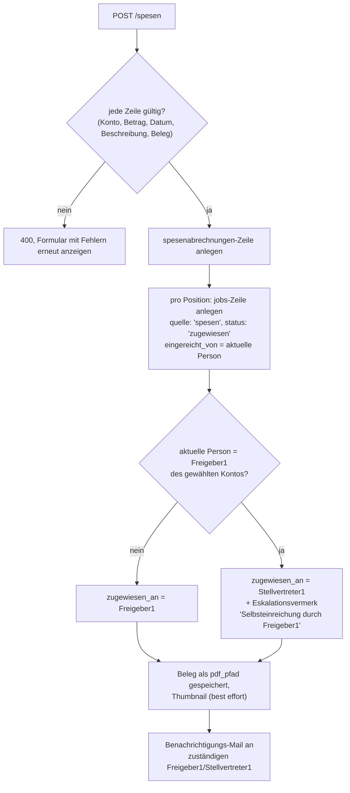

# Spesen-Einreichung

Eine zweite, eigenständige Domäne neben Lieferantenrechnungen: eine Person
erfasst selbst eine Auslage samt Beleg, wählt direkt ein Konto und die
Position durchläuft danach dieselbe Vier-Augen-Freigabekette
(Freigeber 1/2 des gewählten Kontos) wie eine Rechnung. Technisch ist jede
Spesen-Position ein ganz normaler `jobs`-Datensatz
(`quelle = 'spesen'`) — die bestehende Freigabe-Maschinerie
(Status-Automat, Eskalationslogik, Benachrichtigungen, Audit-Log,
Download-Signierung, n8n-Abholung) wird unverändert wiederverwendet. Neu
ist nur, was am Anfang passiert (Einreichung statt Kontierung durch
Dritte) und die eigene Freigabe-1-Review-Seite.

Ursprüngliche Design-Spec:
[2026-08-17-spesen-einreichung-design.md](superpowers/specs/2026-08-17-spesen-einreichung-design.md)
(als Quelle der Wahrheit inzwischen durch diese Seite und den Code
abgelöst).

## Unterschied zur Kontierung

| | Rechnung (Kontierung) | Spesen-Einreichung |
|---|---|---|
| Wer erfasst die Daten | eine Drittperson (Buchhaltung) | die Person selbst, die die Auslage hatte |
| Konto-Auswahl | eingeschränkt auf Konten mit eigener Freigeber-Rolle | **jedes aktive Konto** — jede Person kann auf jedes Konto einreichen |
| Freigabe 1 bei Einreichung | automatisch miterteilt (ausser Interessenskonflikt) | **nie** automatisch — immer eigene Prüfung durch eine andere Person |
| Selbst-Freigabe | durch Konto-Rollen strukturell ausgeschlossen | einreichende Person darf sich **nie** selbst freigeben, siehe unten |

## Datenmodell

Kein Parallelsystem: `quelle`-CHECK auf `jobs` ist um `'spesen'` erweitert
(neben `'scanner'`/`'lieferant'`), plus fünf nur bei Spesen befüllte
Spalten (`eingereicht_von`, `auslage_datum`, `beschreibung`,
`spesenabrechnung_id`, `rechnungsdatum`) und eine schlanke Gruppierungs-
Tabelle `spesenabrechnungen` für die Sammelabrechnung. Details:
[datenmodell.md](datenmodell.md#jobs) und
[datenmodell.md](datenmodell.md#spesenabrechnungen).

## 1. Einreichung (`/spesen/neu`, `src/routes/spesen.js`)

Formular mit mindestens einer, dynamisch hinzufügbaren Positionszeile
(gleiches Zeilen-Klonen/Entfernen-Muster wie die bestehende
Aufsplitten-Seite). Pro Zeile: Konto (jedes aktive, keine
Rollen-Einschränkung), Betrag, Auslage-Datum (nicht in der Zukunft),
Verwendungszweck, Beleg (PDF/PNG/JPEG, Pflicht, max. 20 MB, Bilder höchstens
40 Megapixel (alle Belege einer Einreichung zusammen höchstens 60 MB; die Seite nennt diese Grenzen), Magic-Byte-
geprüft — ein Bild-Upload wird wie beim
[Beleg-Anhängen bei Kontierung](rechnungs-workflow.md#2-kontierung-status-zugewiesen)
serverseitig in eine echte PDF-Seite umgewandelt; ein PDF-Beleg wird wie
ein Rechnungseingang auf Verarbeitbarkeit geprüft — beschädigte,
verschlüsselte oder seitenlose PDFs lehnt das Formular mit einer Meldung pro
Position ab, siehe [n8n-schnittstelle.md](n8n-schnittstelle.md)).

Jede Position ist unabhängig — bei mehreren Positionen mit
unterschiedlichen Konten geht jede an ihren eigenen Freigeber 1. Eine
Sammelabrechnung ist immer rein Spesen (keine gemischten Einreichungen mit
Rechnungspositionen).

**Buchungsart der Konten:** Spesen zählen als Rechnung. Die Konto-Auswahl zeigt nur Konten mit Buchungsart `rechnung` oder `beides`; der Server lehnt Positionen mit einem reinen Gutschrift-Konto ab («Dieses Konto kann nicht für Rechnungen verwendet werden»).

## 2. Freigabe 1 (`/spesen-freigabe1`, `src/routes/spesenFreigabe1.js`, review-only)

Da bei der Einreichung bereits alle Daten erfasst wurden, gibt es für die
prüfende Person nichts mehr einzutragen — strukturell näher an der
Freigabe-2-Seite (reine Anzeige + Freigeben/Ablehnen + Konfliktflag) als
an der Kontierungs-Seite. Autorisierung: Job muss `status = 'zugewiesen'`
und `quelle = 'spesen'` sein, `zugewiesen_an` muss der aktuellen Person
entsprechen (gleicher Admin-Eskalations-Sonderfall wie bei Rechnungen).

Zwei unterschiedliche Konfliktquellen, nicht zu verwechseln:

- **Einreicher = Freigeber1 des Kontos** — bereits bei der Einreichung
  automatisch aufgelöst (siehe oben); die prüfende Person muss hier nichts
  mehr tun.
- **Jeder andere persönliche Konflikt** der prüfenden Person (z. B.
  verwandtschaftlich/finanziell mit der einreichenden Person) — dafür
  bleibt der Konflikt-Radio-Button mit identischer Eskalationslogik wie
  bei der Kontierung (`eskalierenFreigabe1` → Stellvertreter1,
  `eskalierenFreigabe1AnAdmin` bei SYNC-8-Fall).

`freigeben` (kein Konflikt) ruft dieselben Repo-Funktionen wie die
Kontierung im Nicht-Konflikt-Fall (`createFreigabe` mit
`rolle: 'freigeber1'`, `abschliessenFreigabe1`) — Status wechselt zu
`freigabe2`, `zugewiesen_an` auf den effektiven Freigeber 2
(`getEffectiveFreigeber2Id`). `ablehnen` ruft dieselbe `ablehnenJob`-
Funktion wie bei der Kontierung.

## 3. Freigabe 2 — bestehende Seite wiederverwendet

`/freigabe2` (`src/routes/freigabe2.js`/`views/freigabe2.ejs`) läuft für
Spesen-Positionen unverändert — Autorisierung hängt nur an
`konto_id`/`status = 'freigabe2'`. Einzige Änderung: die angezeigten
Detail-Felder schalten per `job.quelle === 'spesen'` um
(Verwendungszweck/Auslage-Datum/Eingereicht-von statt
Lieferant/Rechnungsnummer/Zahlungsziel). Rechnungen und Spesen erscheinen
dadurch gemeinsam in "Meine Freigaben" auf `/pool`.

## 4. Bestätigung an die einreichende Person

Sobald eine Spesenabrechnung vollständig erledigt ist, bekommt die
einreichende Person **eine** Mail (nicht eine je Position) mit den
freigegebenen Positionen, deren Total und den gestempelten Belegen als Anhang
(`src/services/spesenBestaetigung.js`, Mail-Typ `spesen-bestaetigung`). Sie
sagt, dass die Positionen zur Auszahlung vorbereitet werden; die Auszahlung
selbst kennt das Portal nicht, die Mail nennt weder Datum noch IBAN.
Design-Spec:
[2026-11-26-spesen-bestaetigungsmail-design.md](superpowers/specs/2026-11-26-spesen-bestaetigungsmail-design.md).

| Zustand einer Position | zählt als |
|---|---|
| Versand an Bexio gemeldet (Eintrag in `bexio_versand`, siehe [n8n-schnittstelle.md](n8n-schnittstelle.md#versand-an-bexio-bestätigen)) | freigegeben |
| `abgelehnt` oder `geloescht` | nicht durchgekommen |
| alles andere (auch `abgeschlossen` oder `abgeholt` ohne Quittung) | offen — die Mail wartet, auch wochenlang |

Entschieden wird je Abrechnung höchstens einmal
(`spesenabrechnungen.bestaetigung_am`, Vermerk siehe
[datenmodell.md](datenmodell.md#spesenabrechnungen)):

- keine Position freigegeben → keine Mail (die Ablehnungsmails genügen);
- eine freigegebene Position ohne Beleg-Kopie, deren Original-PDF schon
  gelöscht ist (z. B. Versandquittung erst nach der Bereinigung) → keine Mail,
  Vermerk `keine`, Warnung im Server-Log mit der Nummer der Abrechnung;
- Schalter **Admin → Einstellungen → Benachrichtigungen → Spesen freigegeben**
  aus → keine Mail, auch nicht nachträglich;
- einreichende Person ohne Mailadresse → keine Mail (Meldung im Server-Log);
- sonst wird die Mail zusammen mit dem Marker in einer Transaktion eingereiht.

**Auslöser:** eine neue Bexio-Versandquittung, eine Ablehnung in
Spesen-Freigabe 1 oder Freigabe 2 und nachts der Job
[`pdf-bereinigung`](geplante-jobs-und-benachrichtigungen.md#pdf-bereinigung),
der Liegengebliebenes nachholt. Ein Fehler in der Bestätigung
lässt Quittung oder Ablehnung nie scheitern. Die Mail geht immer sofort raus,
nie im Digest; scheitert der Versand, wiederholt `mail-zustellung` ihn.

**Anhänge:** Bei jeder neuen Quittung wird das gestempelte End-PDF kopiert
([`spesen_beleg_kopien`](datenmodell.md#spesen_beleg_kopien)), nur wenn es dem
Hash im Exportnachweis entspricht. Der Anhang heisst
`Spesen-<Abrechnung>-<Position>.pdf`. Sind die Belege zusammen grösser als
15 MB, geht die Mail ohne Anhänge raus und verweist an die Finanzverwaltung;
lässt sich das noch vorhandene Original einer Position nicht kopieren (Hash
weicht ab, Datenträgerfehler), geht der Rest mit einem entsprechenden Hinweis
mit. Mails ganz ohne oder mit unvollständigen Belegen sind im
[Mail-Protokoll](admin-bereich.md#e-mail-protokoll-adminmails) markiert.

**Altbestand:** Abrechnungen, die beim Update schon erledigt waren, wurden
einmalig als `altbestand` markiert und bekommen keine Mail.

## Modul-Deaktivierung

`/admin/module` erlaubt es, das gesamte Spesenmodul auszuschalten
(`admin_config`-Key `modul_spesen_aktiv`, Default aktiv). Deaktiviert:
"Spesen einreichen" verschwindet aus der Seitenleiste (Reiter Portal,
Gruppe Spesen), `GET /spesen/neu`
und `POST /spesen` liefern `403`. **Nicht** betroffen: bereits
eingereichte Positionen — Freigabe 1 (`/spesen-freigabe1`), Freigabe 2
und die n8n-Abholung laufen unverändert weiter, damit eine Deaktivierung
keine hängenden Vorgänge hinterlässt. `/meine-spesen` bleibt als reine
Historie ebenfalls immer erreichbar.

## Navigation

- **Seitenleiste** (Portal → Gruppe Spesen, `src/services/navigation.js`): "Spesen einreichen" → `/spesen/neu` und "Meine Spesen" → `/meine-spesen`; bei deaktiviertem Spesenmodul (Admin → Module) entfällt die ganze Gruppe. Sichtbar
  für jede eingeloggte Person (kein Rollen-/Rechte-Filter, gleiches Niveau
  wie `/kontierung`).
- **`/pool`-Dashboard**: Sektion "Meine offenen Spesen-Freigaben"
  (Positionen mit `status = 'zugewiesen'`, `quelle = 'spesen'`,
  `zugewiesen_an` = aktuelle Person, `linkPrefix: '/spesen-freigabe1'`).
  Die bestehenden Sektionen "Pool", "Meine offenen Kontierungen" und
  "Meine abgelehnten Jobs" schliessen `quelle = 'spesen'` explizit aus —
  sie sind für den Kontierungs-Workflow gebaut, den es bei Spesen nicht
  gibt. "Meine Freigaben" (Freigabe 2) bleibt bewusst typübergreifend.
- **`/meine-spesen`** (eigene Seite, `src/routes/meineSpesen.js`): alle
  eigenen Spesen-Positionen über alle Stati hinweg, reine
  Statusübersicht ohne Aktionslink (ursprünglich eine Sektion auf
  `/pool`, am 2026-08-31 auf eine eigene Seite verschoben, analog zu
  `/meine-abgeschlossenen`).

## n8n-Abholung und Überweisungsdaten

Spesen-Positionen erscheinen im selben `/api/n8n/jobs/abholbereit`-Payload
wie Rechnungen, mit zusätzlichen Feldern (`eingereicht_von`,
`auslage_datum`, `beschreibung`, `rechnungsdatum`, `iban`,
`kontoinhaber`) — siehe
[n8n-schnittstelle.md](n8n-schnittstelle.md#abholung-fertiger-rechnungen).

**IBAN/Kontoinhaber werden bei Freigabe 2 im Freigabe-Snapshot gespeichert.**
Quelle bleiben die ChurchTools-Felder `CT_CUSTOM_FIELD_IBAN` und
`CT_CUSTOM_FIELD_KONTOINHABER`. Der Export verwendet danach dieselben Werte
wie die Stempelseite, ohne erneuten Live-Abruf. Spaetere Stammdatenkorrekturen
aendern eine bereits freigegebene Zahlung nicht stillschweigend.
Neue Freigaben sind bei fehlenden oder nicht abrufbaren Zahlungsdaten gesperrt.
Die Schweizer IBAN wird auf Format und Modulo-97-Pruefsumme geprueft; ein
Kontoinhaber ist Pflicht. Auslaendische IBANs werden derzeit nicht unterstuetzt.
Freigeber 2 ruft zuerst "Zahlungsdaten pruefen" auf und bestaetigt danach IBAN,
Kontoinhaber, Betrag und Konto mit einer nicht vorausgewaehlten Checkbox.
Beim Abschluss werden die ChurchTools-Daten erneut abgerufen. Geaenderte
Zahlungsdaten oder ein geaenderter Vorgangs-/Kontostand verlangen eine neue
Bestaetigung. Identitaet, Zeitpunkt und bestaetigter Stand werden im unveraenderlichen
Freigabe-Snapshot gespeichert. Ablehnen und Eskalieren bleiben ohne Zahlungsdaten moeglich.
Die Pruefsumme bestaetigt weder Kontoinhaberschaft noch die Existenz des Bankkontos.
Altfaelle ohne bestaetigte Zahlungsdaten werden nicht exportiert, bis unter Admin → Vorgänge → Altfaelle
entschieden wurde. Eine Nachbestaetigung zeigt die aktuelle ChurchTools-IBAN ausdruecklich als
aktuellen, nicht historischen Stand; die einreichende Person kann nicht selbst entscheiden.
Siehe [export-und-zahlungsintegritaet.md](export-und-zahlungsintegritaet.md#altfälle).
Die gespeicherten Finanzdaten sind bei Zugriffsschutz und Aufbewahrung zu beruecksichtigen.

## Bewusst nicht gebaut (YAGNI)

- **Kein Spesen-Pool.** Das Konto wird direkt bei der Einreichung
  gewählt, es gibt keine unzugewiesene Phase.
- **Kein Wiederaufnahme-Workflow für abgelehnte Spesen.** Anders als bei
  Rechnungen (`/abgelehnt/:id/ueberarbeiten`) gibt es für Spesen keine
  Bearbeitungsseite — eine abgelehnte Position bleibt in "Meine Spesen"
  sichtbar (mit Ablehnungsgrund); für eine Korrektur reicht die Person
  neu ein. Die Ablehnung ist **endgültig**: Auch der Personen-Sync listet eine
  abgelehnte Spesenposition nicht als hängend und kann sie nicht in den Pool
  zurücksetzen (siehe [personen-sync.md](personen-sync.md)).
- **Keine gemischten Sammelabrechnungen** aus Rechnungs- und
  Spesen-Positionen.
- **Kein Live-Abruf bei Abholung**: Zahlungsdaten kommen aus dem Freigabe-Snapshot.
- **Kein Admin-UI** für den ChurchTools-Custom-Feld-Namen (`.env`-
  Variablen statt `admin_config`, installationsspezifische technische
  Konstante).
