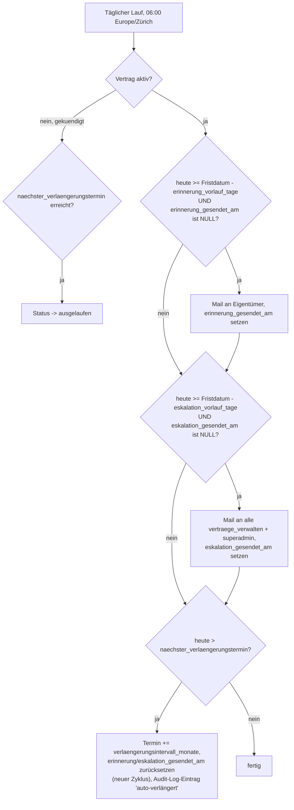

# Vertragsmanagement — Design

Datum: 2026-09-10
Status: Zur Review

Ergänzt am 2026-11-11: Abos, optionale Snipe-IT-Anbindung und
Nextcloud als Dokumentenspeicher.

## Ziel

Laufende Verträge/Abos (Internet, Versicherungen, Software-Lizenzen,
Miete, Wartungsverträge, ...) werden heute nirgends zentral erfasst —
niemand hat einen Überblick, was es gibt, was es kostet und wann
gekündigt werden müsste. Dieses Feature bildet eine schlanke,
eigenständige Registry im Portal ab: pro Vertrag eine verantwortliche
Person (Eigentümer), automatisch berechnete Kündigungsfristen und
rechtzeitige Erinnerungen mit Eskalation, wenn die Frist näher rückt und
niemand reagiert.

## Nicht-Ziele (bewusst ausgeklammert)

- **Keine Verknüpfung zu Lieferanten-Stammdaten, Rechnungen oder
  Bexio.** Reine Fristen-/Stammdaten-Übersicht, kein Ist-Kosten-Abgleich
  gegen tatsächlich bezahlte Rechnungen. Kann später als eigenes Feature
  nachgezogen werden, falls Bedarf entsteht.
- **Kein automatischer Kündigungsversand.** Das Portal markiert nur den
  Status — die Kündigung selbst (Anruf/Brief/Mail an den Anbieter)
  bleibt Sache der verantwortlichen Person.
- **Kein Mehrfach-Eigentümer pro Vertrag.** Genau eine verantwortliche
  Person; Umzuweisen ist jederzeit durch `vertraege_verwalten` möglich.
- **Keine Kosten-Reporting-Auswertung** (Jahresgesamtkosten pro
  Kategorie o.ä.) — YAGNI für den ersten Wurf, die Übersichtsliste mit
  Filtern deckt den geäusserten Bedarf ("Überblick behalten") ab.
- **Keine Erinnerungen für bereits `gekuendigt`/`ausgelaufen`e Verträge.**

## Datenmodell

### `vertrag_kategorien`

```sql
CREATE TABLE vertrag_kategorien (
  id INTEGER PRIMARY KEY AUTOINCREMENT,
  name TEXT NOT NULL UNIQUE,
  aktiv INTEGER NOT NULL DEFAULT 1
);
```

Admin-pflegbar (analog anderer Stammdaten-Listen im Portal). `aktiv = 0`
statt Löschen, damit bestehende Verträge einer deaktivierten Kategorie
nicht verwaisen — deaktivierte Kategorien verschwinden nur aus dem
Auswahl-Dropdown für neue/bearbeitete Verträge.

### `vertraege`

```sql
CREATE TABLE vertraege (
  id INTEGER PRIMARY KEY AUTOINCREMENT,
  anbieter TEXT NOT NULL,
  kategorie_id INTEGER NOT NULL REFERENCES vertrag_kategorien(id),
  beschreibung TEXT,
  eigentuemer_person_id INTEGER NOT NULL REFERENCES personen(id),
  kosten_betrag TEXT,
  kosten_intervall TEXT CHECK (kosten_intervall IN (
    'monatlich', 'vierteljaehrlich', 'halbjaehrlich', 'jaehrlich', 'einmalig'
  )),
  vertragsbeginn TEXT NOT NULL,
  verlaengerungsintervall_monate INTEGER NOT NULL,
  kuendigungsfrist_tage INTEGER NOT NULL,
  naechster_verlaengerungstermin TEXT NOT NULL,
  status TEXT NOT NULL DEFAULT 'aktiv' CHECK (status IN ('aktiv', 'gekuendigt', 'ausgelaufen')),
  gekuendigt_am TEXT,
  gekuendigt_von_person_id INTEGER REFERENCES personen(id),
  erinnerung_gesendet_am TEXT,
  eskalation_gesendet_am TEXT,
  erstellt_am TEXT NOT NULL DEFAULT (datetime('now')),
  aktualisiert_am TEXT NOT NULL DEFAULT (datetime('now'))
);
```

`kosten_betrag` folgt der bestehenden Konvention (`jobs.betrag` ist
ebenfalls `TEXT`, nicht `REAL`, um Rundungsprobleme zu vermeiden) — CHF
wird angenommen (keine Fremdwährungsverträge im Lastenheft).

`naechster_verlaengerungstermin` ist das Datum, an dem sich der Vertrag
automatisch verlängert, wenn nicht rechtzeitig gekündigt wird. Der
tatsächliche Kündigungsfrist-Stichtag ergibt sich daraus zur Laufzeit als
`date(naechster_verlaengerungstermin, '-' || kuendigungsfrist_tage ||
' days')` — bewusst nicht redundant gespeichert, um kein Drift-Risiko
zwischen zwei Datumsfeldern zu haben.

`erinnerung_gesendet_am`/`eskalation_gesendet_am` merken sich, ob für den
**aktuellen** Verlängerungszyklus bereits gemailt wurde (analog
`reminder_gesendet_at`/`eskalation_gesendet_at` bei Pool-Jobs) — beide
werden zurückgesetzt, sobald der Termin automatisch weiterrückt.

### `vertrag_dokumente`

```sql
CREATE TABLE vertrag_dokumente (
  id INTEGER PRIMARY KEY AUTOINCREMENT,
  vertrag_id INTEGER NOT NULL REFERENCES vertraege(id),
  dateiname TEXT NOT NULL,
  nextcloud_datei_id TEXT,
  nextcloud_pfad TEXT NOT NULL UNIQUE,
  sha256 TEXT NOT NULL,
  etag TEXT,
  mime_typ TEXT NOT NULL,
  groesse_bytes INTEGER NOT NULL,
  hochgeladen_von_person_id INTEGER REFERENCES personen(id),
  hochgeladen_am TEXT NOT NULL DEFAULT (datetime('now'))
);
```

Dateien werden zentral in Nextcloud gespeichert und vom Portal über
WebDAV hochgeladen und gelesen. Ein lokales `VERTRAEGE_DIR` als dauerhafte
Ablage entfällt. Erlaubt bleiben PDF/JPG/PNG mit maximal 20 MB pro Datei;
Dateityp und Grösse werden vor der Übertragung serverseitig geprüft.
Die Tabelle speichert Zuordnung, Nextcloud-Dateikennung (soweit von der
Installation geliefert), relativen Pfad, SHA-256-Prüfsumme, ETag und
Dateimetadaten. Konkrete Migration und Schnittstellen werden im
Implementierungsplan ausgearbeitet.

### Nextcloud-Ablage und Zugriff

- Eigener Basisordner für das Portal, mit einem Unterordner je Vertrag,
  z. B. `Vertraege/123-Adobe/`. Die Vertrags-ID ist massgeblich;
  Anbieteränderungen benennen Ordner nicht automatisch um. Dateien
  erhalten kollisionsfreie interne Namen, der Originalname bleibt in
  der Datenbank erhalten.
- Upload, Vorschau und Download erfolgen im Portal. Vor jedem Zugriff
  prüft es Eigentümerschaft bzw. `vertraege_verwalten` und liefert die
  Datei serverseitig aus. Ein persönlicher Nextcloud-Zugang ist dafür
  nicht nötig; es werden keine öffentlichen Freigabelinks erzeugt.
- Technischer Zugang über ein separates Nextcloud-Konto mit Zugriff
  ausschliesslich auf die Vertragsablage und eigenem App-Passwort über
  HTTPS. Zugangsdaten bleiben in der geschützten Serverkonfiguration
  und erscheinen weder im Browser noch in Protokollen oder Datei-URLs.
- Direkte Zugriffe in Nextcloud folgen deren eigenen Rechten und können
  die feinere Portalprüfung umgehen. Der Basisordner darf deshalb nicht
  pauschal an alle Vertragsverantwortlichen freigegeben werden.
- Pfade entstehen serverseitig unter dem konfigurierten Basisordner;
  vom Benutzer übergebene externe URLs oder beliebige WebDAV-Pfade
  werden nicht als Dokumentziel akzeptiert.

### Konsistenz und Ausfälle

- Ein Upload gilt erst nach bestätigter Speicherung in Nextcloud und
  erfolgreicher Metadatenspeicherung als abgeschlossen. Da Datenbank und
  WebDAV keine gemeinsame Transaktion besitzen, muss die Umsetzung
  abgebrochene Uploads und verwaiste Dateien erkennen und bereinigen
  können. Wiederholungen dürfen keine bestehenden Dateien überschreiben.
- Extern verschobene oder gelöschte Dateien werden anhand von Kennung
  und Pfad erkannt; geänderte Inhalte anhand von ETag und Prüfsumme.
  Vor Auslieferung wird der Inhalt gegen die gespeicherte Prüfsumme
  geprüft. Abweichungen erscheinen als verständlicher Hinweis; eine
  geänderte Fassung wird nicht stillschweigend als Original ausgegeben.
- Die erste Version führt keine automatische bidirektionale
  Ordnersynchronisation ein. Externe Änderungen müssen ausdrücklich
  zugeordnet oder als neues Dokument übernommen und auditiert werden.
- Bei Nextcloud-Ausfall bleiben Vertragsdaten, Bearbeitung ohne
  Dateioperationen und Erinnerungen verfügbar. Upload und Download
  melden den Ausfall mit erneuter Versuchsmöglichkeit; fehlgeschlagene
  Uploads werden nicht als erfolgreich dargestellt.
- Auch Dokumentlöschung benötigt eine nachvollziehbare Behandlung
  partieller Fehler. Metadaten dürfen nicht vor bestätigter Dateilöschung
  unwiederbringlich verschwinden; offene Bereinigungen bleiben sichtbar.

### Backup und Wiederherstellung

Das Portal-Backup sichert Vertragsdaten, Dokumentzuordnungen, Pfade und
Prüfsummen. Die PDFs sind darin nicht enthalten. Nextcloud benötigt eine
eigene vollständige Sicherung mit Dateien, Datenbank und Konfiguration.
Die Sicherungen müssen zeitlich zuordenbar sein; ein dokumentierter
gemeinsamer Restore mit Prüfung der Dateizuordnungen und Prüfsummen ist
Voraussetzung für die Betriebsabnahme. Nextcloud-Zugangsdaten werden
nach den bestehenden Regeln für Geheimnisse separat abgesichert.

### Additive Rechte — neuer 9. Wert

`person_berechtigungen.berechtigung` CHECK wird um `vertraege_verwalten`
erweitert (gleiches Tabellen-Rebuild-Migrationsmuster wie bei
`pool_zuweisen`, siehe `migrateTable`-Vorlage in `src/db/index.js`).
`superadmin` erhält das Recht automatisch über sein Rollen-Bundle
(`src/middleware/roles.js`/`permissions.js`), wie alle acht bestehenden
Rechte auch.

**Zugriffsmodell auf `/vertraege`:**

| Person hat... | sieht |
|---|---|
| `vertraege_verwalten` (inkl. `superadmin`) | alle Verträge, Filter nach Kategorie/Status/"läuft bald ab", kann anlegen/bearbeiten/löschen/Eigentümer umziehen |
| nichts davon, ist aber `eigentuemer_person_id` bei ≥1 Vertrag | nur die eigenen Verträge, kann Kosten/Dokumente/Beschreibung pflegen und selbst kündigen, aber keinen neuen Vertrag anlegen und keinen Eigentümer ändern |
| keins von beidem | kein Zugriff auf `/vertraege*` |

Eine Person kann beides gleichzeitig sein (z.B. Buchhaltung verwaltet
alle Verträge und ist gleichzeitig Eigentümer der Internet-Verträge) —
dieselbe Seite, nur mit erweiterter statt gefilterter Sicht. Kein
separates `/meine-vertraege` nötig, im Gegensatz zu "Meine Spesen"
(dort ist die Einreich-Rolle strukturell komplett anders als die
Freigabe-Rolle; hier ist "Eigentümer" einfach der Default-Filter für
alle ohne Verwaltungsrecht).

## Status-Workflow

```
aktiv --[Eigentümer/Verwaltung klickt "Kündigen"]--> gekuendigt
aktiv --[Termin erreicht, keine Kündigung]--> aktiv (Termin rückt automatisch weiter, neuer Zyklus)
gekuendigt --[naechster_verlaengerungstermin erreicht]--> ausgelaufen
```

`gekuendigt` heisst: die Kündigung wurde im Portal erfasst, der Vertrag
läuft aber vertragsgemäss noch bis `naechster_verlaengerungstermin`
weiter — der Vertrag bleibt bis dahin in der Übersicht sichtbar (Status
"gekündigt, läuft aus am ..."), erhält aber keine Erinnerungen mehr.
`ausgelaufen` ist der Endzustand, rein informativ für die Übersicht
("was hatten wir mal") — keine weiteren Übergänge.

## Erinnerung, Eskalation, Auto-Verlängerung

Ein neuer täglicher Job `vertrag-erinnerungen` (Scheduler-Muster wie die
bestehenden sechs Jobs, `src/services/cronJobs.js` +
`src/services/scheduler.js`, zusätzlich über `POST
/internal/cron/vertrag-erinnerungen` und einen "Jetzt ausführen"-Button
unter **Admin → Geplante Jobs** erreichbar):



Zwei neue `admin_config`-Schlüssel (eigene Seite **Admin → Verträge**,
zusammen mit der Kategorien-Verwaltung, nicht auf der bestehenden
Eskalationszeiten-Seite — dort sind alle Schwellen stunden- statt
tagesbasiert):

```
vertrag_erinnerung_vorlauf_tage   (Default '30')
vertrag_eskalation_vorlauf_tage   (Default '7')
```

Reihenfolge im Job ist bewusst Erinnerung-dann-Eskalation-dann-Ablauf in
einem einzigen Lauf (nicht vier separate Durchläufe) — ein Vertrag mit
sehr kurzem Vorlauf kann so an einem Tag direkt in den eskalierten
Zustand fallen, ohne auf den nächsten Tag zu warten.

## Mail-Vorlagen

Zwei neue `mail_log.typ`-Werte (`vertrag-erinnerung`,
`vertrag-eskalation`, gleiche CHECK-Rebuild-Migration wie bei den
bestehenden sieben Typen) und zwei neue Vorlagen im bestehenden
Mail-Vorlagen-System (`src/services/mailTemplates.js`,
`docs/superpowers/specs/2026-09-07-mail-vorlagen-und-batching-design.md`):

| Typ | Variablen (zusätzlich zu `%portalName%`) |
|---|---|
| vertrag-erinnerung | `%anbieter%`, `%kategorie%`, `%fristDatum%`, `%link%` |
| vertrag-eskalation | `%anbieter%`, `%kategorie%`, `%eigentuemerName%`, `%fristDatum%`, `%link%` |

Beide respektieren das bestehende Batching (`mail_batching_aktiv`) wie
jeder andere Typ auch — kein Sonderfall nötig, das ist bereits generisch
über `mail_log.typ` gebaut.

## Routen und Seiten

| Route | Zugriff | Zweck |
|---|---|---|
| `GET /vertraege` | `vertraege_verwalten` oder Eigentümer ≥1 Vertrag | Übersicht, gefiltert nach Rolle (siehe Zugriffsmodell oben); Filter Kategorie/Status/"Frist in nächsten 90 Tagen" |
| `GET /vertraege/neu`, `POST /vertraege` | `vertraege_verwalten` | Vertrag anlegen |
| `GET /vertraege/:id` | Eigentümer des Vertrags oder `vertraege_verwalten` | Detailseite: Stammdaten, Dokumente, Verlauf |
| `GET /vertraege/:id/bearbeiten`, `POST /vertraege/:id` | Eigentümer (eigene Felder) oder `vertraege_verwalten` (alle Felder inkl. Eigentümer-Wechsel) | Bearbeiten |
| `POST /vertraege/:id/kuendigen` | Eigentümer oder `vertraege_verwalten` | Status -> `gekuendigt`, `gekuendigt_am`/`gekuendigt_von_person_id` setzen |
| `POST /vertraege/:id/dokumente` | Eigentümer oder `vertraege_verwalten` | PDF/JPG/PNG hochladen (multer memoryStorage, gleiche Grenzen wie Beleg-Upload) |
| `GET /vertraege/:id/dokumente/:docId` | Eigentümer oder `vertraege_verwalten` | Dokument herunterladen |
| `POST /vertraege/:id/loeschen` | `vertraege_verwalten` | Vertrag komplett löschen (inkl. Dokumente) — nur für Fehlerfassungen, kein Soft-Delete nötig, da kein Compliance-Bezug wie bei Rechnungen |
| `GET/POST /admin/vertraege/kategorien` | `vertraege_verwalten` | Kategorien anlegen/deaktivieren |
| `POST /admin/vertraege/einstellungen` | `vertraege_verwalten` | Erinnerungs-/Eskalations-Vorlauftage |

Neuer Navigationspunkt "Verträge" im Hauptmenü, sichtbar für jede Person
mit Zugriff auf mindestens eine der obigen Seiten (gleiche
Sichtbarkeits-Logik wie bei anderen rollenabhängigen Menüpunkten).

## Integration in bestehende Systeme

- **Audit-Log:** Anlegen, Bearbeiten, Kündigen, Auto-Verlängerung und
  Dokument-Upload/-Löschung werden ins bestehende globale Audit-Log
  geschrieben (gleiche Helper-Funktion wie andere Module) — macht das
  Feature von Anfang an durchsuchbar, ohne eigenes Log zu bauen.
- **Nextcloud und Backup:** Dokumente liegen in Nextcloud; das Portal
  sichert die Metadaten. Die separate Nextcloud-Sicherung und der
  gemeinsame Restore werden wie oben beschrieben in die Betriebsabnahme
  aufgenommen.
- **Geplante Jobs:** `vertrag-erinnerungen` erscheint unter **Admin →
  Geplante Jobs** wie jeder andere Job.

## Tests

- Unit: Berechnung des Fristdatums und der Verlängerungslogik
  (insbesondere Monatsende-Randfälle, z.B. 31. Januar + 1 Monat).
- Unit: Job-Logik für Erinnerung/Eskalation/Auto-Verlängerung/Ablauf mit
  gefaketem "heute".
- Integration: Zugriffskontrolle pro Route (Eigentümer sieht nur eigene,
  `vertraege_verwalten` sieht alle, Person ohne beides bekommt 403).
- `csrfSweep.test.js`-Routenanzahl-Check aktualisieren (neue POST-Routen).
- Nextcloud: Upload/Download mit Berechtigungsprüfung, Dateityp- und
  Grössenbegrenzung, keine Pfadüberschreitung und keine öffentlichen Links.
- Nextcloud: Ausfall, abgebrochener Upload, partielle Löschung und
  Wiederholungen; keine falschen Erfolgsmeldungen oder Überschreibungen.
- Nextcloud: extern verschobene, fehlende oder inhaltlich geänderte
  Dokumente erkennen; Erinnerungen laufen bei Speicherausfall weiter.
- Betriebsabnahme: gemeinsamer Restore von Portal und Nextcloud mit
  Prüfung von Zuordnungen und Dateiprüfsummen.

## Ergänzung: Abos und Snipe-IT

Software- und Dienst-Abos (z. B. Adobe oder Spotify) werden als Verträge
geführt. Die folgenden Anforderungen ergänzen das obige Datenmodell;
eine konkrete Migration und ein Implementierungsplan stehen noch aus.

### Zusätzliche Abo-Daten

- Vertragsart (Abo, Versicherung, Miete, Wartung oder Sonstiges),
  Produkt/Tarif und gegebenenfalls Anzahl Lizenzplätze.
- Konto-E-Mail-Adresse und Verwaltungslink beim Anbieter. Passwörter
  bleiben im Passwortmanager; optional wird dessen Eintrag referenziert.
- Zahlungsweg (Rechnung, Lastschrift oder Firmenkarte) und optionaler
  Verweis auf die vorhandene Karte; keine zusätzlichen Kartengeheimnisse.
- Bereich/Kostenstelle sowie automatische oder manuelle Verlängerung.
- Kündigungsfrist, Abrechnungsintervall und tatsächliches Nutzungsende
  bleiben getrennte Angaben, auch bei monatlich kündbaren Abos.

### Zuständigkeiten

Das Portal führt Vertragsdokumente, Kosten samt Zahlungsintervall,
Verantwortlichkeit, Kündigungsfristen und Erinnerungen. Snipe-IT führt
Software-Lizenzen und deren Zuweisung an Personen oder Geräte.
Lizenzzuweisungen werden zunächst ausschliesslich in Snipe-IT gepflegt.

### Optionale Übertragung Portal → Snipe-IT

- Pro geeignetem Software-Abo lässt sich eine vorhandene Snipe-IT-Lizenz
  verknüpfen oder ausdrücklich eine neue anlegen. Nicht jedes Abo muss
  synchronisiert werden.
- Übertragen werden Produktname, Lizenzanzahl, Lizenznehmer-E-Mail,
  Anbieter sowie ein ausdrücklich gepflegtes Lizenzablaufdatum, soweit
  die Zielinstallation diese Felder unterstützt. Die Kündigungsfrist
  darf nicht als Lizenzablauf verwendet werden.
- Kosten werden erst übertragen, wenn die Bedeutung des Snipe-IT-
  Kostenfelds festgelegt ist: monatliche Abo-Kosten dürfen nicht ohne
  vereinbarte Umrechnung als Anschaffungskosten erscheinen.
- Die externe Lizenz-ID wird dauerhaft gespeichert. Wiederholungen
  aktualisieren dieselbe Lizenz; nach unklarem Ausgang einer Neuanlage
  wird zuerst abgeglichen, bevor nochmals angelegt wird.
- Beide Einträge erhalten einen gegenseitigen Verweis. Welche Felder
  das Portal führt und überschreiben darf, wird bei der Verknüpfung
  sichtbar gemacht; Zuweisungen werden nicht überschrieben.
- Synchronisation erfolgt nach erfolgreicher Speicherung des Vertrags.
  Fehler verhindern die lokale Speicherung nicht, bleiben sichtbar und
  können erneut versucht werden. Letzter Erfolg und Fehlerstatus werden
  protokolliert; Zugangstoken erscheinen nicht im Audit-Log.
- Kündigung und Löschung eines Vertrags löschen keine Lizenz automatisch
  und ziehen keine Lizenzplätze ein. Das Nutzungsende wird separat geprüft.
- Verknüpfung und Übertragung benötigen das Verwaltungsrecht
  `vertraege_verwalten` und werden im Audit-Log erfasst.

Ob die Anbindung direkt per API oder über n8n erfolgt, bleibt für den
Implementierungsplan offen. Vor Umsetzung werden Snipe-IT-Version,
Feldzuordnung und ein eingeschränkt berechtigter API-Zugang geprüft.

### Zusätzliche Abnahmekriterien

- Verknüpfen bestehender Lizenzen erzeugt keine Duplikate.
- Wiederholte Übertragung und Wiederaufnahme nach einem Fehler bleiben
  ohne doppelte Neuanlage; bestehende Lizenzzuweisungen bleiben erhalten.
- Kündigungsfrist und Nutzungsende werden unabhängig getestet.
- API-Ausfall lässt Vertragsbearbeitung und Erinnerungen weiterlaufen.
- Unberechtigte Personen können keine Verknüpfung oder Übertragung auslösen.

## Offene Punkte für die Review

- Löschen ist hart (kein Soft-Delete) — falls doch eine Historie
  gewünscht ist (z.B. für spätere Auswertung "was hatten wir alles"),
  wäre ein Status `geloescht` statt echtem `DELETE` die Alternative,
  analog zum bestehenden Muster bei Rechnungen.
- `verlaengerungsintervall_monate` als reine Zahl (z.B. 12) statt fixer
  Auswahl (monatlich/jährlich/...) — flexibler für unübliche Intervalle
  (z.B. 24 Monate Mindestlaufzeit), aber weniger selbsterklärend im
  Formular. Kann im Formular als Dropdown mit gängigen Werten +
  "custom"-Eingabe gelöst werden.
