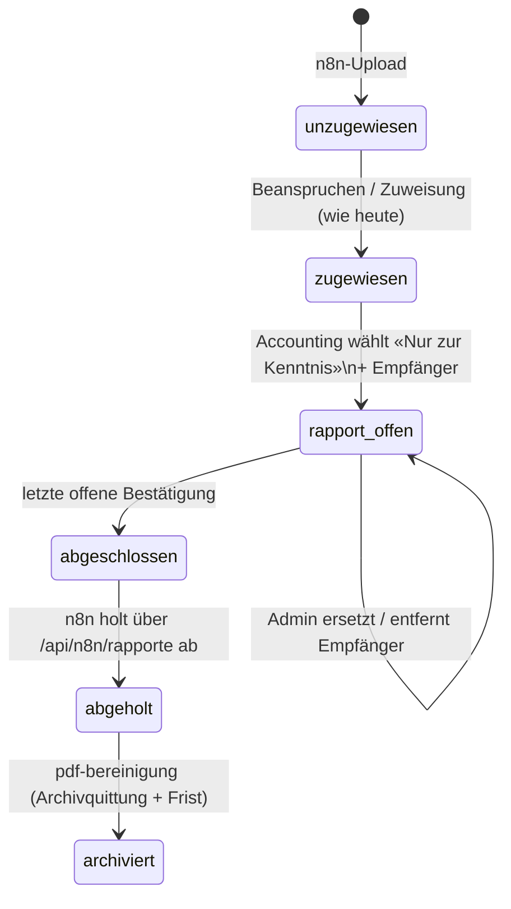

# Rapporte: Dokumente «nur zur Kenntnis» — Design

Datum: 2026-11-06
Status: Entwurf, zur Freigabe

## Ausgangslage / Problem

Über n8n landen nicht nur Rechnungen und Gutschriften im Portal, sondern
auch Dokumente, die weder kontiert noch gebucht werden: Rapporte,
Berichte, Mitteilungen. Heute kennt das Portal nur `jobs.typ =
'rechnung' | 'gutschrift'`, und jeder Beleg läuft auf Kontierung →
Freigabe 1 → Freigabe 2 → Bexio-Export hinaus. Für einen Rapport bleibt
nur Ablehnen und anschliessendes Löschen. Das bildet den Vorgang falsch
ab: Im Audit-Log steht «abgelehnt», obwohl am Dokument nichts falsch
war, und wer es hätte lesen sollen, wird nie belegt.

Beim Arbeitgeber des Betreibers gibt es dafür einen eigenen Weg:
Solche Dokumente werden zur Kenntnis gegeben, bestätigt und sind dann
abgeschlossen, ohne Weiterleitung zur Buchung.

## Ziel

Ein dritter Belegweg «Rapport / nur zur Kenntnis»:

1. Das **Accounting** entscheidet bei einem eingegangenen Beleg, dass es
   ein Rapport ist, und wählt **eine oder mehrere Personen** aus.
2. Diese Personen sehen den Rapport als Aufgabe im Portal und bestätigen
   ihn mit einem Klick «Zur Kenntnis genommen».
3. Erst wenn **alle** ausgewählten Personen bestätigt haben, ist der
   Rapport abgeschlossen.
4. Wer nicht bestätigt, wird erinnert. Danach wird **zum Admin
   eskaliert**, analog zu den anderen Vorgängen.
5. Abgeschlossene Rapporte holt n8n über einen **eigenen Endpunkt
   `/api/n8n/rapporte`** ab und archiviert sie. Danach werden sie wie
   jeder andere Beleg nach den normalen Regeln lokal gelöscht.

## Nicht-Ziele

- Keine Kontierung, kein Konto, kein Kreditor, kein Betrag, keine
  Freigabe 1/2, kein Bexio-Export, keine Zahlung.
- Kein «Zurückweisen» durch Empfänger. Wer findet, der Rapport
  betreffe ihn nicht, schreibt einen Kommentar (bestehende
  Kommentarfunktion). Korrekturen macht der Admin über das Umhängen
  (siehe unten). *Entscheid des Betreibers.*
- Kein Erkennen von Rapporten beim Eingang. Die Entscheidung trifft
  immer ein Mensch.
- Keine Kombination mit dem Aufsplitten. Ein Rapport ist immer ein
  ganzes Dokument.
- Keine Spesen- oder Kreditkarten-Rapporte. Der Weg gilt nur für Belege
  aus n8n (`quelle` `scanner` / `lieferant`).

## Anti-Ziele (wäre ein Fehlschlag, auch wenn es technisch läuft)

- **Ein Rapport erscheint in `GET /api/n8n/jobs/abholbereit`** oder lässt
  sich über die bestehenden `/api/n8n/jobs/*`-Endpunkte exportieren oder
  quittieren. Der bestehende n8n-Workflow unterscheidet nur zwischen
  `rechnung` und `gutschrift` und würde einen unbekannten Typ womöglich
  als Rechnung nach Bexio buchen. Rapporte dürfen **ausschliesslich**
  über `/api/n8n/rapporte/*` sichtbar sein. Das braucht einen
  Regressionstest auf beiden Seiten.
- Ein Rapport landet in Rechnungs-Auswertungen, im Duplikat-/IBAN-Check,
  im Kreditkarten-Abgleich oder in Zahlungsnachweisen. Ausnahme, *meine
  Wahl:* Die bytegenaue Hash-Prüfung beim Eingang (`datei_hash`) erkennt
  Rapporte weiterhin. Ein zweimal eingereichter Rapport kommt also nicht
  als neuer Beleg herein und kann nicht versehentlich als Rechnung gebucht
  werden. Die fachlichen Prüfungen (Kreditor + Nummer, Doppelscan nach
  Kreditor/Betrag/Zahlungsziel) laufen erst bei der Kontierung und
  betreffen Rapporte ohnehin nicht, weil diese Felder fehlen.
- Ein Rapport gilt als abgeschlossen, obwohl eine ausgewählte Person
  noch nicht bestätigt hat und auch nicht vom Admin entfernt oder
  ersetzt wurde.
- Ein Admin «bestätigt» stellvertretend für eine andere Person. Eine
  Kenntnisnahme ist persönlich.

## Ablauf

(Statusnamen im Diagramm sind illustrativ, siehe «Datenmodell».)

### 1. Als Rapport markieren (Accounting)

- Im Kontierungsformular (`GET/POST /kontierung/:id`) gibt es neben
  «Rechnung» und «Gutschrift» eine dritte Wahl **«Nur zur Kenntnis
  (Rapport)»**. Wer heute den Beleg kontieren darf, darf ihn auch als
  Rapport markieren. Das ist die zugewiesene Person, bei
  Admin-Eskalation die Admin-Gruppe. Neue Rechte gibt es nicht.
- Bei dieser Wahl werden die Kontierungsfelder (Konto, Kreditor, Betrag,
  Zahlungsziel, Nummer, Interessenkonflikt, Beleg-Anhang, Aufsplitten)
  ausgeblendet und serverseitig ignoriert. Stattdessen erscheinen:
  - **Empfänger** (Pflicht, mindestens 1): Mehrfachauswahl aus aktiven,
    auflösbaren Personen (`aktiv = 1`, `ct_person_unresolved = 0`).
    *Meine Wahl:* alle aktiven Personen, nicht nur Konto-Rollen, weil
    ein Rapport jeden betreffen kann. Gleiche Suche/Auswahl-Komponente
    wie anderswo im Portal, falls vorhanden.
  - **Bemerkung** (optional, Freitext): erscheint bei den Empfängern und
    in der Mail.
- Die markierende Person darf sich selbst als Empfänger wählen.
- Ferienmodus: **spielt keine Rolle.** *Entscheid des Betreibers.* Nur die
  ausgewählte Person selbst kann bestätigen. Eine Stellvertretung nach
  `src/services/vertretung.js` darf das nicht, und die Aufgabe wird ihr
  weder angezeigt noch per Mail geschickt. Zuweisungsmail, Erinnerung
  und Fristen gelten für die genannte Person. Bleibt der Rapport liegen,
  wird regulär eskaliert, und wer `workflow_eingreifen` hat, kann die
  abwesende Person durch eine andere ersetzen (3a). So steht im Vermerk
  immer, wer das Dokument tatsächlich zur Kenntnis genommen hat.
- Ergebnis: Der Job wechselt in den offenen Rapport-Zustand. Für jeden
  Empfänger gibt es eine offene Kenntnisnahme, und jeder bekommt eine
  Zuweisungsmail (neue Mail-Vorlage, siehe unten). Die Aktion steht im
  Audit-Log und im Verlauf (`freigaben`).
- Rückgängig machen: Solange noch **niemand** bestätigt hat, kann die
  markierende Person oder jemand mit `workflow_eingreifen` die Markierung aufheben. Der Job
  geht dann zurück auf `zugewiesen` an die markierende Person, die
  offenen Kenntnisnahmen werden verworfen. Das wird protokolliert.
  *Meine Wahl.* Ohne diese Möglichkeit bliebe eine Fehlmarkierung nur
  als Admin-Löschung, das wäre zu hart. Danach gibt es kein Zurück mehr.

### 2. Bestätigen (Empfänger)

- Offene Rapporte erscheinen bei den Aufgaben der Person: im Badge-Zähler
  (`src/services/aufgabenZaehler.js`), in der Navigation und auf einer
  Detailseite `GET /rapporte/:id` mit PDF-Vorschau, Bemerkung des
  Accountings, Liste der Empfänger mit Status (bestätigt am / offen)
  und Kommentarbereich.
- Knopf **«Zur Kenntnis genommen»** → `POST /rapporte/:id/bestaetigen`
  (CSRF). Nur eine Person mit offener Kenntnisnahme auf diesem Rapport
  darf das. Das wird serverseitig geprüft, auch gegen doppeltes
  Absenden. Ein zweites Bestätigen ändert nichts.
- Eine Bestätigung ist endgültig.
- Sobald die letzte offene Kenntnisnahme bestätigt ist, geht der Job in
  derselben Transaktion in den abgeschlossenen Zustand, und das finale
  PDF wird erzeugt (siehe 4).
- Abgeschlossene Rapporte erscheinen bei den Beteiligten unter
  «Meine Abgeschlossenen», solange die Datei noch lokal liegt, wie bei
  Rechnungen.

### 3. Erinnerung und Eskalation

Neuer Cron-Job **`rapport-erinnerungen`**, gleiches Muster wie
`freigabe2-erinnerungen` (`src/services/cronJobs.js`): geplante
Ausführung, `cron_log`, Eintrag unter Admin → Geplante Jobs, Zustellung
über die Mail-Outbox.

- Zwei neue Einstellungen unter `/admin/eskalation`, getrennt von den
  Rechnungsfristen: `rapport_reminder_stunden` und
  `rapport_eskalation_stunden`. Dazu kommt `rapport_eskalation_empfaenger`
  (gleiches Format und gleiche Auflösung wie
  `freigabe2_eskalation_empfaenger`, leer = Admin-Gruppe).
  *Meine Defaults:* 72 h Erinnerung, 168 h (7 Tage) Eskalation. Ein
  Rapport ist meist weniger dringend als eine fällige Rechnung.
- Gezählt wird **pro Empfänger** ab dem Zeitpunkt, an dem die
  Kenntnisnahme diesem Empfänger zugeteilt wurde (beim Ersetzen durch
  den Admin also neu).
- **Erinnerung**: einmalig persönliche Mail an jeden noch offenen
  Empfänger nach `rapport_reminder_stunden`.
- **Eskalation**: einmalig pro Rapport (nicht pro Person) eine Mail an
  die Eskalations-Empfänger nach `rapport_eskalation_stunden`, mit der
  Liste der noch offenen Personen und Link auf den Vorgang. Laufen
  Fristen mehrerer Personen nacheinander ab, eskaliert ein Rapport, der
  schon eskaliert ist, erst nach einem Admin-Eingriff (Ersetzen) wieder.
- Anders als bei Freigabe 2 geht die Zuständigkeit bei der Eskalation
  **nicht** auf den Admin über (siehe Anti-Ziele). Der Admin entscheidet
  im Vorgänge-Dashboard, siehe 3a.
- Inaktive oder nicht auflösbare Empfänger (Personen-Sync) werden ohne
  Erinnerung sofort als eskalationsreif behandelt, analog zu
  `listStalledJobs`.

### 3a. Admin-Eingriff (Vorgänge-Dashboard)

Rapporte erscheinen in `/admin/vorgaenge` (`vorgaengeUebersicht.js`) als
eigener Typ «Rapport» mit Status «wartet auf Kenntnisnahme (n von m)».
Wer das Einzelrecht `workflow_eingreifen` hat (dieselbe Prüfung wie beim
bestehenden Umhängen, `kannEingreifen` in `src/routes/admin/vorgaenge.js`),
kann pro offenem Empfänger Folgendes tun. Mit demselben Recht kann er
auch die Markierung aufheben (Abschnitt 1). *Meine Wahl*, damit das
Dashboard einheitlich bleibt.

- **Ersetzen** durch eine andere Person (Pflicht-Begründung, Mail an die
  neue Person, Audit). Das Muster ist das bestehende Umhängen
  (`vorgangUmhaengen.js`, Konfliktschutz wie dort).
- **Entfernen** (Pflicht-Begründung, Audit), z. B. wenn die Person
  ausgetreten ist. Ist danach niemand mehr offen, wird der Rapport
  abgeschlossen. Mindestens ein Empfänger muss bestätigt haben, sonst
  ist «Entfernen» für den letzten offenen Empfänger gesperrt (dann
  ersetzen oder Markierung aufheben).

Bestätigte Kenntnisnahmen kann niemand ändern oder entfernen.

### 4. Finales Dokument

Beim Abschluss wird wie bei Rechnungen ein finales PDF erzeugt
(`pdfStamp.js` / `finalDocument.js`): das Original plus ein Vermerk
**«Zur Kenntnis genommen»** mit markierender Person und Zeitpunkt,
Bemerkung, jedem Empfänger mit Bestätigungszeitpunkt und allfälligen
Admin-Eingriffen (ersetzt/entfernt mit Begründung). Ist eine TSA
konfiguriert, wird das finale PDF zeitgestempelt, und die Abholung wartet
wie bei Rechnungen auf den Zeitstempel (`zeitstempel-nachholen` muss
Rapporte mit abdecken). *Meine Wahl*, passend zum Ziel, das Papierarchiv
abzulösen. Der Vermerk ersetzt den Freigabestempel, die Seite trägt
keine Konto- oder Betragsfelder.

### 5. n8n-Endpunkt `/api/n8n/rapporte`

Gleiche Authentisierung (`X-API-Key` = `N8N_API_KEY`), gleicher
Paperless-Archivvertrag wie bei Rechnungen
([n8n-paperless-archivierung.md](../../n8n-paperless-archivierung.md)),
aber ohne Zahlungs-, Konto- und Positionsfelder:

| Methode | Pfad | Zweck |
|---|---|---|
| GET | `/api/n8n/rapporte/abholbereit` | abgeschlossene, noch nicht abgeholte Rapporte (mit Zeitstempel, falls TSA aktiv) |
| GET | `/api/n8n/rapporte/:id/exportnachweis` | Manifest einmalig festschreiben (Export-ID, SHA-256, Metadaten, `download_pfad`) |
| GET | `{download_pfad}` | finale PDF-Bytes |
| POST | `/api/n8n/rapporte/:id/archivierung-bestaetigen` | Paperless-Quittung wie bei Rechnungen |

Metadaten pro Rapport: `id`, `art: "rapport"`, `eingang_am`, `quelle`,
`absender`, `dateiname`, `markiert_von`, `markiert_am`, `bemerkung`,
`kenntnisnahmen: [{ person, bestaetigt_am | entfernt_am, begruendung }]`,
`abgeschlossen_am`. Fehlerverhalten (401/404/409, Idempotenz) wie bei den
Rechnungs-Endpunkten. Kann der bestehende Code für Exportnachweis und
Quittung (`exportSnapshot.js`, `archiveReceipt.js`) mit einem eigenen
Manifesttyp wiederverwendet werden, ist das vorzuziehen. Das
Rechnungsmanifest darf sich dabei nicht ändern.

Nach der Quittung räumt der bestehende `pdf-bereinigung`-Lauf Rapporte
mit derselben Wartefrist und Hashprüfung auf (Status `abgeholt` →
`archiviert`). Das ist das «normale Löschen».

Ein Legacy-Abhol-ACK ohne Quittung gibt es für Rapporte nicht. Neue
Endpunkte brauchen nur den neuen Ablauf.

Die bestehenden `/api/n8n/jobs/*`-Endpunkte (`abholbereit`,
`exportnachweis`, `exportdatei`, `abholung-bestaetigen`,
`archivierung-bestaetigen`, `archivierung-ausstehend`) müssen Rapporte
ausfiltern bzw. mit 404 ablehnen. Für `archivierung-ausstehend` gibt es
das Gegenstück unter `/api/n8n/rapporte/archivierung-ausstehend`.

### 6. Modul-Schalter

Neuer Schalter `modul_rapporte_aktiv` unter `/admin/module`, gleiches
Verhalten wie beim Spesenmodul: Er blockiert nur das **neue** Markieren
als Rapport. Laufende Rapporte, Bestätigung, Erinnerung, Eskalation und
Abholung laufen weiter. *Meine Wahl für den Default:* aus (`'0'`), damit
das Rollout bewusst passiert, nachdem der n8n-Zweig steht.

### 7. Mail-Vorlagen

Drei neue `mail_log.typ`-Werte mit admin-editierbaren Vorlagen
(`mailTemplates.js`, %variable%-Syntax, Sofort/Gebündelt wie die
übrigen):

- `rapport-zuweisung`: an jeden Empfänger (und an ersetzende Personen).
  Variablen u. a. `%empfaengerName%`, `%jobDateiname%`, `%markiertVon%`,
  `%bemerkung%`, `%link%`.
- `rapport-reminder`: an offene Empfänger.
- `rapport-eskalation`: an Eskalations-Empfänger, mit `%offenePersonen%`.

## Datenmodell (Vorgaben, Details beim Builder)

- `jobs.typ` erhält den Wert `'rapport'`.
- Der offene Zustand braucht einen eigenen `jobs.status`-Wert, z. B.
  `'kenntnisnahme'`, damit alle bestehenden Abfragen auf `zugewiesen`,
  `freigabe2` usw. Rapporte automatisch nicht sehen. Der
  `CHECK`-Constraint muss per Migration erweitert werden (SQLite:
  Tabellen-Neuaufbau nach bestehendem Muster in `src/db/index.js`).
- Für Abschluss/Abholung/Archivierung können `abgeschlossen` /
  `abgeholt` / `archiviert` wiederverwendet werden, **sofern** jede
  bestehende Abfrage auf diese Status, die Rechnungsfachlichkeit hat
  (Export, Zahlung, Auswertung, Duplikate), `typ = 'rapport'` ausschliesst.
  Der Builder entscheidet, ob eigene Status sicherer sind. Massgeblich
  ist das Anti-Ziel oben, das Tests auf beiden Endpunktfamilien belegen.
- Neue Tabelle `kenntnisnahmen` (Name frei): `job_id`, `person_id`,
  `zugeteilt_am`, `bestaetigt_am`, `entfernt_am`, `entfernt_von`,
  `begruendung`, `ersetzt_durch_id`, `erinnert_am`, plus auf Job-Ebene
  `rapport_markiert_von`, `rapport_markiert_am`, `rapport_bemerkung`,
  `rapport_eskaliert_am`. Unveränderlichkeit bestätigter Zeilen per
  Trigger, analog zu den Kommentaren.
- Neue `freigaben.rolle`-Werte für den Verlauf (z. B. `rapport_markiert`,
  `rapport_bestaetigt`, `rapport_empfaenger_ersetzt`,
  `rapport_empfaenger_entfernt`, `rapport_markierung_aufgehoben`).
- Audit-Log, Audit-Export und Audit-Nachweis-Pakete müssen die neuen
  Tabellen und Ereignisse erfassen. Das läuft über die bestehenden
  Trigger und Exportlisten.

## Querschnitt

- **Kommentare**: auf offenen Rapporten schreibbar, danach nur lesbar
  (gleiche Regel wie bei Rechnungen).
- **Testmodus**: Beispieldaten um einen offenen und einen
  abgeschlossenen Rapport ergänzen.
- **CSRF**: alle neuen Formulare, `csrfSweep.test.js` muss grün bleiben.
- **Layout**: neue Seiten nutzen die Shell-Partials und Tabelle/Kachel
  wie die übrigen Listen. Mockups für Desktop.
- **Doku**: `rechnungs-workflow.md` (neuer Pfad im Status-Diagramm),
  `n8n-schnittstelle.md` + `n8n-paperless-archivierung.md` (neuer
  Endpunkt, Hinweis für den n8n-Zweig), `datenmodell.md`,
  `geplante-jobs-und-benachrichtigungen.md`, `admin-bereich.md`.

## Dem Builder überlassen

- Genaue Statusnamen und ob abgeschlossene Rapporte eigene Status
  bekommen (unter Einhaltung des Anti-Ziels).
- Wie viel vom Exportnachweis- und Quittungscode geteilt wird.
- UI-Details der Empfängerauswahl und der Detailseite.
- Aufteilung in Etappen (Vorschlag: 1. Markieren + Bestätigen +
  Abschluss, 2. Erinnerung/Eskalation + Admin-Eingriff,
  3. n8n-Endpunkt + Bereinigung).
